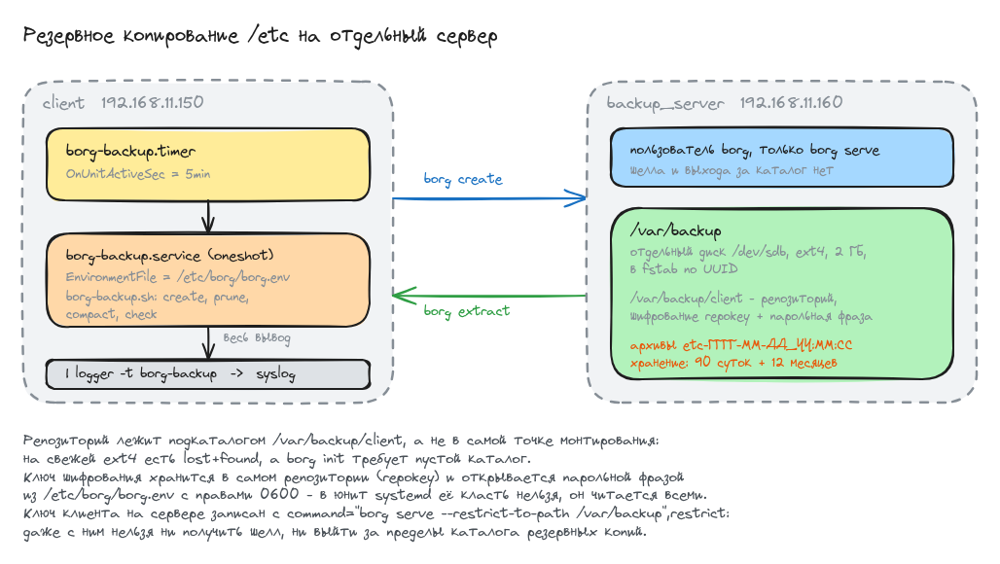

# Домашнее задание: настраиваем бэкапы

## Задание

Стенд Vagrant из двух машин: `backup_server` и `client`. Удалённое резервное
копирование каталога `/etc` с `client` при помощи borgbackup. Требования к копиям:

- каталог для копий `/var/backup`, отдельная точка монтирования, 2 ГБ достаточно;
- репозиторий зашифрован ключом или паролем;
- имя бэкапа содержит время снятия;
- глубина год: по последней копии на конец месяца, кроме последних трёх месяцев;
  последние три месяца - копии на каждый день;
- копия снимается каждые 5 минут;
- снятие копий делает скрипт, запускаемый из cron или systemd-таймера;
- настроено логирование процесса, проще всего - весь вывод в `logger` с тегом.

Стенд запустить на 30 минут, убедиться что копии снимаются, затем остановить бэкап,
удалить `/etc` и восстановить его из копии.

## Схема



Исходник схемы - [scheme.excalidraw](scheme.excalidraw), открывается на excalidraw.com
через Open, если понадобится что-то поправить.

## Стенд

Две машины на `bento/ubuntu-22.04`:

| машина        | хост          | адрес           | роль                              |
|---------------|---------------|-----------------|-----------------------------------|
| backup_server | backup-server | 192.168.11.160  | репозиторий borg на отдельном диске |
| client        | client        | 192.168.11.150  | источник, бэкапится `/etc`         |

Имя машины в vagrant и имя хоста в системе отличаются намеренно: systemd
не принимает подчёркивание в имени хоста, а задание называет машину `backup_server`.

Файлы:

- [Vagrantfile](Vagrantfile) - две ВМ, отдельный диск на 2 ГБ, запуск плейбука
- [provision.yml](ansible/provision.yml) - весь плейбук, три плея: общая часть, сервер, клиент
- [group_vars/all.yml](ansible/group_vars/all.yml) - адреса, пути, реквизиты, политика хранения
- [borg-backup.sh](ansible/files/borg-backup.sh) - скрипт снятия копии
- [borg.env.j2](ansible/templates/borg.env.j2) - файл окружения с парольной фразой, права 0600
- [borg-backup.service.j2](ansible/templates/borg-backup.service.j2) - юнит, заворачивает вывод в logger
- [borg-backup.timer.j2](ansible/templates/borg-backup.timer.j2) - таймер, раз в 5 минут

Плейбук запускается один раз, провижинером машины `client`, сразу на обе
(`ansible.limit = "all"`): клиент раскладывает свой ключ на сервер и инициализирует
там репозиторий, поэтому сервер должен быть готов раньше.

## Запуск

```bash
vagrant up
```

```
PLAY RECAP *********************************************************************
backup_server              : ok=10   changed=6    unreachable=0    failed=0    skipped=1
client                     : ok=15   changed=10   unreachable=0    failed=0    skipped=0
```

Повторный `vagrant provision` не трогает ничего:

```
PLAY RECAP *********************************************************************
backup_server              : ok=10   changed=0    unreachable=0    failed=0    skipped=1
client                     : ok=13   changed=0    unreachable=0    failed=0    skipped=1
```

## Как выполнены требования

### Отдельная точка монтирования /var/backup

Диск на 2 ГБ создаётся и подключается из `Vagrantfile`, файловая система кладётся
на устройство целиком - разметка тут ничего не даёт. В fstab запись по UUID,
а не по `/dev/sdb`: имя устройства зависит от порядка опроса контроллеров.

```shell
vagrant@backup-server:~$ lsblk -o NAME,SIZE,FSTYPE,MOUNTPOINT | grep -E 'NAME|sdb'
NAME    SIZE FSTYPE MOUNTPOINT
sdb       2G ext4   /var/backup
vagrant@backup-server:~$ findmnt /var/backup
TARGET      SOURCE   FSTYPE OPTIONS
/var/backup /dev/sdb ext4   rw,relatime
vagrant@backup-server:~$ grep backup /etc/fstab
UUID=576aae04-275f-4197-ba90-27e6b6e5f607 /var/backup ext4 defaults 0 0
```

### Шифрование репозитория

`borg init --encryption=repokey`: ключ шифрования лежит в самом репозитории
и открывается парольной фразой. Для удалённого репозитория это рекомендованный
вариант, ключ не потеряется вместе с клиентом.

```shell
vagrant@client:~$ borg info "$BORG_REPO"
Repository ID: 79d429f6b612590ceb8aff8c951cbea63cbdcd6ac696e9c98def3f0218f4ed3c
Location: ssh://borg@192.168.11.160/var/backup/client
Encrypted: Yes (repokey)
```

Парольная фраза лежит в `/etc/borg/borg.env` с правами 0600 и подключается юнитом
через `EnvironmentFile`. В методичке она задана через `Environment=` прямо в юните,
но юнит читается любым пользователем:

```shell
vagrant@client:~$ systemctl show borg-backup.service -p Environment -p EnvironmentFiles
Environment=
EnvironmentFiles=/etc/borg/borg.env (ignore_errors=no)
vagrant@client:~$ sudo ls -l /etc/borg/borg.env
-rw------- 1 root root 700 Aug 12 22:45 /etc/borg/borg.env
```

Ключ клиента на сервере ограничен так, что даже с ним нельзя ни получить шелл,
ни выйти за пределы каталога копий:

```shell
vagrant@backup-server:~$ sudo cat /home/borg/.ssh/authorized_keys
command="borg serve --restrict-to-path /var/backup",restrict ssh-ed25519 AAAAC3NzaC1lZDI1NTE5AAAAIMXPTbrjbmPJC...
```

### Имя бэкапа со временем снятия

Шаблон `etc-{now:%Y-%m-%d_%H:%M:%S}`, раскрывает его сам borg:

```
etc-2026-08-12_22:47:11              Wed, 2026-08-12 22:47:11 [c6ac0861cb9c298f264de6241fe117e2b158f56991524fef3880b6527dd19fef]
etc-2026-08-12_23:17:17              Wed, 2026-08-12 23:17:17 [99d5c67207e44d0848b5bfedbb01939adfcab03c08b63b23d0d7083df11f6907]
```

### Копия каждые 5 минут

`systemd`-таймер, `OnUnitActiveSec=5min`. За 30 минут ровно семь прогонов:

```shell
vagrant@client:~$ sudo journalctl -t borg-backup -o short-iso | grep -- '--- старт:'
2026-08-12T22:47:11+0000 --- старт: цель /etc, репозиторий ssh://borg@192.168.11.160/var/backup/client
2026-08-12T22:52:12+0000 --- старт: цель /etc, репозиторий ssh://borg@192.168.11.160/var/backup/client
2026-08-12T22:57:13+0000 --- старт: цель /etc, репозиторий ssh://borg@192.168.11.160/var/backup/client
2026-08-12T23:02:14+0000 --- старт: цель /etc, репозиторий ssh://borg@192.168.11.160/var/backup/client
2026-08-12T23:07:15+0000 --- старт: цель /etc, репозиторий ssh://borg@192.168.11.160/var/backup/client
2026-08-12T23:12:16+0000 --- старт: цель /etc, репозиторий ssh://borg@192.168.11.160/var/backup/client
2026-08-12T23:17:17+0000 --- старт: цель /etc, репозиторий ssh://borg@192.168.11.160/var/backup/client
```

### Логирование

Юнит заворачивает весь вывод скрипта в `logger -t borg-backup`, оттуда он попадает
и в journald, и в `/var/log/syslog`. Отдельная ротация не нужна: файл штатно
ротирует `logrotate` из пакета rsyslog.

```shell
vagrant@client:~$ sudo grep -c borg-backup /var/log/syslog
229
```

Лог одного прогона целиком:

```
Aug 12 23:17:17 client borg-backup[4273]: --- старт: цель /etc, репозиторий ssh://borg@192.168.11.160/var/backup/client
Aug 12 23:17:17 client borg-backup[4273]: --- создание архива
Aug 12 23:17:17 client borg-backup[4273]: Repository: ssh://borg@192.168.11.160/var/backup/client
Aug 12 23:17:17 client borg-backup[4273]: Archive name: etc-2026-08-12_23:17:17
Aug 12 23:17:17 client borg-backup[4273]: Archive fingerprint: 99d5c67207e44d0848b5bfedbb01939adfcab03c08b63b23d0d7083df11f6907
Aug 12 23:17:17 client borg-backup[4273]: Time (start): Wed, 2026-08-12 23:17:17
Aug 12 23:17:17 client borg-backup[4273]: Duration: 0.06 seconds
Aug 12 23:17:17 client borg-backup[4273]: Number of files: 808
Aug 12 23:17:17 client borg-backup[4273]:                        Original size      Compressed size    Deduplicated size
Aug 12 23:17:17 client borg-backup[4273]: This archive:                2.29 MB              1.03 MB                599 B
Aug 12 23:17:17 client borg-backup[4273]: All archives:                6.86 MB              3.10 MB              1.15 MB
Aug 12 23:17:18 client borg-backup[4273]: terminating with success status, rc 0
Aug 12 23:17:18 client borg-backup[4273]: --- политика хранения: --keep-daily 90 --keep-monthly 12
Aug 12 23:17:18 client borg-backup[4273]: Keeping archive (rule: daily #1):        etc-2026-08-12_23:17:17
Aug 12 23:17:18 client borg-backup[4273]: Pruning archive (1/1):                   etc-2026-08-12_23:12:16
Aug 12 23:17:18 client borg-backup[4273]: Keeping archive (rule: daily[oldest] #2): etc-2026-08-12_22:47:11
Aug 12 23:17:18 client borg-backup[4273]: terminating with success status, rc 0
Aug 12 23:17:18 client borg-backup[4273]: --- освобождение места
Aug 12 23:17:19 client borg-backup[4273]: terminating with success status, rc 0
Aug 12 23:17:19 client borg-backup[4273]: --- проверка репозитория
Aug 12 23:17:19 client borg-backup[4273]: terminating with success status, rc 0
Aug 12 23:17:19 client borg-backup[4273]: --- готово, итоговый код 0
```

Виден и объём: архив занимает 2.29 МБ в исходном виде, но после дедупликации
добавляет к репозиторию всего 599 байт - между копиями `/etc` почти не меняется.

## Политика хранения

`--keep-daily 90 --keep-monthly 12`. Девяносто суток - это и есть «последние три
месяца посуточно», двенадцать месяцев - «глубина год по копии на конец месяца».

Проверить политику на живом стенде нельзя: за 30 минут все копии попадают в одни
сутки. Поэтому проверял на отдельном репозитории, создав по архиву на каждый день
за 400 дней - `borg create --timestamp` позволяет проставить архиву дату задним
числом, а `prune` смотрит именно на неё.

```shell
vagrant@client:~$ borg prune --dry-run --list --glob-archives 'etc-*' \
                       --keep-daily 90 --keep-monthly 12 "$DEMO"
создано архивов: 401
диапазон: etc-2025-07-08_12:00:00 .. etc-2026-08-12_12:00:00

оставить: 101
удалить:  300

по каким правилам оставляем:
     90 daily
     11 monthly
```

Не суточные архивы - это ровно последние числа месяцев:

```
etc-2026-04-30  <- monthly #1
etc-2026-03-31  <- monthly #2
etc-2026-02-28  <- monthly #3
etc-2026-01-31  <- monthly #4
etc-2025-12-31  <- monthly #5
etc-2025-11-30  <- monthly #6
etc-2025-10-31  <- monthly #7
etc-2025-09-30  <- monthly #8
etc-2025-08-31  <- monthly #9
etc-2025-07-31  <- monthly #10
etc-2025-07-08  <- monthly[oldest] #11
```

После применения:

```
осталось архивов: 101

2025-07: 2 шт.     <- конец месяца плюс самый старый архив репозитория
2025-08: 1 шт.
2025-09: 1 шт.
2025-10: 1 шт.
2025-11: 1 шт.
2025-12: 1 шт.
2026-01: 1 шт.
2026-02: 1 шт.
2026-03: 1 шт.
2026-04: 1 шт.
2026-05: 17 шт.    <- отсюда начинаются последние 90 суток
2026-06: 30 шт.
2026-07: 31 шт.
2026-08: 12 шт.
```

Ровно то, что требует задание: последние три месяца посуточно (17+30+31+12 = 90),
дальше по одной копии на конец каждого месяца в пределах года. Помеченный
`[oldest]` архив borg удерживает дополнительно - это самый старый архив
репозитория, он не удаляется даже когда выходит за окно.

## Восстановление

Сценарий: кладём метку в `/etc`, снимаем копию, останавливаем бэкап, сносим `/etc`
и поднимаем его из архива.

### 1. Метка и последняя копия

```shell
root@client:~# echo "метка восстановления, создана $(date '+%F %T')" > /etc/otus-restore-marker
root@client:~# systemctl start borg-backup.service
```

### 2. Останавливаем бэкап

```shell
root@client:~# systemctl stop borg-backup.timer
root@client:~# systemctl is-active borg-backup.timer
inactive
```

### 3. Проверяем, что метка в архиве

```shell
root@client:~# LAST=$(borg list --short "$BORG_REPO" | tail -1); echo "$LAST"
etc-2026-08-12_23:24:12
root@client:~# borg list "${BORG_REPO}::${LAST}" | grep otus-restore-marker
-rw-r--r-- root   root         76 Wed, 2026-08-12 23:24:12 etc/otus-restore-marker
```

### 4. Распаковываем в промежуточный каталог

Важный момент: распаковываем **не поверх** `/etc`, а рядом. Пока идёт распаковка,
рабочий `/etc` на месте, и система не остаётся без `passwd`, `nsswitch.conf`
и `pam.d` на всё время операции.

```shell
root@client:~# mkdir -p /root/restore && cd /root/restore
root@client:~/restore# borg extract --list "${BORG_REPO}::${LAST}" etc
root@client:~/restore# find /root/restore/etc | wc -l
1662
```

### 5. Подменяем каталог

Обе команды одной строкой: `/etc` отсутствует только на время двух `mv`,
а сам `mv` уже загружен в память и в `/etc` не заглядывает.

```shell
root@client:~# mv /etc /etc.broken && mv /root/restore/etc /etc
```

### 6. Проверяем результат

```shell
root@client:~# cat /etc/otus-restore-marker
метка восстановления, создана 2026-08-12 23:24:12
root@client:~# systemctl is-system-running
running
root@client:~# id vagrant
uid=1000(vagrant) gid=1000(vagrant) groups=1000(vagrant),4(adm),24(cdrom),27(sudo),30(dip),46(plugdev),110(lxd)
root@client:~# getent hosts backup-server
192.168.11.160  backup-server
root@client:~# diff -rq /etc.broken /etc | wc -l
0
```

Метка вернулась, разрешение имён и учётные записи работают, а восстановленный `/etc`
совпал со снесённым до последнего файла.

Отдельная проверка - новое подключение по ssh. Оно требует рабочих `/etc/passwd`,
`/etc/shadow`, `/etc/pam.d` и `/etc/ssh`, то есть проходит только если каталог
действительно восстановлен, а не просто существует:

```shell
$ vagrant ssh client -c "hostname; whoami; sudo systemctl is-enabled borg-backup.timer"
client
vagrant
enabled
```

### 7. Убираем следы и включаем бэкап обратно

```shell
root@client:~# rm -rf /etc.broken /root/restore
root@client:~# systemctl start borg-backup.timer
```

## Особенности реализации

**Репозиторий лежит подкаталогом `/var/backup/client`, а не в самой точке
монтирования.** На свежей ext4 есть `lost+found`, а `borg init` требует пустой
каталог и на непустом падает. Заодно в одну точку монтирования можно складывать
копии нескольких клиентов.

**Диск переживает `vagrant destroy`.** Файл `.vagrant/backup_disk.vdi` создаётся
только если его ещё нет, и при пересоздании стенда подключается обратно вместе
с уже накопленными копиями. Это ровно то поведение, которого ждёшь от резервных
копий: они не должны исчезать вместе с машиной. Для прогона с чистого листа файл
нужно удалить руками.

**`borg compact` после `prune`.** В borg 1.2 `prune` только помечает данные
ненужными, место освобождает отдельная команда. Без неё репозиторий растёт,
хотя архивы удаляются.

**`borg check` в каждом прогоне.** Здесь репозиторий крошечный и проверка занимает
доли секунды. На боевом объёме её выносят в отдельный редкий таймер, потому что
она читает весь репозиторий.

**Парольная фраза попадает в резервную копию.** `/etc/borg/borg.env` лежит внутри
`/etc`, то есть внутри того, что бэкапится. Само по себе это не страшно, копия
зашифрована, но получается замкнутый круг: чтобы расшифровать копию, нужна фраза,
которая лежит только в этой копии. Второй экземпляр фразы и выгрузку ключа
(`borg key export`) надо хранить отдельно от стенда.

## На чём споткнулся

**Значение с пробелами в файле окружения.** `BORG_RSH` содержит опции ssh, и первая
версия файла была без кавычек:

```
BORG_RSH=ssh -i /root/.ssh/id_ed25519 -o StrictHostKeyChecking=accept-new
```

systemd такое читает правильно, а вот `source` в шелле разбирает строку как
присваивание `BORG_RSH=ssh` плюс попытку выполнить команду `-i`. Ansible-задача,
которая проверяла репозиторий через `. /etc/borg/borg.env`, теряла опции, ssh шёл
без ключа и без `StrictHostKeyChecking`, упирался в вопрос про отпечаток хоста
и молча висел - плейбук стоял на задаче, пока я его не прервал. Лечится кавычками
вокруг значения; заодно ansible-задачи теперь получают переменные через
`environment:`, а не разбирают файл, предназначенный для systemd.

**`--keep-daily 90` считает не календарные дни.** Первую проверку политики я сделал
на разреженном наборе: 25 архивов, разбросанных по 14 месяцам. Ожидал, что старые
удалятся, а не удалилось вообще ничего. Причина в том, что `--keep-daily N` означает
«оставить последний архив в каждом из N последних суток, **в которых есть архивы**»,
а не «за последние N календарных дней». На 25 архивах суточное правило разобрало
все и до месячного дело не дошло. На плотном наборе - по архиву на каждый день -
политика отработала именно так, как задумано.

**Порядок перенаправлений при захвате вывода borg.** `borg prune --list` печатает
решения в stderr. Написанное по привычке `команда 2>&1 > файл` отправляет stderr
на текущий stdout, то есть в терминал, и только потом stdout в файл - в файле
оказывается пусто. Нужно `команда > файл 2>&1`.

**Имя хоста в /var/log/syslog.** В journald записи идут от `client`, а в syslog-файле
от `vagrant`: rsyslog запоминает имя хоста при старте, а vagrant переименовывает
машину позже. На работу это не влияет, но при чтении логов сбивает с толку.
