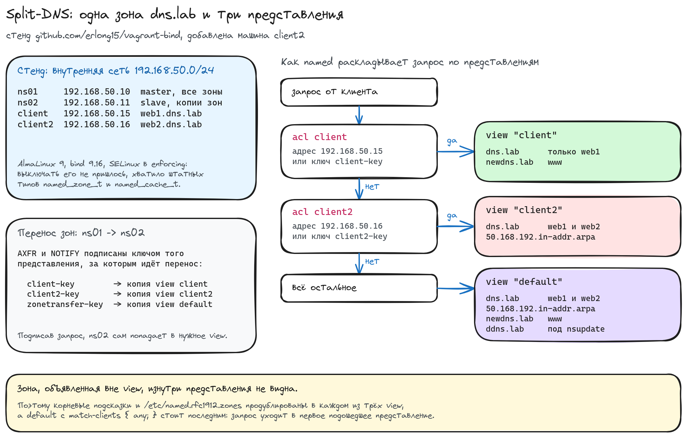

# Домашнее задание: split-DNS

## Задание

- Взять стенд [github.com/erlong15/vagrant-bind](https://github.com/erlong15/vagrant-bind), добавить ещё один сервер `client2`.
- Завести в зоне `dns.lab` имена: `web1` смотрит на клиент1, `web2` смотрит на клиент2.
- Завести ещё одну зону `newdns.lab`, в ней запись `www`, которая смотрит на обоих клиентов.
- Настроить split-dns: клиент1 видит обе зоны, но в зоне `dns.lab` только `web1`; клиент2 видит только `dns.lab`.
- Настроить всё без выключения SELinux.

## Схема



## Стенд

Четыре машины на `almalinux/9` в одной внутренней сети `192.168.50.0/24`.

| машина  | адрес          | роль                                        |
|---------|----------------|---------------------------------------------|
| ns01    | 192.168.50.10  | master, держит все файлы зон                 |
| ns02    | 192.168.50.11  | slave, забирает по копии на каждое представление |
| client  | 192.168.50.15  | клиент1, на него смотрит `web1.dns.lab`      |
| client2 | 192.168.50.16  | клиент2, на него смотрит `web2.dns.lab`      |

`eth0` у всех занят под NAT, который поднимает сам vagrant, стенд живёт на `eth1`.

Файлы:

- [Vagrantfile](Vagrantfile) - четыре ВМ во внутренней сети
- [ansible.cfg](ansible.cfg) - инвентарь vagrant и отключённая проверка ключей хоста
- [provision.yml](ansible/provision.yml) - весь плейбук
- [group_vars/all.yml](ansible/group_vars/all.yml) - адреса, ключи, описание зон и представлений
- [named.conf.j2](ansible/templates/named.conf.j2) - конфигурация bind, один шаблон на оба сервера
- [zone.j2](ansible/templates/zone.j2) - шаблон файла зоны, разворачивается в пять файлов
- [resolv.conf.j2](ansible/templates/resolv.conf.j2), [rndc.conf.j2](ansible/templates/rndc.conf.j2), [motd.j2](ansible/templates/motd.j2) - мелочи для клиентов

## Запуск

```bash
vagrant up
```

```
PLAY RECAP *********************************************************************
client                     : ok=10   changed=7    unreachable=0    failed=0    skipped=0
client2                    : ok=10   changed=7    unreachable=0    failed=0    skipped=0
ns01                       : ok=19   changed=15   unreachable=0    failed=0    skipped=1
ns02                       : ok=17   changed=12   unreachable=0    failed=0    skipped=3
```

## Зоны и записи

Зоны описаны данными в [group_vars/all.yml](ansible/group_vars/all.yml) и разворачиваются
одним шаблоном. Зона `dns.lab` существует в двух вариантах: полном и урезанном под клиента1.

| файл           | зона                     | записи                                   |
|----------------|--------------------------|------------------------------------------|
| `dns.lab.full` | dns.lab                  | ns01, ns02, web1 → .15, web2 → .16       |
| `dns.lab.web1` | dns.lab                  | ns01, ns02, web1 → .15                   |
| `dns.lab.rev`  | 50.168.192.in-addr.arpa  | PTR на .10, .11, .15, .16                |
| `newdns.lab`   | newdns.lab               | ns01, ns02, www → .15 и www → .16        |
| `ddns.lab`     | ddns.lab                 | зона из исходного стенда, живёт под `nsupdate` |

`www` смотрит на обоих клиентов - это просто две A-записи с одним именем:

```
www             IN      A       192.168.50.15
www             IN      A       192.168.50.16
```

Сам ns01 попадает в представление `default` и видит всё сразу:

```shell
[vagrant@ns01 ~]$ dig +short web1.dns.lab web2.dns.lab
192.168.50.15
192.168.50.16
[vagrant@ns01 ~]$ dig +short www.newdns.lab
192.168.50.15
192.168.50.16
```

## Как устроен split-DNS

Разделение делается представлениями (`view`). Каждое представление - это отдельный
набор зон плюс правило, кому его показывать. Запрос уходит в **первое** подошедшее
представление и видит только его зоны, поэтому `default` с `match-clients { any; }`
стоит последним, а зон снаружи `view` нет вообще.

Списки доступа собраны так, чтобы в представление можно было попасть двумя способами -
по адресу и по ключу TSIG:

```
acl "client"  { !key "client2-key"; key "client-key";  192.168.50.15;  };
acl "client2" { !key "client-key";  key "client2-key"; 192.168.50.16; };

view "client" {
        match-clients { client; };
        zone "dns.lab" IN {
                type master;
                file "/var/named/zones/dns.lab.web1";
                allow-transfer { key "client-key"; };
                notify explicit;
                also-notify { 192.168.50.11 key "client-key"; };
        };
        zone "newdns.lab" IN { ... };
};
```

Отрицание чужого ключа стоит первым элементом: запрос, подписанный `client2-key`,
не должен проваливаться в представление `client` только потому, что совпал адрес.

```shell
[vagrant@ns01 ~]$ dig @192.168.50.10 +short web2.dns.lab
192.168.50.16
[vagrant@ns01 ~]$ sudo dig -k /etc/named/keys/client-key.key @192.168.50.10 web2.dns.lab \
                       +noall +comments | grep HEADER
;; ->>HEADER<<- opcode: QUERY, status: NXDOMAIN, id: 55568
```

## Проверка: клиент1

Видит обе зоны, но в `dns.lab` только `web1`.

```shell
[vagrant@client ~]$ dig +short web1.dns.lab
192.168.50.15
[vagrant@client ~]$ dig web2.dns.lab | grep -E '^;; ->>HEADER|^;; flags'
;; ->>HEADER<<- opcode: QUERY, status: NXDOMAIN, id: 40808
;; flags: qr aa rd ra; QUERY: 1, ANSWER: 0, AUTHORITY: 1, ADDITIONAL: 1
[vagrant@client ~]$ dig +short www.newdns.lab
192.168.50.15
192.168.50.16
[vagrant@client ~]$ ping -c1 -W2 web2.dns.lab
ping: web2.dns.lab: Name or service not known
```

Флаг `aa` в ответе на `web2` важен: это не «сервер не знает», а «сервер авторитетен
для `dns.lab` и такого имени в ней нет». Клиент1 не может отличить урезанную зону
от настоящей.

## Проверка: клиент2

Видит `dns.lab` целиком и не видит `newdns.lab`. Вместе с прямой зоной в его
представление положена и обратная, `50.168.192.in-addr.arpa`: это та же самая
`dns.lab`, только с другой стороны, и без неё `dig -x` перестал бы работать.

```shell
[vagrant@client2 ~]$ dig +short web1.dns.lab
192.168.50.15
[vagrant@client2 ~]$ dig +short web2.dns.lab
192.168.50.16
[vagrant@client2 ~]$ dig +short -x 192.168.50.16
web2.dns.lab.
[vagrant@client2 ~]$ ping -c1 -W2 www.newdns.lab
ping: www.newdns.lab: Name or service not known
```

В представлении клиента2 зоны `newdns.lab` нет вовсе, поэтому
сервер не отвечает NXDOMAIN сам, а честно идёт искать имя в интернете - и не находит,
домена `.lab` в корне не существует. На этом стенде проверка подписи отрицательного
ответа не проходит, поэтому клиент получает SERVFAIL вместо NXDOMAIN:

```shell
[vagrant@client2 ~]$ dig www.newdns.lab | grep HEADER
;; ->>HEADER<<- opcode: QUERY, status: SERVFAIL, id: 33079
[vagrant@client2 ~]$ dig +cd www.newdns.lab | grep HEADER
;; ->>HEADER<<- opcode: QUERY, status: NXDOMAIN, id: 3300
```

`+cd` выключает проверку подписей, и ответ становится нормальным NXDOMAIN. Для задания
разница косметическая: имя не резолвится ни так, ни так. Но она хорошо показывает
разницу между «зона есть, записи нет» у клиента1 и «зоны нет вообще» у клиента2.

## Мастер и слейв отдают одно и то же

Оба сервера держат все три представления, поэтому ответ не зависит от того,
кого спросили:

```shell
[vagrant@client ~]$ for s in 192.168.50.10 192.168.50.11; do
>   echo "@$s web1=$(dig +short @$s web1.dns.lab) web2=$(dig +short @$s web2.dns.lab)"
> done
@192.168.50.10 web1=192.168.50.15 web2=
@192.168.50.11 web1=192.168.50.15 web2=

[vagrant@client2 ~]$ for s in 192.168.50.10 192.168.50.11; do
>   echo "@$s web1=$(dig +short @$s web1.dns.lab) web2=$(dig +short @$s web2.dns.lab)"
> done
@192.168.50.10 web1=192.168.50.15 web2=192.168.50.16
@192.168.50.11 web1=192.168.50.15 web2=192.168.50.16
```

Методичка на этом месте обрывается: конфигурация слейва в ней дописана только до
списка ключей. Загвоздка в том, что слейв не может просто «забрать зону dns.lab» -
таких зон на мастере три, и они разные. Решается это тем же механизмом, что и
раздача клиентам: **ns02 подписывает запрос ключом того представления, копию которого
хочет получить**, и мастер сам кладёт его в нужное view.

```
view "client" {
        match-clients { client; };
        zone "dns.lab" IN {
                type slave;
                masters { 192.168.50.10 key "client-key"; };
                file "/var/named/slaves/client/dns.lab.web1";
                notify no;
        };
};
```

Видно по журналу - одна и та же зона переносится трижды, каждый раз со своим ключом:

```shell
[vagrant@ns02 ~]$ for v in client client2 default; do sudo rndc retransfer dns.lab IN $v; done
[vagrant@ns02 ~]$ sudo journalctl -u named --no-pager --since -40s | grep "transferred serial"
Aug 19 12:29:17 ns02 named[9373]: zone dns.lab/IN/client: transferred serial 2026081901: TSIG 'client-key'
Aug 19 12:29:17 ns02 named[9373]: zone dns.lab/IN/client2: transferred serial 2026081901: TSIG 'client2-key'
Aug 19 12:29:17 ns02 named[9373]: zone dns.lab/IN/default: transferred serial 2026081901: TSIG 'zonetransfer-key'
```

Уведомления об изменениях идут тем же путём: в каждой зоне на мастере стоит
`notify explicit` и `also-notify { ns02 key <ключ представления> }`. Без этого ns02
получил бы обычное уведомление, попал бы с ним в `default` и пошёл обновлять не ту копию.

Копии лежат по каталогам, по одному на представление - имена файлов совпадают,
содержимое разное:

```shell
[vagrant@ns02 ~]$ sudo find /var/named/slaves -type f | sort
/var/named/slaves/client2/dns.lab.full
/var/named/slaves/client2/dns.lab.rev
/var/named/slaves/client/dns.lab.web1
/var/named/slaves/client/newdns.lab
/var/named/slaves/default/ddns.lab
/var/named/slaves/default/ddns.lab.jnl
/var/named/slaves/default/dns.lab.full
/var/named/slaves/default/dns.lab.rev
/var/named/slaves/default/newdns.lab
```

## Зона под nsupdate

`ddns.lab` из исходного стенда осталась на месте, она в представлении `default`:

```shell
[vagrant@ns01 ~]$ sudo nsupdate -k /etc/named/keys/zonetransfer-key.key <<EOF
> server 192.168.50.10
> zone ddns.lab
> update add test.ddns.lab. 60 A 192.168.50.15
> send
> EOF
[vagrant@ns01 ~]$ dig +short test.ddns.lab
192.168.50.15
```

С клиентов она недоступна:клиент1 попадает в представление `client`, где такой зоны нет. 
Кто попал в view, видит ровно его зоны и ничего больше.

Управление серверами с клиентов из исходного стенда тоже сохранилось, ключ rndc
плейбук раскладывает вместе с остальными:

```shell
[vagrant@client ~]$ rndc -c ~/rndc.conf status | head -2
version: BIND 9.16.23-RH (Extended Support Version) <id:fde3b1f>
running on ns01: Linux x86_64 5.14.0-611.54.6.el9_7.x86_64 #1 SMP PREEMPT_DYNAMIC Fri May 15 04:23:18 EDT 2026
```

Подсказки по этим проверкам лежат в `/etc/motd`, он показывается при входе на клиента.

## SELinux выключать не пришлось

SELinux в enforcing на всех машинах, ни одного правила писать не понадобилось,
ни одного отказа в журнале нет:

```shell
[vagrant@ns01 ~]$ getenforce
Enforcing
[vagrant@ns01 ~]$ sudo ausearch -m AVC -ts boot
<no matches>
```

Всё, что для этого нужно, - разложить файлы по каталогам, которым штатная политика
уже назначила правильный тип. Каталог `/etc/named`, куда файлы зон кладёт методичка,
для этого не годится: named имеет право только читать его.

```shell
[vagrant@ns01 ~]$ sudo ls -ldZ /etc/named /var/named/zones /var/named/dynamic
drwxr-x---. 3 root  named system_u:object_r:named_conf_t:s0      18 Aug 19 11:26 /etc/named
drwxrwx---. 2 named named system_u:object_r:named_cache_t:s0    178 Aug 19 12:23 /var/named/dynamic
drwxr-x---. 2 root  named unconfined_u:object_r:named_zone_t:s0  83 Aug 19 11:27 /var/named/zones
```

Отсюда раскладка:

| что                             | куда                    | тип             | почему                                |
|---------------------------------|-------------------------|-----------------|---------------------------------------|
| статические зоны мастера        | `/var/named/zones`      | `named_zone_t`  | named только читает                    |
| зона под `nsupdate`             | `/var/named/dynamic`    | `named_cache_t` | named пишет журнал изменений           |
| копии зон на слейве             | `/var/named/slaves`     | `named_cache_t` | named пишет то, что забрал с мастера   |
| ключи TSIG и `named.conf`       | `/etc/named`            | `named_conf_t`  | только чтение, больше и не нужно       |

Проверил, что дело именно в типе, а не в правах: если подсунуть слейву файл зоны
в `/etc/named`, перенос проходит, а запись на диск - нет.

```shell
[vagrant@ns02 ~]$ sudo journalctl -u named --no-pager --since -30s | grep dumping
Aug 19 12:29:57 ns02 named[13051]: dumping master file: /etc/named/tmp-g934YSrnlt: open: permission denied
```

Права тут ни при чём - каталог был выставлен в `0770 root:named`, и вручную от имени
named файл в нём создаётся:

```shell
[vagrant@ns02 ~]$ sudo runuser -u named -- touch /etc/named/proba && echo ok
ok
```

Не помогает и булев переключатель `named_write_master_zones`, он и так включён:
он открывает запись в `named_zone_t`, а `/etc/named` - это `named_conf_t`. Стоит
перевести SELinux в permissive, и тот же файл появляется:

```shell
[vagrant@ns02 ~]$ getsebool named_write_master_zones
named_write_master_zones --> on
[vagrant@ns02 ~]$ sudo setenforce 0 && sudo systemctl restart named
[vagrant@ns02 ~]$ sudo ls -lZ /etc/named/dns.lab.web1
-rw-r--r--. 1 named named system_u:object_r:named_conf_t:s0 284 Aug 19 12:30 /etc/named/dns.lab.web1
```

Обратно в enforcing, файл убран, зона вернулась в `/var/named/slaves` - там она
пишется без всяких послаблений.

