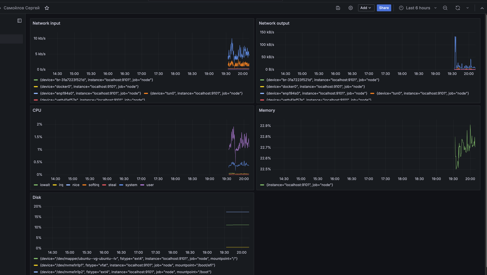

# Домашнее задание

## Настройка мониторинга

**Цель:** научиться настраивать дашборд.

## Описание / Пошаговая инструкция выполнения домашнего задания

### 🎯 Что нужно сделать?

Настроить дашборд с 4-мя графиками:

- память;
- процессор;
- диск;
- сеть.

Настроить на одной из систем:

- zabbix (использовать screen — комплексный экран);
- prometheus + grafana.

## 🗂 Формат сдачи

Скриншот дашборда (в название дашборда — ваше имя).

## Решение

Стек: **Prometheus + Grafana + node_exporter**, всё поднимается через `docker-compose.yml`.

### Состав

- [`docker-compose.yml`](docker-compose.yml) — три сервиса (`node-exporter`, `prometheus`, `grafana`), все в `network_mode: host`.
- [`prometheus/prometheus.yml`](prometheus/prometheus.yml) — конфиг Prometheus.
- [`grafana/provisioning/datasources/prometheus.yml`](grafana/provisioning/datasources/prometheus.yml) —  datasource Prometheus для grafana.

### Запуск

```bash
docker compose up -d
```

- Prometheus UI: <http://localhost:9090> (таргеты — `/targets`).
- Grafana UI: <http://localhost:3001>, логин `admin` / `admin`.

### Дашборд

4 панели на метриках node_exporter:

| Панель | PromQL |
| --- | --- |
| CPU | `avg by (mode) (rate(node_cpu_seconds_total{mode!="idle"}[1m]))` |
| Memory | `100 * (1 - node_memory_MemAvailable_bytes / node_memory_MemTotal_bytes)` |
| Disk | `100 * (1 - node_filesystem_avail_bytes{fstype!~"tmpfs\|overlay\|squashfs"} / node_filesystem_size_bytes{fstype!~"tmpfs\|overlay\|squashfs"})` |
| Network (rx / tx) | `rate(node_network_receive_bytes_total{device!="lo"}[1m])` / `rate(node_network_transmit_bytes_total{device!="lo"}[1m])` |

### Скриншот


