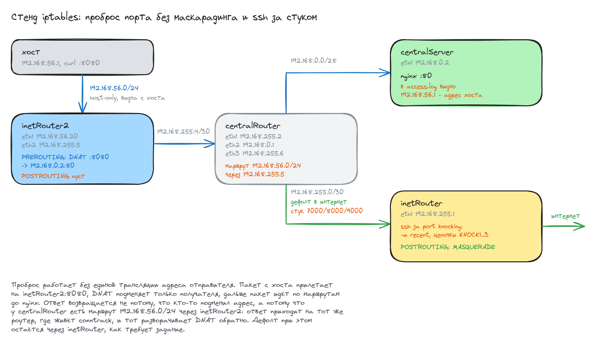

# Домашнее задание: сценарии iptables

## Задание

- Реализовать port knocking: `centralRouter` попадает на ssh `inetRouter` через knock-скрипт.
- Добавить `inetRouter2`, который виден с хоста (host-only сеть).
- Запустить nginx на `centralServer`.
- Пробросить 80-й порт на `inetRouter2:8080`.
- Дефолт в интернет оставить через `inetRouter`.
- Со звёздочкой: реализовать проход на 80-й порт **без маскарадинга**.

## Схема



## Стенд

Четыре машины на `bento/ubuntu-22.04`. Адаптер N в vagrant соответствует `eth(N-1)`
в госте, `eth0` везде занят под NAT, который поднимает сам vagrant.

| хост          | интерфейсы                                                | роль |
|---------------|-----------------------------------------------------------|------|
| inetRouter    | eth1 192.168.255.1/30                                     | выход в интернет, ssh за стуком |
| inetRouter2   | eth1 192.168.56.20/24 (host-only), eth2 192.168.255.5/30   | публикация 8080 -> 80 |
| centralRouter | eth1 192.168.255.2/30, eth2 192.168.0.1/28, eth3 192.168.255.6/30 | транзит |
| centralServer | eth1 192.168.0.2/28                                       | nginx |

Все внутренние сети объявлены через `virtualbox__intnet` и с хоста не видны.
Единственное исключение - адаптер 2 у `inetRouter2`: он задан без `intnet`,
то есть это host-only сеть, и именно через неё хост попадает на проброшенный порт.

Файлы:

- [Vagrantfile](Vagrantfile) - четыре ВМ, внутренние сети и одна host-only
- [provision.yml](ansible/provision.yml) - весь плейбук
- [group_vars/all.yml](ansible/group_vars/all.yml) - адреса, порты, параметры стука
- маршруты по хостам:
  [inetRouter](ansible/host_vars/inetRouter.yml),
  [inetRouter2](ansible/host_vars/inetRouter2.yml),
  [centralRouter](ansible/host_vars/centralRouter.yml),
  [centralServer](ansible/host_vars/centralServer.yml)
- [99-routes.yaml](ansible/templates/99-routes.yaml) - шаблон netplan
- правила iptables по хостам:
  [inetRouter](ansible/templates/rules-inetRouter.v4.j2),
  [inetRouter2](ansible/templates/rules-inetRouter2.v4.j2),
  [centralRouter](ansible/templates/rules-centralRouter.v4.j2),
  [centralServer](ansible/templates/rules-centralServer.v4.j2)
- [knock.sh.j2](ansible/templates/knock.sh.j2) - скрипт стука

## Запуск

```bash
vagrant up
```

```
PLAY RECAP *********************************************************************
centralRouter              : ok=15   changed=12   unreachable=0    failed=0    skipped=0
centralServer              : ok=13   changed=10   unreachable=0    failed=0    skipped=1
inetRouter                 : ok=10   changed=9    unreachable=0    failed=0    skipped=0
inetRouter2                : ok=10   changed=9    unreachable=0    failed=0    skipped=0
```

Повторный `vagrant provision` не трогает ничего:

```
PLAY RECAP *********************************************************************
centralRouter              : ok=13   changed=0    unreachable=0    failed=0    skipped=0
centralServer              : ok=11   changed=0    unreachable=0    failed=0    skipped=1
inetRouter                 : ok=8    changed=0    unreachable=0    failed=0    skipped=0
inetRouter2                : ok=8    changed=0    unreachable=0    failed=0    skipped=0
```

## Маршрутизация

```shell
vagrant@centralRouter:~$ ip r
default via 192.168.255.1 dev eth1 proto static
192.168.0.0/28 dev eth2 proto kernel scope link src 192.168.0.1
192.168.56.0/24 via 192.168.255.5 dev eth3 proto static
192.168.255.0/30 dev eth1 proto kernel scope link src 192.168.255.2
192.168.255.4/30 dev eth3 proto kernel scope link src 192.168.255.6
```

Две строки тут ключевые. Дефолт смотрит на `inetRouter` - как требует задание.
Маршрут `192.168.56.0/24 via 192.168.255.5` отправляет ответы хосту обратно
через `inetRouter2`, и именно он позволяет обойтись без маскарадинга.

Дефолтный маршрут на `eth0` у всех, кроме `inetRouter`, отключён через
`dhcp4-overrides: use-routes: false`, иначе трафик уходил бы в NAT vagrant мимо стенда.

```shell
vagrant@centralServer:~$ traceroute -n -m 4 8.8.8.8
traceroute to 8.8.8.8 (8.8.8.8), 4 hops max, 60 byte packets
 1  192.168.0.1  0.247 ms  0.214 ms  0.178 ms
 2  192.168.255.1  0.918 ms  0.889 ms  0.839 ms
 3  10.0.2.2  1.125 ms  1.096 ms  1.063 ms
 4  10.119.184.1  51.293 ms  51.283 ms  51.257 ms
```

Хост видит только `inetRouter2`:

```shell
$ ip -br addr | grep 192.168.56
vboxnet3         UP             192.168.56.1/24 fe80::800:27ff:fe00:3/64
$ ping -c2 192.168.56.20 | tail -2
2 packets transmitted, 2 received, 0% packet loss, time 1013ms
rtt min/avg/max/mdev = 0.354/0.465/0.577/0.111 ms
```

## Port knocking

Реализовано на модуле `recent` и трёх собственных цепочках, без knockd.
Каждый этап запоминает адрес в своём списке и **дропает** пакет: снаружи
порты выглядят закрытыми, стучащий не получает никакого ответа.

```
-A INPUT -i eth1 -p tcp --dport 22 -m recent --rcheck --seconds 60 --name KNOCKED -j ACCEPT
-A INPUT -i eth1 -p tcp --dport 22 -j LOG --log-prefix "[knock ssh deny] "

-A INPUT -i eth1 -p tcp --dport 7000 -j KNOCK1
-A INPUT -i eth1 -p tcp --dport 8000 -j KNOCK2
-A INPUT -i eth1 -p tcp --dport 9000 -j KNOCK3

-A KNOCK1 -m recent --name STAGE1 --set -j DROP
-A KNOCK2 -m recent --rcheck --seconds 15 --name STAGE1 -m recent --name STAGE2 --set -j DROP
-A KNOCK2 -j DROP
-A KNOCK3 -m recent --rcheck --seconds 15 --name STAGE2 -m recent --name KNOCKED --set -j DROP
-A KNOCK3 -j DROP
```

### До стука ssh закрыт

```shell
vagrant@centralRouter:~$ ssh -o ConnectTimeout=5 vagrant@192.168.255.1 hostname
ssh: connect to host 192.168.255.1 port 22: Connection timed out
код возврата: 255
```

Не `Connection refused`, а таймаут - политика `DROP`, а не `REJECT`, поэтому
порт снаружи неотличим от закрытого фаерволом наглухо.

### Стучимся и заходим

```shell
vagrant@centralRouter:~$ /usr/local/bin/knock.sh
стучимся на 192.168.255.1: 7000 8000 9000
  -> 7000
  -> 8000
  -> 9000
последовательность отправлена, ssh на 192.168.255.1 открыт ~60 секунд
vagrant@centralRouter:~$ ssh vagrant@192.168.255.1 'hostname; echo зашли с $(echo $SSH_CLIENT | cut -d" " -f1)'
inetRouter
зашли с 192.168.255.2
```

### Что видно на inetRouter

Журнал ядра показывает и отбитую попытку, и все три этапа:

```shell
vagrant@inetRouter:~$ sudo journalctl -k | grep -oE '\[knock [^]]*\].*DPT=[0-9]+'
[knock ssh deny] IN=eth1 ... SRC=192.168.255.2 DST=192.168.255.1 DF SPT=48720 DPT=22
[knock 1/3]      IN=eth1 ... SRC=192.168.255.2 DST=192.168.255.1 DF SPT=50980 DPT=7000
[knock 2/3]      IN=eth1 ... SRC=192.168.255.2 DST=192.168.255.1 DF SPT=36956 DPT=8000
[knock 3/3 ok]   IN=eth1 ... SRC=192.168.255.2 DST=192.168.255.1 DF SPT=51248 DPT=9000
```

Списки модуля `recent` доступны прямо в procfs:

```shell
vagrant@inetRouter:~$ sudo cat /proc/net/xt_recent/KNOCKED
src=192.168.255.2 ttl: 64 last_seen: 4294980421 oldest_pkt: 1 4294980421
```

Счётчики цепочек: по одному пакету на этап, и ни один не дошёл до
завершающего `DROP` - значит последовательность была правильной.

```shell
vagrant@inetRouter:~$ sudo iptables -nvL KNOCK2
Chain KNOCK2 (1 references)
 pkts bytes target     prot opt in     out     source        destination
    1    60 LOG        all  --  *      *       0.0.0.0/0     0.0.0.0/0   recent: CHECK seconds: 15 name: STAGE1 ... prefix "[knock 2/3] "
    1    60 DROP       all  --  *      *       0.0.0.0/0     0.0.0.0/0   recent: CHECK seconds: 15 name: STAGE1 recent: SET name: STAGE2
    0     0 DROP       all  --  *      *       0.0.0.0/0     0.0.0.0/0
```

### Окно закрывается

Через минуту после стука новые подключения снова отбиваются, а повторный стук
открывает доступ заново:

```shell
vagrant@centralRouter:~$ sleep 70; ssh -o ConnectTimeout=5 vagrant@192.168.255.1 hostname
ssh: connect to host 192.168.255.1 port 22: Connection timed out
код возврата: 255
vagrant@centralRouter:~$ /usr/local/bin/knock.sh >/dev/null && ssh vagrant@192.168.255.1 hostname
inetRouter
```

Уже открытая сессия при этом не рвётся: её держит правило
`-m conntrack --ctstate ESTABLISHED,RELATED`, окно ограничивает только новые подключения.

## Проброс 80-го порта

На `inetRouter2` одно правило DNAT и ни одного правила в `POSTROUTING`:

```
-A PREROUTING -i eth1 -p tcp --dport 8080 -j DNAT --to-destination 192.168.0.2:80
```

С хоста:

```shell
$ curl -s -o /dev/null -w 'код ответа: %{http_code}\n' http://192.168.56.20:8080/
код ответа: 200
$ curl -s http://192.168.56.20:8080/
<html><body>
<h1>centralServer</h1>
<p>nginx на 192.168.0.2:80</p>
</body></html>
```

## Без маскарадинга

Это то самое задание со звёздочкой. Обычно проброс на чужую подсеть делают
парой DNAT + MASQUERADE: подменяют адрес отправителя на адрес роутера, чтобы
ответ гарантированно вернулся туда же. Платой за это становится потерянный
адрес клиента - сервер видит вместо него роутер.

Здесь маскарадинга нет вообще. Ответ возвращается на `inetRouter2` не потому,
что кто-то подменил отправителя, а потому что `centralRouter` знает маршрут
`192.168.56.0/24 via 192.168.255.5`. Пакет приходит на тот же роутер, где живёт
запись conntrack, и она разворачивает DNAT обратно.

Четыре независимых подтверждения.

**1. Цепочка POSTROUTING пуста:**

```shell
vagrant@inetRouter2:~$ sudo iptables -t nat -nvL POSTROUTING --line-numbers
Chain POSTROUTING (policy ACCEPT 3 packets, 196 bytes)
num   pkts bytes target     prot opt in     out     source               destination
```

**2. Работает ровно одно правило - DNAT, и его счётчик растёт:**

```shell
vagrant@inetRouter2:~$ sudo iptables -t nat -nvL PREROUTING --line-numbers
Chain PREROUTING (policy ACCEPT 6 packets, 300 bytes)
num   pkts bytes target     prot opt in     out     source               destination
1        2   120 DNAT       tcp  --  eth1   *      0.0.0.0/0            0.0.0.0/0   tcp dpt:8080 to:192.168.0.2:80
```

**3. nginx видит настоящий адрес клиента** - `192.168.56.1`, то есть хост,
а не адрес какого-либо роутера стенда:

```shell
vagrant@centralServer:~$ sudo tail -2 /var/log/nginx/access.log
192.168.56.1 - - [13/Aug/2026:07:04:55 +0000] "GET / HTTP/1.1" 200 84 "-" "curl/8.5.0"
192.168.56.1 - - [13/Aug/2026:07:04:55 +0000] "GET / HTTP/1.1" 200 84 "-" "curl/8.5.0"
```

**4. В таблице соединений подменён только получатель.** Обратный кортеж
начинается с `src=192.168.0.2`, а заканчивается `dst=192.168.56.1` - адрес
отправителя в нём остался исходным, SNAT не выполнялся:

```shell
vagrant@inetRouter2:~$ sudo conntrack -L | grep 8080
tcp 6 73 TIME_WAIT src=192.168.56.1 dst=192.168.56.20 sport=47060 dport=8080 \
                   src=192.168.0.2  dst=192.168.56.1  sport=80   dport=47060 [ASSURED]
```

Дополнительно на `centralRouter` включено логирование транзита, и там тоже
виден исходный адрес - значит по пути его никто не подменял:

```shell
vagrant@centralRouter:~$ sudo journalctl -k | grep -oE '\[web transit\].*DPT=[0-9]+'
[web transit] IN=eth3 OUT=eth2 ... SRC=192.168.56.1 DST=192.168.0.2 DF PROTO=TCP SPT=47048 DPT=80
```

## Всё переживает перезагрузку

Правила сохраняются через `iptables-persistent`, маршруты лежат в отдельном
файле netplan. После `vagrant reload`:

```shell
vagrant@centralRouter:~$ ip r | grep -E 'default|192.168.56'
default via 192.168.255.1 dev eth1 proto static
192.168.56.0/24 via 192.168.255.5 dev eth3 proto static
vagrant@inetRouter:~$ sudo iptables -nL | grep -c '^Chain KNOCK'
3
```

```shell
$ curl -s -o /dev/null -w 'код ответа: %{http_code}\n' http://192.168.56.20:8080/
код ответа: 200
vagrant@centralRouter:~$ /usr/local/bin/knock.sh >/dev/null && ssh vagrant@192.168.255.1 hostname
inetRouter
```

## Особенности реализации

**Первым правилом в INPUT - управляющий интерфейс vagrant.** На `inetRouter`
и `centralServer` политика `INPUT` стоит `DROP`. Без строки
`-A INPUT -i eth0 -j ACCEPT` первый же `iptables-restore` отрезал бы машину:
`vagrant ssh` ходит именно через NAT на `eth0`.

**Правила раскладываются одним файлом через `iptables-restore`.** Так набор
применяется целиком: не бывает промежуточного состояния, в котором политика
уже `DROP`, а разрешающие правила ещё не добавлены.

**Стук дропает, а не реджектит.** `REJECT` выдал бы стучащему `ICMP
port-unreachable` и тем самым сообщил, что на порту кто-то слушает.
С `DROP` сканирование не отличает эти порты от полностью закрытых.

**Маршрут возврата задан на `centralRouter`, а не на `centralServer`.**
У сервера всего один маршрут - дефолт на `centralRouter`, и этого достаточно:
решение о том, что ответы для `192.168.56.0/24` идут через `inetRouter2`,
принимается один раз на роутере. Сервер о существовании второго роутера
вообще не знает.

**`FORWARD` на `inetRouter2` закрыт политикой `DROP`.** Через него разрешено
только новое подключение к `192.168.0.2:80` и ответный трафик. Правило
написано уже по подменённому адресу: `DNAT` в `PREROUTING` отрабатывает
раньше, чем пакет попадает в `FORWARD`.

## На чём споткнулся

**Дефолт на eth0 не отключался.** Netplan генерировал `UseRoutes=false`,
а маршрут `default via 10.0.2.2` оставался. У `eth0` есть альтернативное имя
вида `enp0s3`, и его перехватывает `50-cloud-init.yaml`, оставшийся в боксе
от установки. Файлы networkd сортируются по имени, `enp0s3` идёт раньше `eth0`,
поэтому выигрывает он. Лечится удалением этого файла и запретом cloud-init
трогать сеть - обе задачи есть в плейбуке. Ту же грабку я уже проходил
в домашней работе по сетевой лаборатории.

**Свои маршруты нельзя класть в `50-vagrant.yaml`.** Этот файл принадлежит
vagrant, он переписывает его на каждом `up` и `reload`, так что после
перезагрузки маршруты пропали бы. Отдельный `99-routes.yaml` vagrant не трогает.

**Пакеты нужно ставить до смены маршрутов.** На первом прогоне дефолт ещё висит
на `eth0` и интернет есть, поэтому задача установки пакетов идёт первой,
а `netplan apply` - после неё.
