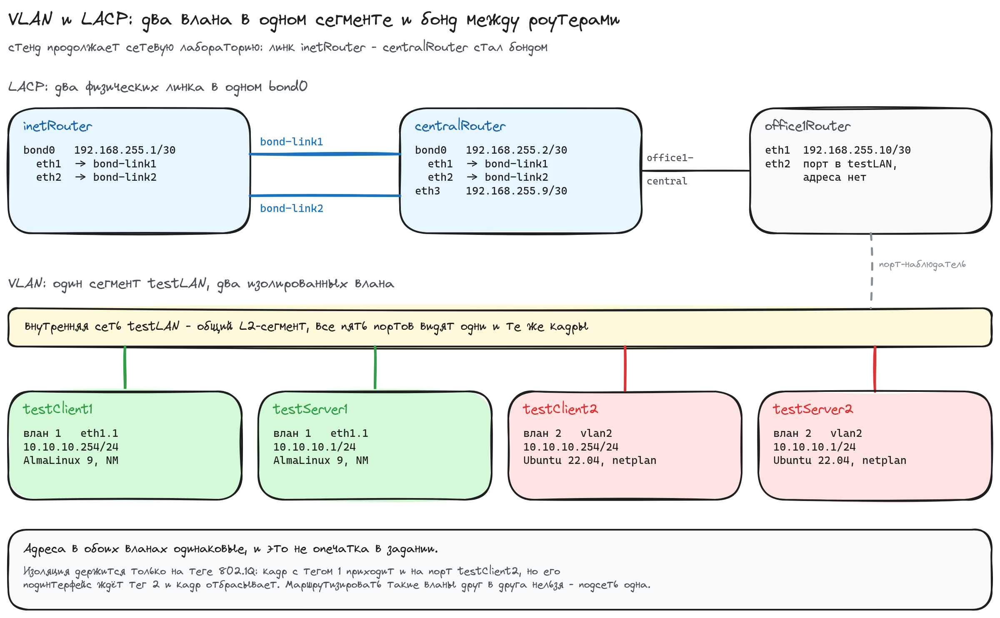

# Домашнее задание: строим бонды и вланы

## Задание

- В Office1 в тестовой подсети появляются серверы с дополнительными интерфейсами
  и адресами во внутренней сети `testLAN`:
  - testClient1 - 10.10.10.254
  - testClient2 - 10.10.10.254
  - testServer1 - 10.10.10.1
  - testServer2 - 10.10.10.1
- Развести вланами: testClient1 <-> testServer1, testClient2 <-> testServer2.
- Между centralRouter и inetRouter пробросить 2 линка (общая internal-сеть)
  и объединить их в бонд, проверить работу с отключением интерфейсов.

## Схема



## Стенд

Семь машин. Стенд продолжает сетевую лабораторию из [../network](../network):
там inetRouter и centralRouter соединял один линк, здесь их два и они в бонде.

| машина        | ОС              | что на ней                                             |
|---------------|-----------------|--------------------------------------------------------|
| inetRouter    | AlmaLinux 9     | bond0 192.168.255.1/30 из eth1 и eth2                  |
| centralRouter | AlmaLinux 9     | bond0 192.168.255.2/30, eth3 192.168.255.9/30 в Office1 |
| office1Router | AlmaLinux 9     | eth1 192.168.255.10/30, eth2 - порт в testLAN без адреса |
| testClient1   | AlmaLinux 9     | влан 1, 10.10.10.254/24                                 |
| testServer1   | AlmaLinux 9     | влан 1, 10.10.10.1/24                                   |
| testClient2   | Ubuntu 22.04    | влан 2, 10.10.10.254/24                                 |
| testServer2   | Ubuntu 22.04    | влан 2, 10.10.10.1/24                                   |

Коробки разные намеренно: на RHEL-семье вланы и бонд описываются профилями
NetworkManager, на Ubuntu - через netplan. Обе схемы в одном стенде.
`eth0` везде занят под NAT, который поднимает сам vagrant.

Файлы:

- [Vagrantfile](Vagrantfile) - семь ВМ, внутренние сети, неразборчивый режим на адаптерах
- [ansible.cfg](ansible.cfg) - инвентарь vagrant и отключённая проверка ключей хоста
- [provision.yml](ansible/provision.yml) - весь плейбук
- [group_vars/all.yml](ansible/group_vars/all.yml) - порты бонда, режим, общие параметры
- host_vars: адреса и номера вланов по машинам -
  [inetRouter](ansible/host_vars/inetRouter.yml),
  [centralRouter](ansible/host_vars/centralRouter.yml),
  [office1Router](ansible/host_vars/office1Router.yml),
  [testClient1](ansible/host_vars/testClient1.yml),
  [testServer1](ansible/host_vars/testServer1.yml),
  [testClient2](ansible/host_vars/testClient2.yml),
  [testServer2](ansible/host_vars/testServer2.yml)
- [vlan.nmconnection.j2](ansible/templates/vlan.nmconnection.j2) - влан на RHEL-семье
- [60-vlan.yaml.j2](ansible/templates/60-vlan.yaml.j2) - влан на Ubuntu
- [bond.nmconnection.j2](ansible/templates/bond.nmconnection.j2),
  [bond-port.nmconnection.j2](ansible/templates/bond-port.nmconnection.j2) - бонд и его порты
- [ethernet.nmconnection.j2](ansible/templates/ethernet.nmconnection.j2) - обычные интерфейсы

## Запуск

```bash
vagrant up
```

```
PLAY RECAP *********************************************************************
centralRouter              : ok=11   changed=6    unreachable=0    failed=0    skipped=3
inetRouter                 : ok=10   changed=5    unreachable=0    failed=0    skipped=4
office1Router              : ok=9    changed=4    unreachable=0    failed=0    skipped=5
testClient1                : ok=8    changed=4    unreachable=0    failed=0    skipped=4
testClient2                : ok=6    changed=3    unreachable=0    failed=0    skipped=6
testServer1                : ok=8    changed=4    unreachable=0    failed=0    skipped=4
testServer2                : ok=6    changed=3    unreachable=0    failed=0    skipped=6
```

Повторный `vagrant provision` не трогает ничего:

```
PLAY RECAP *********************************************************************
centralRouter              : ok=10   changed=0    unreachable=0    failed=0    skipped=3
inetRouter                 : ok=9    changed=0    unreachable=0    failed=0    skipped=4
office1Router              : ok=8    changed=0    unreachable=0    failed=0    skipped=5
testClient1                : ok=7    changed=0    unreachable=0    failed=0    skipped=4
testClient2                : ok=5    changed=0    unreachable=0    failed=0    skipped=6
testServer1                : ok=7    changed=0    unreachable=0    failed=0    skipped=4
testServer2                : ok=5    changed=0    unreachable=0    failed=0    skipped=6
```

## Вланы

Все четыре тестовые машины сидят в одной внутренней сети `testLAN` - это один
широковещательный домен, физически общий провод. Адреса в задании выданы
попарно одинаковые: и testClient1, и testClient2 держат 10.10.10.254, и оба
сервера - 10.10.10.1. В обычной сети это была бы авария с дублированием
адресов. Здесь не авария ровно потому, что кадры разъезжаются по тегу 802.1Q
и хосты соседнего влана друг друга просто не видят.

Адрес живёт не на физическом порту, а на подинтерфейсе. На RHEL-семье это
профиль NetworkManager:

```ini
[connection]
id=vlan1
type=vlan
interface-name=eth1.1

[vlan]
parent=eth1
id=1

[ipv4]
method=manual
address1=10.10.10.254/24
```

На Ubuntu то же самое в netplan:

```yaml
network:
  version: 2
  ethernets:
    eth1:
      dhcp4: no
  vlans:
    vlan2:
      id: 2
      link: eth1
      addresses: [10.10.10.254/24]
```

Разница только в синтаксисе и в имени интерфейса: NetworkManager называет его
по физическому порту и тегу (`eth1.1`), netplan - как назвали в конфиге (`vlan2`).

### Проверка

testClient1, влан 1:

```shell
[vagrant@testClient1 ~]$ ip -br addr show eth1.1
eth1.1@eth1      UP             10.10.10.254/24
[vagrant@testClient1 ~]$ ip -d link show eth1.1 | grep -o 'vlan protocol 802.1Q id [0-9]*'
vlan protocol 802.1Q id 1
[vagrant@testClient1 ~]$ ping -c3 10.10.10.1
--- 10.10.10.1 ping statistics ---
3 packets transmitted, 3 received, 0% packet loss, time 2059ms
rtt min/avg/max/mdev = 0.479/0.737/1.120/0.276 ms
[vagrant@testClient1 ~]$ ip neigh show dev eth1.1
10.10.10.1 lladdr 08:00:27:8d:2f:ef DELAY
```

testClient2, влан 2:

```shell
vagrant@testClient2:~$ ip -br addr show vlan2
vlan2@eth1       UP             10.10.10.254/24 fe80::a00:27ff:fe4f:8c7c/64
vagrant@testClient2:~$ ip -d link show vlan2 | grep -o 'vlan protocol 802.1Q id [0-9]*'
vlan protocol 802.1Q id 2
vagrant@testClient2:~$ ping -c3 10.10.10.1
--- 10.10.10.1 ping statistics ---
3 packets transmitted, 3 received, 0% packet loss, time 2034ms
rtt min/avg/max/mdev = 0.366/0.379/0.396/0.012 ms
vagrant@testClient2:~$ ip neigh show dev vlan2
10.10.10.1 lladdr 08:00:27:1a:05:d0 DELAY
```

Оба клиента пингуют один и тот же адрес 10.10.10.1, оба получают ответ - 
но отвечают им разные машины:

| MAC                 | чей он      | кому ответил |
|---------------------|-------------|--------------|
| `08:00:27:8d:2f:ef` | testServer1 | testClient1  |
| `08:00:27:1a:05:d0` | testServer2 | testClient2  |

Кто ответит на 10.10.10.1, решает не адрес, а тег влана.

### Как это выглядит на проводе

У office1Router есть порт `eth2` в том же сегменте `testLAN`, адреса на нём нет.
Он нужен только чтобы посмотреть, что реально летает по общему проводу. Пингуем
одновременно с обоих клиентов:

```shell
[vagrant@office1Router ~]$ sudo tcpdump -nei eth2 -c 12 icmp
08:23:08.540229 08:00:27:1a:05:d0 > 08:00:27:4f:8c:7c, ethertype 802.1Q (0x8100), length 102: vlan 2, p 0, ethertype IPv4 (0x0800), 10.10.10.1 > 10.10.10.254: ICMP echo reply, id 2, seq 1, length 64
08:23:08.580437 08:00:27:98:87:66 > 08:00:27:8d:2f:ef, ethertype 802.1Q (0x8100), length 102: vlan 1, p 0, ethertype IPv4 (0x0800), 10.10.10.254 > 10.10.10.1: ICMP echo request, id 2, seq 1, length 64
08:23:08.580828 08:00:27:8d:2f:ef > 08:00:27:98:87:66, ethertype 802.1Q (0x8100), length 102: vlan 1, p 0, ethertype IPv4 (0x0800), 10.10.10.1 > 10.10.10.254: ICMP echo reply, id 2, seq 1, length 64
08:23:09.242136 08:00:27:4f:8c:7c > 08:00:27:1a:05:d0, ethertype 802.1Q (0x8100), length 102: vlan 2, p 0, ethertype IPv4 (0x0800), 10.10.10.254 > 10.10.10.1: ICMP echo request, id 2, seq 2, length 64
```

Один порт, одни и те же адреса `10.10.10.254 > 10.10.10.1` - и два независимых
разговора, различающихся только полем `vlan 1` / `vlan 2` в заголовке.
Кадр влана 1 доходит и до порта testClient2 тоже, но его подинтерфейс ждёт
тег 2 и такой кадр отбрасывает.

Маршрутизировать эти вланы друг в друга нельзя даже при желании: подсеть у них
одна и та же, для роутера это была бы одна сеть на двух интерфейсах.

## Бонд

Два линка между inetRouter и centralRouter - это две **разные** внутренние сети,
`bond-link1` и `bond-link2`. Бонд эмулирует один провод из нескольких; если
сложить оба адаптера в один сегмент, получится один провод, включённый дважды,
и отключение интерфейса ничего не проверит.

Режим - `802.3ad`, то есть настоящий LACP:

```ini
[bond]
mode=802.3ad
miimon=100
lacp_rate=fast
xmit_hash_policy=layer2+3
```

### Бонд собрался

```shell
[vagrant@inetRouter ~]$ sudo cat /proc/net/bonding/bond0
802.3ad info
LACP active: on
LACP rate: fast
Min links: 0
Aggregator selection policy (ad_select): stable
System priority: 65535
System MAC address: 08:00:27:88:f0:1c
Active Aggregator Info:
	Aggregator ID: 3
	Number of ports: 2
	Actor Key: 9
	Partner Key: 9
	Partner Mac Address: 08:00:27:52:2f:c5
```

`Number of ports: 2` и заполненный `Partner Mac Address` - это и есть признак
того, что LACP договорился с соседом, а не просто два порта лежат рядом.
Оба порта в одном агрегаторе:

```shell
[vagrant@inetRouter ~]$ sudo grep -E 'Slave Interface|MII Status|Aggregator ID' /proc/net/bonding/bond0 | tail -6
Slave Interface: eth1
MII Status: up
Aggregator ID: 3
Slave Interface: eth2
MII Status: up
Aggregator ID: 3
```

### Через бонд ходит реальный трафик

Проверять пингом собственного адреса бонда неинтересно. У office1Router прописан
маршрут в сеть бонда через centralRouter, так что трафик до inetRouter идёт
транзитом по бонду:

```shell
[vagrant@office1Router ~]$ ping -c3 192.168.255.1
--- 192.168.255.1 ping statistics ---
3 packets transmitted, 3 received, 0% packet loss, time 2035ms
rtt min/avg/max/mdev = 0.680/0.978/1.520/0.383 ms
[vagrant@office1Router ~]$ traceroute -n -w1 -m3 192.168.255.1
traceroute to 192.168.255.1 (192.168.255.1), 3 hops max, 60 byte packets
 1  192.168.255.9  0.223 ms  0.175 ms  0.138 ms
 2  192.168.255.1  0.383 ms  0.438 ms  0.401 ms
```

### Отключение интерфейса

Пингуем с office1Router и на четвёртой секунде гасим `eth1` на centralRouter:

```shell
[vagrant@centralRouter ~]$ sudo ip link set eth1 down
```

```shell
[vagrant@office1Router ~]$ ping -i0.3 -c40 192.168.255.1
--- 192.168.255.1 ping statistics ---
40 packets transmitted, 33 received, 17.5% packet loss, time 11846ms
rtt min/avg/max/mdev = 0.554/0.711/1.448/0.167 ms
```

Связь просела на семь пакетов, около двух секунд, и восстановилась сама -
трафик поехал по второму линку:

```shell
[vagrant@centralRouter ~]$ sudo grep -E 'Slave Interface|MII Status' /proc/net/bonding/bond0 | tail -4
Slave Interface: eth1
MII Status: down
Slave Interface: eth2
MII Status: up
```

Две секунды тут не случайны. Когда гаснет `eth1` на centralRouter, его сосед
inetRouter карьера не теряет: у него свой конец провода по-прежнему включён,
внутренняя сеть VirtualBox об аварии на другом порту не сообщает. Поэтому
inetRouter узнаёт о пропаже соседа только по таймауту LACP - три пропущенных
LACPDU, а с `lacp_rate=fast` это примерно три секунды. На живом железе
с выдернутым патч-кордом линк упал бы у обеих сторон сразу.

## Почему 802.3ad, а не active-backup из методички

Методичка предлагает `mode=1` с `fail_over_mac=1`. Это не LACP: никакого
протокола там не согласовывается, резервирование держится на том, что второй
порт молчит, пока жив первый. В этом стенде у такого режима есть неприятное
свойство, и его видно на том же тесте. Переключаем оба роутера в active-backup
и повторяем ровно то же отключение `eth1` на centralRouter:

```shell
[vagrant@office1Router ~]$ ping -i0.3 -c40 192.168.255.1
--- 192.168.255.1 ping statistics ---
40 packets transmitted, 14 received, +9 errors, 65% packet loss, time 11843ms
```

Связь не восстановилась вообще:

```shell
[vagrant@office1Router ~]$ ping -c5 -i0.5 192.168.255.1
5 packets transmitted, 0 received, 100% packet loss, time 2014ms
```

Причина та же, что и с двумя секундами выше, только без спасательного круга.
centralRouter увидел, что его `eth1` лёг, и переключился на `eth2`. А inetRouter
ничего не заметил и продолжает слать в `eth1`, то есть в сеть `bond-link1`, где
на том конце уже никого нет. Сказать ему об этом некому: механизма сигнализации
в active-backup нет. LACP же обменивается кадрами постоянно, и именно поэтому
переживает аварию, о которой драйверу локально ничего не известно.

