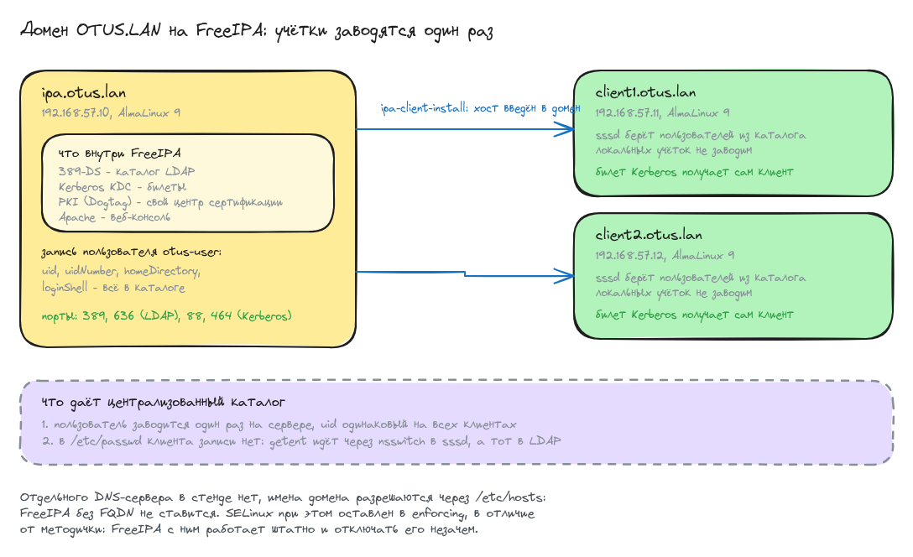

# Домашнее задание: LDAP

## Задание

1. Установить FreeIPA.
2. Написать Ansible-playbook для конфигурации клиента.

## Схема




## Стенд

Три машины на `almalinux/9`:

| машина  | имя хоста        | адрес          | роль |
|---------|------------------|----------------|------|
| ipa     | ipa.otus.lan     | 192.168.57.10  | сервер FreeIPA, 4 ГБ |
| client1 | client1.otus.lan | 192.168.57.11  | клиент домена |
| client2 | client2.otus.lan | 192.168.57.12  | клиент домена |

Имя машины в vagrant короткое, а имя хоста внутри системы полное: FreeIPA
без FQDN не ставится, но набирать `vagrant ssh ipa.otus.lan` каждый раз неудобно.

Файлы:

- [Vagrantfile](Vagrantfile) - три ВМ и запуск плейбука
- [provision.yml](ansible/provision.yml) - весь плейбук: общая часть, сервер, клиенты
- [group_vars/all.yml](ansible/group_vars/all.yml) - домен, пароли, тестовый пользователь
- [hosts.j2](ansible/templates/hosts.j2) - шаблон `/etc/hosts`


## Запуск

```bash
vagrant up
```

Разворачивание домена занимает минут пятнадцать: `ipa-server-install` поднимает 389-DS, Kerberos, центр сертификации и Apache.

```
PLAY RECAP *********************************************************************
client1                    : ok=10   changed=5    unreachable=0    failed=0    skipped=0
client2                    : ok=10   changed=5    unreachable=0    failed=0    skipped=0
ipa                        : ok=15   changed=7    unreachable=0    failed=0    skipped=0
```

Повторный `vagrant provision` не трогает ничего:

```
PLAY RECAP *********************************************************************
client1                    : ok=9    changed=0    unreachable=0    failed=0    skipped=1
client2                    : ok=9    changed=0    unreachable=0    failed=0    skipped=1
ipa                        : ok=11   changed=0    unreachable=0    failed=0    skipped=4
```

## 1. Сервер FreeIPA

Установка идёт неинтерактивно: ключ `-U` отвечает на все вопросы мастера
значениями из параметров.

```
ipa-server-install -U \
  --realm=OTUS.LAN --domain=otus.lan --hostname=ipa.otus.lan \
  --ds-password=... --admin-password=... \
  --no-ntp --no-host-dns
```

`--no-host-dns` нужен потому, что отдельного DNS-сервера в стенде нет и имена
разрешаются через `/etc/hosts`; без этого ключа установщик упрётся в проверку
DNS-записи. `--no-ntp` - синхронизацию времени мы уже настроили сами через chrony.
Kerberos к расхождению часов очень чувствителен: тикет с перекосом больше пяти
минут отвергается, поэтому chrony ставится и запускается на всех трёх машинах.

Все службы поднялись:

```shell
[root@ipa ~]# ipactl status
Directory Service: RUNNING
krb5kdc Service: RUNNING
kadmin Service: RUNNING
httpd Service: RUNNING
ipa-custodia Service: RUNNING
pki-tomcatd Service: RUNNING
ipa-otpd Service: RUNNING
ipa: INFO: The ipactl command was successful
[root@ipa ~]# ipa --version
VERSION: 4.13.1, API_VERSION: 2.257
[root@ipa ~]# hostname -f
ipa.otus.lan
```

Kerberos выдаёт тикет администратору домена:

```shell
[root@ipa ~]# kinit admin
Password for admin@OTUS.LAN:
[root@ipa ~]# klist
Ticket cache: KCM:0
Default principal: admin@OTUS.LAN

Valid starting       Expires              Service principal
08/16/2026 16:37:43  08/17/2026 16:26:17  krbtgt/OTUS.LAN@OTUS.LAN
```

Веб-консоль доступна на `https://ipa.otus.lan/` - для этого на хост-машине
нужно добавить в `/etc/hosts` строку `192.168.57.10 ipa.otus.lan`.
Логин `admin`, пароль - тот, что задан в `ipa_admin_password`.

## 2. Playbook для клиентов

Клиент вводится в домен одной командой, тоже неинтерактивно:

```
ipa-client-install -U \
  --domain=otus.lan --realm=OTUS.LAN --server=ipa.otus.lan \
  --principal=admin --password=... \
  --mkhomedir --no-ntp --force-join
```

`--mkhomedir` включает создание домашнего каталога при первом входе доменного
пользователя, иначе входить будет некуда. Задача обёрнута проверкой наличия
`/etc/ipa/default.conf`, поэтому повторный прогон плейбука хост заново
не перезаписывает.

Оба клиента и сам сервер видны в домене:

```shell
[root@ipa ~]# ipa host-find
  Host name: client1.otus.lan
  Host name: client2.otus.lan
  Host name: ipa.otus.lan
Number of entries returned 3
```

### Пользователь заводится один раз на сервере и виден везде

```shell
[root@ipa ~]# ipa user-show otus-user
  User login: otus-user
  First name: Otus
  Last name: User
  Home directory: /home/otus-user
  Login shell: /bin/sh
  UID: 1437000003
```

```shell
[root@client1 ~]# id otus-user
uid=1437000003(otus-user) gid=1437000003(otus-user) groups=1437000003(otus-user)
[root@client2 ~]# id otus-user
uid=1437000003(otus-user) gid=1437000003(otus-user) groups=1437000003(otus-user)
```

UID одинаковый на обеих машинах - это и есть смысл централизованного каталога.
Локальной учётной записи при этом нет, пользователь приходит только из LDAP:

```shell
[root@client1 ~]# grep -c otus-user /etc/passwd
0
[root@client1 ~]# getent passwd otus-user
otus-user:*:1437000003:1437000003:Otus User:/home/otus-user:/bin/sh
```

`grep` по файлу не находит ничего, а `getent` находит: разница в том, что
`getent` спрашивает не файл, а nsswitch, за которым стоит sssd, а за ним каталог.

### Клиент знает, к какому домену подключён

```shell
[root@client1 ~]# grep -E '^(basedn|realm|domain|server)' /etc/ipa/default.conf
basedn = dc=otus,dc=lan
realm = OTUS.LAN
domain = otus.lan
server = ipa.otus.lan
[root@client1 ~]# grep -E 'id_provider|auth_provider' /etc/sssd/sssd.conf
id_provider = ipa
auth_provider = ipa
```

Тикет Kerberos доменный пользователь получает прямо с клиента:

```shell
[root@client1 ~]# kinit otus-user
Password for otus-user@OTUS.LAN:
[root@client1 ~]# klist
Ticket cache: KCM:0
Default principal: otus-user@OTUS.LAN

Valid starting       Expires              Service principal
08/16/2026 16:39:06  08/17/2026 15:47:42  krbtgt/OTUS.LAN@OTUS.LAN
```

### Каталог отвечает по сети

Запрос с клиента на сервер, аутентификация тикетом Kerberos:

```shell
[root@client1 ~]# kinit otus-user
[root@client1 ~]# ldapsearch -LLL -Y GSSAPI -H ldap://ipa.otus.lan \
                     -b dc=otus,dc=lan "(uid=otus-user)" uid uidNumber homeDirectory loginShell
dn: uid=otus-user,cn=users,cn=compat,dc=otus,dc=lan
uid: otus-user
uidNumber: 1437000003
homeDirectory: /home/otus-user
loginShell: /bin/sh

dn: uid=otus-user,cn=users,cn=accounts,dc=otus,dc=lan
uid: otus-user
uidNumber: 1437000003
homeDirectory: /home/otus-user
loginShell: /bin/sh
```

Запись отдаётся дважды: `cn=accounts` - настоящая ветка каталога,
`cn=compat` - слой совместимости для клиентов, которые не умеют в схему FreeIPA.

Порты, которые слушает сервер:

```shell
[root@ipa ~]# ss -lnt | awk 'NR==1 || $4 ~ /:(389|636|88|443|464)$/ {print $1, $4}'
State Local
LISTEN 0.0.0.0:88     # Kerberos
LISTEN 0.0.0.0:464    # смена пароля
LISTEN *:389          # LDAP
LISTEN *:443          # веб-консоль
LISTEN *:636          # LDAPS
```

