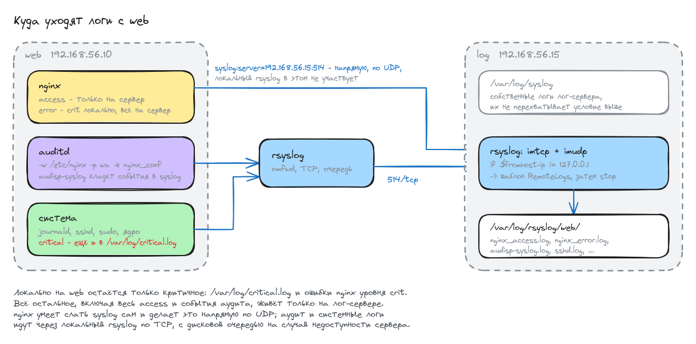

# Домашнее задание: центральный сервер сбора логов

## Задание

- Поднять две машины: `web` и `log`.
- На `web` поднять nginx.
- На `log` настроить центральный лог-сервер (journald, rsyslog или elk на выбор).
- Настроить аудит, отслеживающий изменения конфигураций nginx.
- Все критичные логи с `web` собираются и локально, и удалённо.
- Все логи nginx уходят на удалённый сервер, локально остаются только критичные.
- Логи аудита тоже уходят на удалённую систему.

Из трёх предложенных систем взял **rsyslog**: он уже стоит в Ubuntu, умеет и принимать,
и отправлять, а nginx и auditd отдают в него события штатными средствами, без дополнительных
агентов. 

## Схема




Важная деталь, которая не видна из конфигов по отдельности: **источников два, и идут они
разными путями**. nginx умеет писать в syslog сам, и директива `syslog:server=` отправляет
логи прямо на лог-сервер по UDP, минуя локальный rsyslog. Аудит и системные логи попадают
в локальный rsyslog и уже он пересылает их по TCP. Поэтому на лог-сервере нужны оба
приёмника, `imudp` и `imtcp`.

## Стенд

Две машины на `bento/ubuntu-22.04`:

| хост | адрес          | роль                                        |
|------|----------------|---------------------------------------------|
| web  | 192.168.56.10  | nginx, auditd, rsyslog-клиент               |
| log  | 192.168.56.15  | центральный сервер сбора логов на rsyslog   |

Файлы:

- [Vagrantfile](Vagrantfile) - две ВМ и запуск плейбука
- [provision.yml](ansible/provision.yml) - весь плейбук, три плея: общая подготовка, лог-сервер, web
- [group_vars/all.yml](ansible/group_vars/all.yml) - адреса, порт, пути
- [rsyslog-server.conf.j2](ansible/templates/rsyslog-server.conf.j2) - приём логов на `log`
- [rsyslog-client.conf.j2](ansible/templates/rsyslog-client.conf.j2) - пересылка логов с `web`
- [nginx-remote-logging.conf.j2](ansible/templates/nginx-remote-logging.conf.j2) - логи nginx
- [audit-nginx.rules](ansible/files/audit-nginx.rules) - правило аудита на конфиги nginx

Плейбук запускается один раз, провижинером машины `web`, сразу на обе (`ansible.limit = "all"`):
лог-сервер должен быть готов раньше, чем `web` начнёт слать, и порядок плеев это обеспечивает.

## Запуск

```bash
vagrant up
```

```
PLAY RECAP *********************************************************************
log                        : ok=8    changed=5    unreachable=0    failed=0    skipped=0
web                        : ok=16   changed=13   unreachable=0    failed=0    skipped=0
```

Повторный `vagrant provision` не трогает ничего:

```
PLAY RECAP *********************************************************************
log                        : ok=7    changed=0    unreachable=0    failed=0    skipped=0
web                        : ok=12   changed=0    unreachable=0    failed=0    skipped=0
```

## Что настроено

### Лог-сервер

```shell
vagrant@log:~$ grep -vE '^\s*#|^\s*$' /etc/rsyslog.d/00-remote-server.conf
module(load="imudp")
input(type="imudp" port="514")
module(load="imtcp")
input(type="imtcp" port="514")
template(name="RemoteLogs" type="string"
         string="/var/log/rsyslog/%HOSTNAME%/%PROGRAMNAME%.log")
if $fromhost-ip != "127.0.0.1" then {
    action(type="omfile" dynaFile="RemoteLogs"
           fileCreateMode="0640" dirCreateMode="0755"
           fileOwner="syslog" fileGroup="adm")
    stop
}
```

Принятое раскладывается по каталогам: хост, внутри файл на каждую программу. Имя файла
начинается с `00-`, чтобы правило отработало раньше штатного `50-default.conf`, а `stop`
не дал чужим логам попасть ещё и в локальный `/var/log/syslog`.

Порты слушаются оба:

```shell
vagrant@log:~$ sudo ss -lntup | grep :514
tcp   LISTEN 0  25     0.0.0.0:514   0.0.0.0:*   users:(("rsyslogd",pid=2300,fd=8))
tcp   LISTEN 0  25        [::]:514      [::]:*   users:(("rsyslogd",pid=2300,fd=9))
udp   UNCONN 0  0      0.0.0.0:514   0.0.0.0:*   users:(("rsyslogd",pid=2300,fd=6))
udp   UNCONN 0  0         [::]:514      [::]:*   users:(("rsyslogd",pid=2300,fd=7))
```

### Логи nginx

```shell
vagrant@web:~$ grep -nE 'access_log|error_log' /etc/nginx/nginx.conf /etc/nginx/conf.d/remote-logging.conf
/etc/nginx/nginx.conf:39:	# access_log отключён ansible: весь access уходит на лог-сервер
/etc/nginx/nginx.conf:40:	error_log /var/log/nginx/error.log crit;
/etc/nginx/conf.d/remote-logging.conf:5:error_log  /var/log/nginx/error.log crit;
/etc/nginx/conf.d/remote-logging.conf:10:error_log  syslog:server=192.168.56.15:514,tag=nginx_error warn;
/etc/nginx/conf.d/remote-logging.conf:11:access_log syslog:server=192.168.56.15:514,tag=nginx_access,severity=info combined;
```

Локальный `access_log` выключен совсем, локальный `error_log` прижат до уровня `crit`,
а на сервер уходит всё: весь access и ошибки начиная с `warn`. Директивы `error_log`
на одном уровне вложенности не заменяют друг друга, а складываются, поэтому локальная
и удалённая строки работают одновременно.

### Пересылка системных логов и аудит

```shell
vagrant@web:~$ grep -vE '^\s*#|^\s*$' /etc/rsyslog.d/90-remote-forward.conf
*.crit                          /var/log/critical.log
action(type="omfwd"
       target="192.168.56.15" port="514" protocol="tcp"
       queue.type="linkedlist"
       queue.filename="fwd_192_168_56_15"
       queue.maxdiskspace="100m"
       queue.saveonshutdown="on"
       action.resumeRetryCount="-1")
vagrant@web:~$ sudo auditctl -l
-w /etc/nginx -p wa -k nginx_conf
```

Критичное дублируется в локальный `/var/log/critical.log`, всё остальное уезжает по TCP.
Дисковая очередь нужна, чтобы при недоступном лог-сервере сообщения копились, а не терялись.

Время на обеих машинах синхронизировано, иначе события в общем потоке перемешаются:

```shell
vagrant@web:~$ date -u +'%F %T'; timedatectl | grep -E 'synchronized|NTP service'
2026-08-12 14:10:47
System clock synchronized: yes
              NTP service: active
vagrant@log:~$ date -u +'%F %T'
2026-08-12 14:10:58
```

## Проверка

### Access-логи nginx уходят на сервер и не пишутся локально

Дёргаем nginx с хоста:

```shell
$ curl -o /dev/null -w '%{http_code}\n' http://192.168.56.10/
200
$ curl -o /dev/null -w '%{http_code}\n' http://192.168.56.10/otus-test
404
```

На лог-сервере:

```shell
vagrant@log:~$ sudo tail -3 /var/log/rsyslog/web/nginx_access.log
Aug 12 14:10:59 web nginx_access: 192.168.56.1 - - [12/Aug/2026:14:10:59 +0000] "GET / HTTP/1.1" 200 612 "-" "curl/8.5.0"
Aug 12 14:10:59 web nginx_access: 192.168.56.1 - - [12/Aug/2026:14:10:59 +0000] "GET /otus-test HTTP/1.1" 404 162 "-" "curl/8.5.0"
Aug 12 14:10:59 web nginx_access: 192.168.56.1 - - [12/Aug/2026:14:10:59 +0000] "GET /otus-test2 HTTP/1.1" 404 162 "-" "curl/8.5.0"
```

Локально файл существует, но пустой - в него никто не пишет:

```shell
vagrant@web:~$ ls -l /var/log/nginx/
total 4
-rw-r----- 1 www-data adm  0 Aug 12 14:09 access.log
-rw-r----- 1 www-data adm 76 Aug 12 14:09 error.log
```

### Ошибки nginx уходят на сервер, локально остаются только критичные

Прячем index, чтобы получить 403:

```shell
vagrant@web:~$ sudo mv /var/www/html/index.nginx-debian.html /var/www/
$ curl -o /dev/null -w '%{http_code}\n' http://192.168.56.10/
403
```

На лог-сервере ошибка есть:

```shell
vagrant@log:~$ sudo tail -1 /var/log/rsyslog/web/nginx_error.log
Aug 12 14:11:37 web nginx_error: 2026/08/12 14:11:37 [error] 3206#3206: *4 directory index of "/var/www/html/" is forbidden, client: 192.168.56.1, server: _, request: "GET / HTTP/1.1", host: "192.168.56.10"
```

Локально её нет: `403` пишется с уровнем `error`, а локальный лог принимает только `crit`
и выше:

```shell
vagrant@web:~$ sudo grep -c '\[error\]' /var/log/nginx/error.log
0
vagrant@web:~$ sudo cat /var/log/nginx/error.log
2026/08/12 14:09:23 [notice] 2932#2932: using inherited sockets from "6;7;"
```

Единственная строка в локальном файле - это `notice` от самого запуска nginx. Такие
сообщения о старте пишутся до того, как начинает действовать уровень из конфигурации,
поэтому фильтр их не отсекает.

### Критичное сообщение попадает и локально, и на сервер

```shell
vagrant@web:~$ logger -p user.crit 'OTUS: проверка критичного сообщения'
vagrant@web:~$ sudo tail -1 /var/log/critical.log
Aug 12 14:12:26 web vagrant: OTUS: проверка критичного сообщения
```

```shell
vagrant@log:~$ sudo grep -r 'проверка критичного' /var/log/rsyslog/web/
/var/log/rsyslog/web/vagrant.log:Aug 12 14:12:26 web vagrant: OTUS: проверка критичного сообщения
```

### Аудит ловит правку конфига nginx

```shell
vagrant@web:~$ sudo sh -c 'echo "# правка для проверки аудита" >> /etc/nginx/nginx.conf'
vagrant@web:~$ sudo ausearch -k nginx_conf -i < /var/log/audit/audit.log | tail -5
type=PROCTITLE msg=audit(08/12/2026 14:13:04.510:448) : proctitle=sh -c echo "# правка для проверки аудита" >> /etc/nginx/nginx.conf
type=PATH msg=audit(08/12/2026 14:13:04.510:448) : item=1 name=/etc/nginx/nginx.conf inode=1179666 dev=fd:00 mode=file,644 ouid=root ogid=root rdev=00:00 nametype=NORMAL
type=PATH msg=audit(08/12/2026 14:13:04.510:448) : item=0 name=/etc/nginx/ inode=394288 dev=fd:00 mode=dir,755 ouid=root ogid=root rdev=00:00 nametype=PARENT
type=CWD msg=audit(08/12/2026 14:13:04.510:448) : cwd=/tmp
type=SYSCALL msg=audit(08/12/2026 14:13:04.510:448) : arch=x86_64 syscall=openat success=yes exit=3 items=2 ppid=4432 pid=4436 auid=vagrant uid=root comm=sh exe=/usr/bin/dash key=nginx_conf
```

Видно, кто (`auid=vagrant`), чем (`exe=/usr/bin/dash`), какой командой (`proctitle`)
и какой именно файл менял.

Это же событие уехало на лог-сервер:

```shell
vagrant@log:~$ sudo grep -h 'nginx_conf' /var/log/rsyslog/web/audisp-syslog.log | tail -1
Aug 12 14:13:04 web audisp-syslog: type=SYSCALL msg=audit(1786543984.510:448): arch=c000003e syscall=257 success=yes exit=3 ... items=2 ppid=4432 pid=4436 auid=1000 uid=0 comm="sh" exe="/usr/bin/dash" subj=unconfined key="nginx_conf" ARCH=x86_64 SYSCALL=openat AUID="vagrant" UID="root"
```

### Что в итоге лежит на лог-сервере

```shell
vagrant@log:~$ sudo find /var/log/rsyslog -type f | sort
/var/log/rsyslog/web/audisp-syslog.log
/var/log/rsyslog/web/auditd.log
/var/log/rsyslog/web/dbus-daemon.log
/var/log/rsyslog/web/nginx_access.log
/var/log/rsyslog/web/nginx_error.log
/var/log/rsyslog/web/python3.log
/var/log/rsyslog/web/rsyslogd.log
/var/log/rsyslog/web/sshd.log
/var/log/rsyslog/web/sudo.log
/var/log/rsyslog/web/systemd.log
/var/log/rsyslog/web/systemd-logind.log
/var/log/rsyslog/web/vagrant.log
```

При этом сам лог-сервер продолжает вести свой локальный журнал - условие по адресу
отправителя его сообщения не перехватывает:

```shell
vagrant@log:~$ sudo tail -2 /var/log/syslog
Aug 12 14:13:53 log systemd[3254]: Reached target Main User Target.
Aug 12 14:13:53 log systemd[3254]: Startup finished in 46ms.
```

## Отличия от методички

**Правило приёма ограничено адресом отправителя.** В методичке в `/etc/rsyslog.conf`
дописывается голое

```
$template RemoteLogs,"/var/log/rsyslog/%HOSTNAME%/%PROGRAMNAME%.log"
*.* ?RemoteLogs
& ~
```

Под `*.*` попадают и собственные сообщения лог-сервера: они уехали бы
в `/var/log/rsyslog/log/`, а идущий следом `& ~` оборвал бы обработку, и локальный
`/var/log/syslog` на самом лог-сервере перестал бы наполняться. Обернул в проверку
`if $fromhost-ip != "127.0.0.1"`. Заодно `& ~` - устаревший синтаксис, в rsyslog 8
для этого есть `stop`.

**Правила лежат в `/etc/rsyslog.d/`, а не в `/etc/rsyslog.conf`.** Каталог для того
и предназначен, а номер в имени файла задаёт порядок: приём должен отработать
раньше `50-default.conf`.

**Локальный `error_log` nginx прижат до `crit`, `access_log` выключен.** В методичке
`error_log /var/log/nginx/error.log;` остаётся с уровнем по умолчанию, то есть локально
пишутся все ошибки, а по условию локально должны оставаться только критичные.

**Отправка на лог-сервер по TCP с очередью.** Методичка про транспорт не говорит,
а по умолчанию это UDP: сообщения теряются молча, если сервер недоступен или занят.
`omfwd` с `protocol="tcp"` и дисковой очередью переживает перезапуск лог-сервера.
На nginx это не распространяется - он умеет отдавать syslog только по UDP, поэтому
на приёме подняты оба протокола.

**Аудит в методичке не описан вовсе**, хотя есть в условии. Сделал правилом
`-w /etc/nginx -p wa -k nginx_conf` и включил плагин `audisp-syslog`: без него события
остались бы только в `/var/log/audit/audit.log`, мимо syslog, и на лог-сервер бы не попали.

## На чём споткнулся

**`validate` у модуля `template` требует `%s`.** Сначала пытался проверять сниппет
для nginx через `validate: 'nginx -t -c /etc/nginx/nginx.conf'`, ansible на это отвечает
`validate must contain %s`. Подставить `%s` тут нельзя: файл из `conf.d` сам по себе
не проверяется, его директивы валидны только внутри `http`, и `nginx -t` нужно давать
конфигурацию целиком. Вынес проверку в отдельный шаг после всех правок.

**`ausearch` без терминала читает stdin.** Через `vagrant ssh -c "sudo ausearch -k nginx_conf"`
команда стабильно отвечала `<no matches>`, хотя `grep nginx_conf /var/log/audit/audit.log`
находил две записи. Дело в том, что ansible и `vagrant ssh -c` не выделяют псевдотерминал,
а `ausearch` в этом случае считает, что данные придут на вход, и разбирает пустой поток.
Лечится явным `< /var/log/audit/audit.log` или `--input`.

**auditd нельзя перезапустить через systemctl.** В юните стоит `RefuseManualStop`,
`systemctl restart auditd` завершается ошибкой. Правила перечитываются `augenrules --load`,
конфигурация с плагинами - сигналом `SIGHUP` демону.

**У nginx две директивы `error_log` на разных уровнях.** В `nginx.conf` Ubuntu она
есть и на верхнем уровне, и внутри `http`. Директива наследуется только если на текущем
уровне не задана ни разу, поэтому строку из `conf.d` (это уровень `http`) недостаточно
просто добавить: она отменила бы верхнюю для всего http-контекста. Обе локальные строки
приведены к `crit`, а удалённая добавлена рядом с локальной на уровне `http`.
