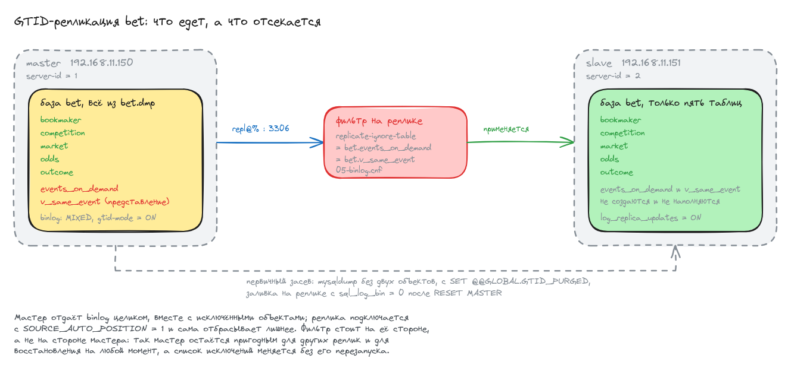

# Домашнее задание: репликация MySQL

## Задание

- Развернуть базу `bet` из дампа `bet.dmp` на мастере.
- Настроить репликацию так, чтобы на реплику ехали только таблицы
  `bookmaker`, `competition`, `market`, `odds`, `outcome`.
- Репликация должна быть GTID.

В дампе, помимо этих пяти таблиц, есть ещё таблица `events_on_demand`
и представление `v_same_event` - их на реплике быть не должно.

## Схема



Исходник схемы - [scheme.excalidraw](scheme.excalidraw), открывается на excalidraw.com
через Open, если понадобится что-то поправить.

Ключевой момент: фильтр стоит **на стороне реплики**. Мастер пишет в binlog всё,
включая исключённые объекты, и отдаёт его целиком; реплика применяет только то,
что проходит через `replicate-ignore-table`. Так мастер остаётся полноценным
источником для других реплик и для восстановления на любой момент, а список
исключений меняется без его перезапуска.

## Стенд

Две машины на `bento/ubuntu-22.04`, адреса как в стенде из методички:

| хост   | адрес           | server-id | роль                          |
|--------|-----------------|-----------|-------------------------------|
| master | 192.168.11.150  | 1         | источник, полная база `bet`   |
| slave  | 192.168.11.151  | 2         | реплика, только пять таблиц   |

Файлы:

- [Vagrantfile](Vagrantfile) - две ВМ и запуск плейбука
- [provision.yml](ansible/provision.yml) - весь плейбук, три плея: общая установка, мастер, реплика
- [group_vars/all.yml](ansible/group_vars/all.yml) - адреса, реквизиты, список исключённых объектов
- [bet.dmp](ansible/files/bet.dmp) - дамп из стенда курса
- конфиги MySQL теми же пятью файлами, что и в стенде методички:
  [01-base.cnf](ansible/templates/01-base.cnf.j2),
  [02-max-connections.cnf](ansible/templates/02-max-connections.cnf.j2),
  [03-performance.cnf](ansible/templates/03-performance.cnf.j2),
  [04-slow-query.cnf](ansible/templates/04-slow-query.cnf.j2),
  [05-binlog.cnf](ansible/templates/05-binlog.cnf.j2)

Плейбук запускается один раз, провижинером машины `slave`, сразу на обе
(`ansible.limit = "all"`): реплика снимает дамп с мастера и подключается к нему,
поэтому мастер должен быть готов раньше, а порядок плеев это обеспечивает.

## Запуск

```bash
vagrant up
```

```
PLAY RECAP *********************************************************************
master                     : ok=15   changed=11   unreachable=0    failed=0    skipped=0
slave                      : ok=14   changed=9    unreachable=0    failed=0    skipped=0
```

Повторный `vagrant provision` не трогает ничего:

```
PLAY RECAP *********************************************************************
master                     : ok=13   changed=0    unreachable=0    failed=0    skipped=1
slave                      : ok=8    changed=0    unreachable=0    failed=0    skipped=5
```

## Как настроено

### Версии и GTID

```shell
mysql> SELECT VERSION(), @@server_id, @@gtid_mode, @@enforce_gtid_consistency;
```

```
-- master
VERSION()                 @@server_id  @@gtid_mode  @@enforce_gtid_consistency
8.0.46-0ubuntu0.22.04.3   1            ON           ON
-- slave
VERSION()                 @@server_id  @@gtid_mode  @@enforce_gtid_consistency
8.0.46-0ubuntu0.22.04.3   2            ON           ON
```

`server-id` у мастера и реплики разные, GTID включён на обоих.

### Фильтр репликации

```shell
vagrant@slave:~$ grep -vE '^\s*#|^\s*$' /etc/mysql/mysql.conf.d/05-binlog.cnf
[mysqld]
log-bin         = mysql-bin
max-binlog-size = 16M
binlog-format   = MIXED
binlog_expire_logs_seconds = 604800
gtid-mode                = ON
enforce-gtid-consistency = ON
log_replica_updates      = ON
replicate-ignore-table = bet.events_on_demand
replicate-ignore-table = bet.v_same_event
```

Тот же файл на мастере отличается только отсутствием двух последних строк:
`replicate-ignore-table` - параметр реплики, на мастере он не имеет смысла.

### Первичный засев реплики

Реплику нельзя просто подключить к мастеру: данные, залитые из `bet.dmp` до старта
репликации, через binlog уже не приедут. Поэтому мастер отдаёт дамп без двух
исключённых объектов:

```bash
mysqldump --single-transaction --triggers --routines --events \
  --set-gtid-purged=ON \
  --databases bet \
  --ignore-table=bet.events_on_demand --ignore-table=bet.v_same_event \
  > /tmp/master.sql
```

`--set-gtid-purged=ON` кладёт в файл `SET @@GLOBAL.GTID_PURGED` - историю уже
выполненных на мастере транзакций. По ней реплика поймёт, что эти транзакции
у неё уже есть, и начнёт со следующей.

На реплике заливка идёт так:

```bash
mysql -e "RESET MASTER"                                  # gtid_executed должен быть пуст
( echo "SET sql_log_bin = 0;"; cat /tmp/master.sql ) | mysql
```

`RESET MASTER` нужен потому, что `SET @@GLOBAL.GTID_PURGED` выполняется только при
пустом `gtid_executed`. `sql_log_bin = 0` - чтобы реплика не записала заливку
в собственный binlog и не завела поверх истории мастера свои GTID.

Дальше обычное подключение:

```sql
CHANGE REPLICATION SOURCE TO
  SOURCE_HOST = '192.168.11.150', SOURCE_PORT = 3306,
  SOURCE_USER = 'repl', SOURCE_PASSWORD = '!OtusLinux2018',
  SOURCE_AUTO_POSITION = 1;
START REPLICA;
```

## Проверка

### На мастере база целиком, на реплике только пять таблиц

```shell
master mysql> USE bet; SHOW TABLES;
Tables_in_bet
bookmaker
competition
events_on_demand
market
odds
outcome
v_same_event
```

```shell
slave mysql> USE bet; SHOW TABLES;
Tables_in_bet
bookmaker
competition
market
odds
outcome
```

Ровно те пять таблиц, что требует задание. Представления `v_same_event` тоже нет:

```shell
slave mysql> SELECT table_name, table_type FROM information_schema.tables
          -> WHERE table_schema='bet' ORDER BY table_name;
TABLE_NAME   TABLE_TYPE
bookmaker    BASE TABLE
competition  BASE TABLE
market       BASE TABLE
odds         BASE TABLE
outcome      BASE TABLE
```

### Статус репликации

```shell
slave mysql> SHOW REPLICA STATUS\G
             Replica_IO_State: Waiting for source to send event
                  Source_Host: 192.168.11.150
                  Source_User: repl
           Replica_IO_Running: Yes
          Replica_SQL_Running: Yes
       Replicate_Ignore_Table: bet.events_on_demand,bet.v_same_event
                   Last_Error:
        Seconds_Behind_Source: 0
    Replica_SQL_Running_State: Replica has read all relay log; waiting for more updates
            Executed_Gtid_Set: 9c9365e7-965c-11f1-82a5-08002716ddef:1-39
                Auto_Position: 1
```

Оба потока работают, `Auto_Position: 1` - подключение идёт по GTID, а не по имени
binlog-файла и смещению. Мастер со своей стороны видит реплику:

```shell
master mysql> SHOW REPLICAS;
Server_Id  Host  Port  Source_Id  Replica_UUID
2                3306  1          9f33d3a1-965c-11f1-a2d2-08002716ddef
```

### Вставка строки на мастере

Было на обоих:

```
id  bookmaker_name
3   unibet
4   betway
5   bwin
6   ladbrokes
```

Пишем на мастере:

```shell
master mysql> INSERT INTO bet.bookmaker (id, bookmaker_name) VALUES (1, '1xbet');
master mysql> SELECT * FROM bet.bookmaker ORDER BY id;
id  bookmaker_name
1   1xbet
3   unibet
4   betway
5   bwin
6   ladbrokes
```

Через пару секунд на реплике:

```shell
slave mysql> SELECT * FROM bet.bookmaker ORDER BY id;
id  bookmaker_name
1   1xbet
3   unibet
4   betway
5   bwin
6   ladbrokes
```

### Изменение строки

```shell
master mysql> UPDATE bet.bookmaker SET bookmaker_name = 'winline' WHERE id = 1;
```

```shell
slave mysql> SELECT * FROM bet.bookmaker WHERE id = 1;
id  bookmaker_name
1   winline
```

### GTID совпадают

```shell
master mysql> SELECT @@GLOBAL.gtid_executed\G
master_gtid_executed: 9c9365e7-965c-11f1-82a5-08002716ddef:1-41
slave  mysql> SELECT @@GLOBAL.gtid_executed\G
slave_gtid_executed:  9c9365e7-965c-11f1-82a5-08002716ddef:1-41
```

UUID один и тот же - это идентификатор мастера, транзакции нумеруются им глобально.
Реплика догнала мастера ровно до 41-й транзакции.

### Те же изменения в binlog реплики

`log_replica_updates = ON`, поэтому применённые транзакции реплика пишет
и в свой binlog - вместе с GTID:

```shell
vagrant@slave:~$ sudo mysqlbinlog --base64-output=DECODE-ROWS -v /var/lib/mysql/mysql-bin.000001
SET @@SESSION.GTID_NEXT= '9c9365e7-965c-11f1-82a5-08002716ddef:40'/*!*/;
BEGIN
INSERT INTO bet.bookmaker (id, bookmaker_name) VALUES (1, '1xbet')
COMMIT/*!*/;
SET @@SESSION.GTID_NEXT= '9c9365e7-965c-11f1-82a5-08002716ddef:41'/*!*/;
BEGIN
UPDATE bet.bookmaker SET bookmaker_name = 'winline' WHERE id = 1
COMMIT/*!*/;
```

Видно и вставку, и изменение, каждая транзакция со своим GTID.

### Фильтр действительно фильтрует

Пишем в исключённую таблицу на мастере:

```shell
master mysql> INSERT INTO bet.events_on_demand (id, sortname) VALUES (999, 'otus-filter-test');
master mysql> SELECT id, sortname FROM bet.events_on_demand WHERE id = 999;
id   sortname
999  otus-filter-test
```

На реплике таблицы нет, и репликация от этого не встала:

```shell
slave mysql> SHOW TABLES FROM bet LIKE 'events_on_demand';
(пусто)
slave mysql> SHOW REPLICA STATUS\G
           Replica_IO_Running: Yes
          Replica_SQL_Running: Yes
                Last_IO_Error:
               Last_SQL_Error:
```

Это важная часть проверки: реплика получает транзакцию по этой таблице,
но не применяет её, а не падает с ошибкой «таблицы не существует».

## Отличия от методички

**Ubuntu 22.04 и MySQL 8.0 вместо CentOS 7 и Percona Server 5.7.** В стенде курса
используется `centos/7`, а пакеты ставятся из `yum`. CentOS 7 снят с поддержки
в июне 2024 года, его зеркала переехали в архив, и `yum install` на голом боксе
просто не отработает. Percona Server 5.7 закончил жизненный цикл ещё раньше.
Остальные домашние работы этого репозитория собраны на `bento/ubuntu-22.04`,
поэтому взял его и MySQL 8.0 из репозитория дистрибутива. Настройка от смены
СУБД не поменялась: GTID, `replicate-ignore-table` и `mysqldump` работают так же.

**Пять конфигов из стенда сохранены по именам, но приведены к MySQL 8.0.**
Из `03-performance.cnf` убраны `query-cache-limit` и `query-cache-size`: кеш
запросов выкинут из MySQL 8.0 целиком, и с этими строками сервер не поднимется.
Из `01-base.cnf` убран `symbolic-links` - параметр удалён там же. В `05-binlog.cnf`
`expire-logs-days = 7` заменён на `binlog_expire_logs_seconds = 604800`: старое имя
объявлено устаревшим. Пути к сокету и логу ошибок в Ubuntu другие, каталог конфигов
называется `mysql.conf.d`, а не `my.cnf.d`.

**Дамп для реплики снимается только по базе `bet`.** В методичке
`mysqldump --all-databases`, то есть в дамп попадает и схема `mysql` с учётными
записями. В MySQL 8.0 заливать её на другой сервер поверх существующей - плохая
идея: там лежат словарь данных и пользователи самой реплики. Дампится `--databases bet`,
этого достаточно, потому что реплицируется только она.

**Добавлены `RESET MASTER` и `sql_log_bin = 0` при заливке.** В методичке дамп
просто заливается через `SOURCE`. При включённом GTID этого мало: `SET @@GLOBAL.GTID_PURGED`
из дампа выполнится только при пустом `gtid_executed`, а сама заливка иначе
запишется в binlog реплики и заведёт там собственные GTID.

**Современный синтаксис команд.** В MySQL 8.0.22 переименованы
`CHANGE MASTER TO` → `CHANGE REPLICATION SOURCE TO`, `START SLAVE` → `START REPLICA`,
`SHOW SLAVE STATUS` → `SHOW REPLICA STATUS`, `SHOW SLAVE HOSTS` → `SHOW REPLICAS`.
Старые формы ещё работают, но помечены устаревшими, поэтому в выводах выше
поля называются `Replica_IO_Running` и `Source_Host`, а не `Slave_IO_Running`
и `Master_Host`.

## На чём споткнулся

**Мастер слушал только localhost, и реплика не могла подключиться.** Симптом
в `SHOW REPLICA STATUS`:

```
Last_IO_Error: Error connecting to source 'repl@192.168.11.150:3306' ...
               Can't connect to MySQL server on '192.168.11.150:3306' (111)
```

При этом на реплике уже лежали пять нужных таблиц, и со стороны всё выглядело
рабочим - но они приехали из залитого дампа, а не по репликации. Причина в порядке
чтения конфигов: в `/etc/mysql/mysql.conf.d/` рядом с нашими `01-base.cnf`...`05-binlog.cnf`
лежит дистрибутивный `mysqld.cnf`, а имена в каталоге читаются по алфавиту, и `mysqld`
идёт после цифр. При повторе одного параметра побеждает прочитанный последним,
поэтому `bind-address = 127.0.0.1` из `mysqld.cnf` перебивал наш адрес:

```shell
vagrant@master:~$ sudo ss -lntp | grep 3306
LISTEN 0 500 127.0.0.1:3306 0.0.0.0:*  users:(("mysqld",pid=3091,fd=24))
```

Плейбук теперь комментирует эту строку в `mysqld.cnf`. `mysqlx-bind-address`
оставлен на localhost - X-протокол тут не нужен.

**Задача запуска репликации всегда рапортовала об изменении.** Модуль
`mysql_replication` в режиме `startreplica` возвращает `changed` независимо от того,
шла репликация до этого или нет. Обвязал условием по `Replica_IO_Running`
и `Replica_SQL_Running`, после чего повторный прогон плейбука даёт честный `changed=0`.

**Наличие таблиц на реплике ничего не доказывает.** Пока я не посмотрел
`Replica_IO_Running`, картина выглядела правильной: на реплике ровно пять нужных
таблиц с данными. Но это результат заливки дампа, репликация при этом стояла.
Проверять надо связку: оба потока в `Yes`, пустые `Last_IO_Error` и `Last_SQL_Error`,
совпадающие `gtid_executed` и живое изменение, доехавшее с мастера. Заодно
`SHOW REPLICAS` на мастере показывает реплику только пока её IO-поток подключён,
на разорванном соединении вывод пустой.
