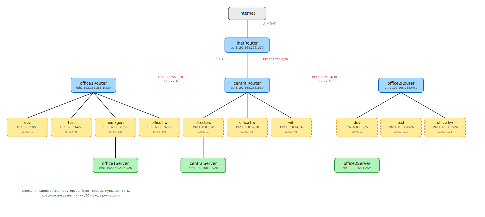

# Домашнее задание: сетевая лаборатория

## Задание

- Собрать сеть из трёх площадок (central, office1, office2) и настроить маршрутизацию.
- Все сервера должны видеть друг друга.
- Весь интернет-трафик должен уходить через inetRouter.
- У всех хостов, кроме inetRouter, отключить дефолтный маршрут на NAT-интерфейсе eth0,
  который поднимает vagrant.

Адресация задана условием, свободной остаётся только нумерация линков между роутерами.

## Теория

Посчитал все сети из задания. Три последние - это линки между роутерами, в условии их нет,
я их выделил сам: взял три /30 из 192.168.255.0/24, для соединения точка-точка двух адресов
как раз хватает.

```
сеть              CIDR                маска              узлов  первый         последний      broadcast
central
  directors       192.168.0.0/28      255.255.255.240       14  192.168.0.1    192.168.0.14   192.168.0.15
  office hardware 192.168.0.32/28     255.255.255.240       14  192.168.0.33   192.168.0.46   192.168.0.47
  wifi            192.168.0.64/26     255.255.255.192       62  192.168.0.65   192.168.0.126  192.168.0.127
office1
  dev             192.168.2.0/26      255.255.255.192       62  192.168.2.1    192.168.2.62   192.168.2.63
  test            192.168.2.64/26     255.255.255.192       62  192.168.2.65   192.168.2.126  192.168.2.127
  managers        192.168.2.128/26    255.255.255.192       62  192.168.2.129  192.168.2.190  192.168.2.191
  office hardware 192.168.2.192/26    255.255.255.192       62  192.168.2.193  192.168.2.254  192.168.2.255
office2
  dev             192.168.1.0/25      255.255.255.128      126  192.168.1.1    192.168.1.126  192.168.1.127
  test            192.168.1.128/26    255.255.255.192       62  192.168.1.129  192.168.1.190  192.168.1.191
  office hardware 192.168.1.192/26    255.255.255.192       62  192.168.1.193  192.168.1.254  192.168.1.255
линки
  inet-central    192.168.255.0/30    255.255.255.252        2  192.168.255.1  192.168.255.2  192.168.255.3
  office2-central 192.168.255.4/30    255.255.255.252        2  192.168.255.5  192.168.255.6  192.168.255.7
  office1-central 192.168.255.8/30    255.255.255.252        2  192.168.255.9  192.168.255.10 192.168.255.11
```

Ошибок в разбиении нет. Перебрал все пары подсетей - ни одна не перекрывается с другой даже
частично. Выравнивание тоже в порядке: адрес каждой сети кратен её размеру, например у
192.168.2.192/26 блок 64 и 192 на 64 делится, так что съехавших границ нет.

Свободное место в central:

```
192.168.0.16/28     14 узлов    broadcast 192.168.0.31
192.168.0.48/28     14 узлов    broadcast 192.168.0.63
192.168.0.128/25   126 узлов    broadcast 192.168.0.255
```

В офисных сетях свободного места не осталось, 192.168.1.0/24 и 192.168.2.0/24 разобраны
полностью. В 192.168.255.0/24, откуда я брал линки, осталось:

```
192.168.255.12/30    2 узла     broadcast 192.168.255.15
192.168.255.16/28   14 узлов    broadcast 192.168.255.31
192.168.255.32/27   30 узлов    broadcast 192.168.255.63
192.168.255.64/26   62 узла     broadcast 192.168.255.127
192.168.255.128/25 126 узлов    broadcast 192.168.255.255
```

В методичке в списке свободных сетей значатся 192.168.255.4/30 и 192.168.255.8/29. Это список
на момент теоретической части, когда линков между офисами ещё нет. Как только их
добавляешь, обе сети становятся заняты, поэтому у меня список отличается.

## Схема



Исходник схемы - [scheme.excalidraw](scheme.excalidraw), открывается на excalidraw.com через
Open, если понадобится что-то поправить.

## Стенд

Семь машин на bento/ubuntu-22.04. 

Адаптер N в Vagrantfile соответствует интерфейсу eth(N-1) в госте, потому что eth0 везде занят
под NAT, который поднимает сам vagrant. Адреса по хостам получились такие:

```
inetRouter      eth1 192.168.255.1/30
centralRouter   eth1 192.168.255.2/30   eth2 192.168.0.1/28   eth3 192.168.0.33/28
                eth4 192.168.0.65/26    eth5 192.168.255.9/30 eth6 192.168.255.5/30
centralServer   eth1 192.168.0.2/28
office1Router   eth1 192.168.255.10/30  eth2 192.168.2.1/26   eth3 192.168.2.65/26
                eth4 192.168.2.129/26   eth5 192.168.2.193/26
office1Server   eth1 192.168.2.130/26
office2Router   eth1 192.168.255.6/30   eth2 192.168.1.1/25   eth3 192.168.1.129/26
                eth4 192.168.1.193/26
office2Server   eth1 192.168.1.2/25
```

Настройка собрана в ansible:

- [provision.yml](ansible/provision.yml) - весь плейбук
- маршруты по хостам:
  [inetRouter](ansible/host_vars/inetRouter.yml),
  [centralRouter](ansible/host_vars/centralRouter.yml),
  [centralServer](ansible/host_vars/centralServer.yml),
  [office1Router](ansible/host_vars/office1Router.yml),
  [office1Server](ansible/host_vars/office1Server.yml),
  [office2Router](ansible/host_vars/office2Router.yml),
  [office2Server](ansible/host_vars/office2Server.yml)
- [99-routes.yaml](ansible/templates/99-routes.yaml) - шаблон netplan: маршруты и отключение
  дефолта на eth0
- [rules.v4](ansible/templates/rules.v4) - правило NAT для inetRouter

Сеть 192.168.50.0/24 для ansible, которая есть в методичке, мне не понадобилась. Она и там
помечена как необязательная: vagrant сам генерирует инвентарь и ходит на хосты через свой
NAT-интерфейс. Группы routers и servers, которые нужны плейбуку, задаются прямо в Vagrantfile
через `ansible.groups`, так что и отдельный файл инвентаря не нужен.

## Запуск

```bash
vagrant up
```

Поднимаются семь машин, после последней автоматически отрабатывает ansible: ставит traceroute,
гасит ufw, включает форвардинг на роутерах, настраивает NAT на inetRouter и раскладывает
маршруты.

```
PLAY RECAP *********************************************************************
centralRouter              : ok=8    changed=7    unreachable=0    failed=0
centralServer              : ok=7    changed=6    unreachable=0    failed=0
inetRouter                 : ok=11   changed=10   unreachable=0    failed=0
office1Router              : ok=8    changed=7    unreachable=0    failed=0
office1Server              : ok=7    changed=6    unreachable=0    failed=0
office2Router              : ok=8    changed=7    unreachable=0    failed=0
office2Server              : ok=7    changed=6    unreachable=0    failed=0
```

Повторный `vagrant provision` ничего не трогает, `changed=0` на всех хостах.

## Маршруты

Маршруты лежат в `ansible/host_vars/<хост>.yml` и собираются одним шаблоном. Держать семь
почти одинаковых netplan-файлов не хотелось, а так вся маршрутизация стенда видна в семи
коротких файлах по три-шесть строк.

 У всех, кроме inetRouter, дефолт смотрит в сторону центра: сервер на свой роутер, 
 роутер офиса на centralRouter, centralRouter на inetRouter. Навстречу нужны два
маршрута на centralRouter - в office1 и в office2, и один на inetRouter, сразу на всю
192.168.0.0/16, иначе ответам из интернета некуда возвращаться.

Свои сети роутеры знают сами, они directly connected, отдельные маршруты для них не нужны.

## Проверка

Пинг с каждого хоста на каждый, 42 пары. Прогонял уже после `vagrant reload`, то есть это
проверка ещё и на то, что настройки переживают перезагрузку:

```
from \ to      inetRouter     centralRouter  centralServer  office1Router  office1Server  office2Router  office2Server
inetRouter     -              OK             OK             OK             OK             OK             OK
centralRouter  OK             -              OK             OK             OK             OK             OK
centralServer  OK             OK             -              OK             OK             OK             OK
office1Router  OK             OK             OK             -              OK             OK             OK
office1Server  OK             OK             OK             OK             -              OK             OK
office2Router  OK             OK             OK             OK             OK             -              OK
office2Server  OK             OK             OK             OK             OK             OK             -
```

Отдельно проверил, что с сервера видны не только основные адреса роутеров, но и все остальные
их интерфейсы:

```shell
vagrant@office1Server:~$ for t in 192.168.0.33 192.168.0.65 192.168.1.129 192.168.1.193 192.168.2.65; do
>   ping -c1 -W2 $t >/dev/null && echo "$t OK"
> done
192.168.0.33 OK
192.168.0.65 OK
192.168.1.129 OK
192.168.1.193 OK
192.168.2.65 OK
```

Дефолтные маршруты. На NAT-интерфейсе он остался только у inetRouter, у остальных смотрит
внутрь сети:

```shell
inetRouter      default via 10.0.2.2 dev eth0 proto dhcp src 10.0.2.15 metric 100
centralRouter   default via 192.168.255.1 dev eth1 proto static
centralServer   default via 192.168.0.1 dev eth1 proto static
office1Router   default via 192.168.255.9 dev eth1 proto static
office1Server   default via 192.168.2.129 dev eth1 proto static
office2Router   default via 192.168.255.5 dev eth1 proto static
office2Server   default via 192.168.1.1 dev eth1 proto static
```

Таблица маршрутов на centralRouter, видно три свои сети, два маршрута в офисы и дефолт наружу:

```shell
vagrant@centralRouter:~$ ip r
default via 192.168.255.1 dev eth1 proto static
10.0.2.0/24 dev eth0 proto kernel scope link src 10.0.2.15 metric 100
192.168.0.0/28 dev eth2 proto kernel scope link src 192.168.0.1
192.168.0.32/28 dev eth3 proto kernel scope link src 192.168.0.33
192.168.0.64/26 dev eth4 proto kernel scope link src 192.168.0.65
192.168.1.0/24 via 192.168.255.6 dev eth6 proto static
192.168.2.0/24 via 192.168.255.10 dev eth5 proto static
192.168.255.0/30 dev eth1 proto kernel scope link src 192.168.255.2
192.168.255.4/30 dev eth6 proto kernel scope link src 192.168.255.5
192.168.255.8/30 dev eth5 proto kernel scope link src 192.168.255.9
```

Выход в интернет с office1Server, в первых трёх переходах видно весь путь до inetRouter:

```shell
vagrant@office1Server:~$ traceroute -n -m 5 8.8.8.8
traceroute to 8.8.8.8 (8.8.8.8), 5 hops max, 60 byte packets
 1  192.168.2.129  0.966 ms  0.950 ms  1.148 ms
 2  192.168.255.9  1.487 ms  1.482 ms  1.477 ms
 3  192.168.255.1  2.027 ms  2.023 ms  2.082 ms
 4  10.0.2.2  2.078 ms  2.075 ms  2.133 ms
vagrant@office1Server:~$ ping -c2 8.8.8.8 | tail -2
2 packets transmitted, 2 received, 0% packet loss, time 1001ms
rtt min/avg/max/mdev = 50.185/61.978/73.771/11.793 ms
```

С office2Server то же самое, только через свой роутер:

```shell
vagrant@office2Server:~$ traceroute -n -m 5 8.8.8.8
 1  192.168.1.1  0.346 ms  0.325 ms  0.448 ms
 2  192.168.255.5  0.628 ms  0.624 ms  0.727 ms
 3  192.168.255.1  1.228 ms  1.224 ms  1.221 ms
 4  10.0.2.2  1.327 ms  1.323 ms  1.319 ms
```

NAT после перезагрузки на месте:

```shell
vagrant@inetRouter:~$ sudo iptables -t nat -S POSTROUTING
-P POSTROUTING ACCEPT
-A POSTROUTING ! -d 192.168.0.0/16 -o eth0 -j MASQUERADE
```

## На чём споткнулся

Дольше всего заняла работа с дефолтом на eth0. По методичке достаточно добавить интерфейсу
`dhcp4-overrides: use-routes: false`. Я добавил, netplan сгенерировал `UseRoutes=false`
в конфиге networkd, а маршрут `default via 10.0.2.2` всё равно оставался, даже после reboot.
Выяснилось, что настройки до eth0 просто не доезжают:

```shell
vagrant@centralRouter:~$ networkctl status eth0
● 2: eth0
                  Network File: /run/systemd/network/10-netplan-enp0s3.network
             Alternative Names: enp0s3
```

У интерфейса есть альтернативное имя enp0s3, и его перехватывает `50-cloud-init.yaml`,
оставшийся в боксе от установки, где enp0s3 описан с обычным dhcp4. Файлы networkd
сортируются по имени, enp0s3 идёт раньше eth0, поэтому выигрывает он. Лечится удалением этого
файла и запретом cloud-init трогать сеть, обе задачи есть в плейбуке.

Второе - маршруты нельзя класть в `/etc/netplan/50-vagrant.yaml`, как предлагает методичка.
Этот файл принадлежит vagrant, он переписывает его на каждом `vagrant up` и `reload`, так что
после перезагрузки маршруты пропадут до следующего provision. Свои маршруты кладу отдельным
файлом `99-routes.yaml`: netplan собирает конфиг из всего каталога, а vagrant в чужой файл не
лезет. Проверил через `vagrant reload`, маршруты на месте.

Третье - способ сохранить правила iptables из методички на Ubuntu 22.04 не работает. Там
правила восстанавливаются скриптом в `/etc/network/if-pre-up.d/`, но это каталог ifupdown,
которого в системе с netplan просто нет, и правила молча не поднялись бы после ребута.
Поставил iptables-persistent, он штатно применяет `/etc/iptables/rules.v4` при загрузке.

Хосты в конце плейбука я не перезагружаю, `netplan apply` применяет маршруты сразу. Что всё
переживает ребут, проверил отдельно через `vagrant reload`.
