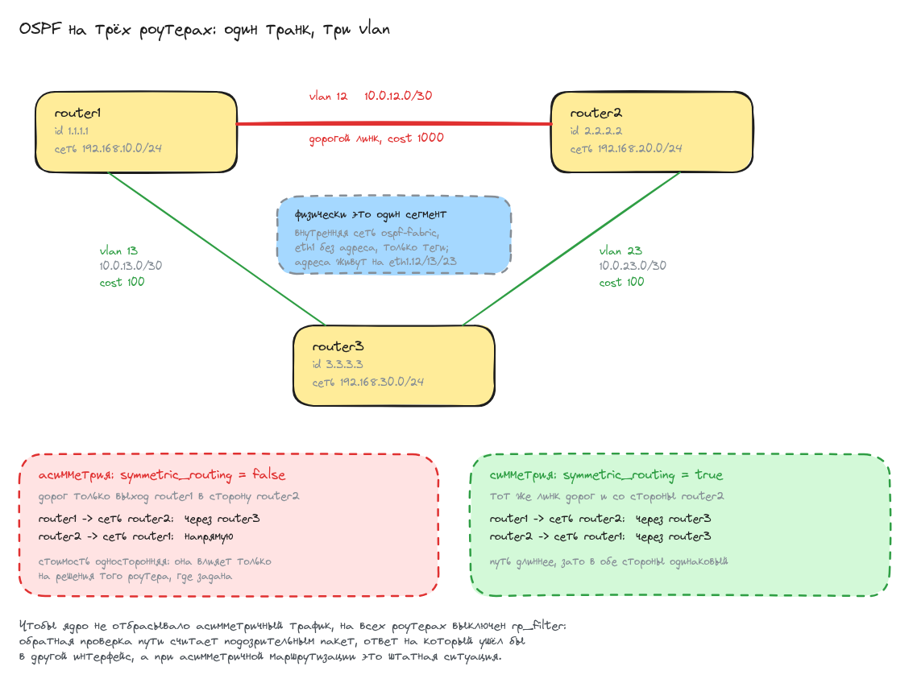

# Домашнее задание: OSPF

## Задание

- Поднять три виртуалки.
- Объединить их разными vlan.
- Поднять OSPF между машинами на базе Quagga.
- Изобразить асимметричный роутинг.
- Сделать один из линков «дорогим», но чтобы при этом роутинг был симметричным.

## Схема




## Стенд

Три роутера на `bento/ubuntu-22.04`, все три сидят в одной внутренней сети
и разведены по трём широковещательным доменам тегами 802.1Q.

| роутер  | router-id | vlan-интерфейсы                          | своя сеть        |
|---------|-----------|------------------------------------------|------------------|
| router1 | 1.1.1.1   | eth1.12 10.0.12.1/30, eth1.13 10.0.13.1/30 | 192.168.10.0/24 |
| router2 | 2.2.2.2   | eth1.12 10.0.12.2/30, eth1.23 10.0.23.1/30 | 192.168.20.0/24 |
| router3 | 3.3.3.3   | eth1.13 10.0.13.2/30, eth1.23 10.0.23.2/30 | 192.168.30.0/24 |

Интерфейсы: `eth0` - NAT от vagrant, `eth1` - транк без адреса, `eth2` - своя сеть роутера.

Файлы:

- [Vagrantfile](Vagrantfile) - три ВМ, транк и тупиковые сети
- [ansible.cfg](ansible.cfg) - инвентарь vagrant и отключённая проверка ключей хоста
- [provision.yml](ansible/provision.yml) - весь плейбук
- [group_vars/all.yml](ansible/group_vars/all.yml) - стоимость дорогого линка и переключатель сценария
- адресация по роутерам:
  [router1](ansible/host_vars/router1.yml),
  [router2](ansible/host_vars/router2.yml),
  [router3](ansible/host_vars/router3.yml)
- [99-ospf.yaml.j2](ansible/templates/99-ospf.yaml.j2) - шаблон netplan: транк и vlan-интерфейсы
- [frr.conf.j2](ansible/templates/frr.conf.j2) - шаблон конфигурации FRR

## Запуск

```bash
vagrant up
```

```
PLAY RECAP *********************************************************************
router1                    : ok=10   changed=8    unreachable=0    failed=0    skipped=0
router2                    : ok=10   changed=8    unreachable=0    failed=0    skipped=0
router3                    : ok=10   changed=8    unreachable=0    failed=0    skipped=0
```

Повторный `vagrant provision` не трогает ничего:

```
PLAY RECAP *********************************************************************
router1                    : ok=8    changed=0    unreachable=0    failed=0    skipped=0
router2                    : ok=8    changed=0    unreachable=0    failed=0    skipped=0
router3                    : ok=8    changed=0    unreachable=0    failed=0    skipped=0
```

## Объединение через vlan

Все три роутера подключены одним адаптером в общую внутреннюю сеть `ospf-fabric` -
физически это один сегмент, эдакий неуправляемый свитч. Разделение на три линка
сделано тегами 802.1Q: у `eth1` своего адреса нет, он только несёт кадры,
а адреса живут на подинтерфейсах.

```shell
root@router1:~# ip -br addr show | grep -vE '^(lo|eth0)'
eth1             UP             fe80::a00:27ff:fe18:10e0/64
eth2             UP             192.168.10.1/24 fe80::a00:27ff:fe4c:7825/64
eth1.13@eth1     UP             10.0.13.1/30 fe80::a00:27ff:fe18:10e0/64
eth1.12@eth1     UP             10.0.12.1/30 fe80::a00:27ff:fe18:10e0/64
```

Теги видно явно:

```shell
root@router1:~# ip -d link show eth1.12 | grep -o 'vlan protocol 802.1Q id [0-9]*'
vlan protocol 802.1Q id 12
root@router1:~# ip -d link show eth1.13 | grep -o 'vlan protocol 802.1Q id [0-9]*'
vlan protocol 802.1Q id 13
```

## OSPF поднялся

У каждого роутера ровно два соседа, все в состоянии `Full`:

```shell
root@router1:~# vtysh -c "show ip ospf neighbor"
Neighbor ID     Pri State           Dead Time Address         Interface
2.2.2.2           1 Full/DR           32.670s 10.0.12.2       eth1.12:10.0.12.1
3.3.3.3           1 Full/DR           32.663s 10.0.13.2       eth1.13:10.0.13.1

root@router2:~# vtysh -c "show ip ospf neighbor"
Neighbor ID     Pri State           Dead Time Address         Interface
1.1.1.1           1 Full/Backup       30.898s 10.0.12.1       eth1.12:10.0.12.2
3.3.3.3           1 Full/DR           30.911s 10.0.23.2       eth1.23:10.0.23.1

root@router3:~# vtysh -c "show ip ospf neighbor"
Neighbor ID     Pri State           Dead Time Address         Interface
1.1.1.1           1 Full/Backup       39.084s 10.0.13.1       eth1.13:10.0.13.2
2.2.2.2           1 Full/Backup       39.104s 10.0.23.1       eth1.23:10.0.23.2
```

## Асимметричный роутинг

Ключевая идея: **стоимость интерфейса в OSPF односторонняя**. Она влияет только
на решения того роутера, где задана, и ничего не говорит соседу. Если сделать
дорогим выход router1 в сторону router2, но не наоборот, получится ровно то,
что нужно: туда трафик пойдёт в обход, обратно - напрямую.

Это состояние по умолчанию, `symmetric_routing: false`.

```shell
root@router1:~# vtysh -c "show ip ospf interface" | grep -E '^eth1\.|Cost:'
eth1.12 is up
  Router ID 1.1.1.1, Network Type BROADCAST, Cost: 1000
eth1.13 is up
  Router ID 1.1.1.1, Network Type BROADCAST, Cost: 100

root@router2:~# vtysh -c "show ip ospf interface" | grep -E '^eth1\.|Cost:'
eth1.12 is up
  Router ID 2.2.2.2, Network Type BROADCAST, Cost: 100
eth1.23 is up
  Router ID 2.2.2.2, Network Type BROADCAST, Cost: 100
```

Таблицы маршрутов разъезжаются: у router1 путь стоит 300 и идёт через router3,
у router2 - 200 и идёт напрямую.

```shell
root@router1:~# vtysh -c "show ip route ospf" | grep 192.168.20
O>* 192.168.20.0/24 [110/300] via 10.0.13.2, eth1.13, weight 1, 00:02:16

root@router2:~# vtysh -c "show ip route ospf" | grep 192.168.10
O>* 192.168.10.0/24 [110/200] via 10.0.12.1, eth1.12, weight 1, 00:02:28
```

И это видно в трассировке. Туда - два хопа через router3:

```shell
root@router1:~# traceroute -n -s 192.168.10.1 192.168.20.1
traceroute to 192.168.20.1 (192.168.20.1), 30 hops max, 60 byte packets
 1  10.0.13.2  0.209 ms  0.191 ms  0.181 ms
 2  192.168.20.1  0.304 ms  0.199 ms  0.185 ms
```

Обратно - один хоп напрямую:

```shell
root@router2:~# traceroute -n -s 192.168.20.1 192.168.10.1
traceroute to 192.168.10.1 (192.168.10.1), 30 hops max, 60 byte packets
 1  192.168.10.1  0.604 ms  0.586 ms  0.575 ms
```

Пакет уходит одним путём, а возвращается другим - это и есть асимметричная
маршрутизация. Связность при этом полная:

```shell
root@router1:~# ping -c2 -I 192.168.10.1 192.168.20.1 | tail -2
2 packets transmitted, 2 received, 0% packet loss, time 1012ms
rtt min/avg/max/mdev = 0.424/0.474/0.524/0.050 ms
```

Чтобы это работало, на всех роутерах выключен `rp_filter`. Обратная проверка пути
отбрасывает пакет, если ответ его отправителю ушёл бы через другой интерфейс,
а при асимметричном роутинге это штатная ситуация, а не подделка адреса.

## Дорогой линк с симметричным роутингом

Второе требование задания: линк остаётся дорогим, но маршрут становится
симметричным. Для этого ту же стоимость выставляем и со стороны router2 -
тогда обход выбирают оба конца.

Переключается без правки файлов:

```bash
ansible-playbook ansible/provision.yml -e symmetric_routing=true
```

```
PLAY RECAP *********************************************************************
router1                    : ok=8    changed=0    unreachable=0    failed=0    skipped=0
router2                    : ok=9    changed=2    unreachable=0    failed=0    skipped=0
router3                    : ok=8    changed=0    unreachable=0    failed=0    skipped=0
```

Поменялся только router2 - остальных задача не коснулась.

```shell
root@router2:~# vtysh -c "show ip ospf interface" | grep -E '^eth1\.|Cost:'
eth1.12 is up
  Router ID 2.2.2.2, Network Type BROADCAST, Cost: 1000
eth1.23 is up
  Router ID 2.2.2.2, Network Type BROADCAST, Cost: 100
```

Маршрут у router2 тоже ушёл в обход, стоимость выросла с 200 до 300:

```shell
root@router2:~# vtysh -c "show ip route ospf" | grep 192.168.10
O>* 192.168.10.0/24 [110/300] via 10.0.23.2, eth1.23, weight 1, 00:00:41
```

Теперь обе трассировки идут через router3 - маршрут симметричный:

```shell
root@router1:~# traceroute -n -s 192.168.10.1 192.168.20.1
 1  10.0.13.2  0.476 ms  0.453 ms  0.446 ms
 2  192.168.20.1  0.828 ms  0.818 ms  0.807 ms

root@router2:~# traceroute -n -s 192.168.20.1 192.168.10.1
 1  10.0.23.2  0.431 ms  0.413 ms  0.405 ms
 2  192.168.10.1  0.811 ms  0.802 ms  0.795 ms
```

Дорогой линк router1 - router2 при этом никуда не делся, он просто не используется
ни в одну сторону. Вернуться к асимметрии - запустить плейбук без переменной:

```bash
ansible-playbook ansible/provision.yml
```

