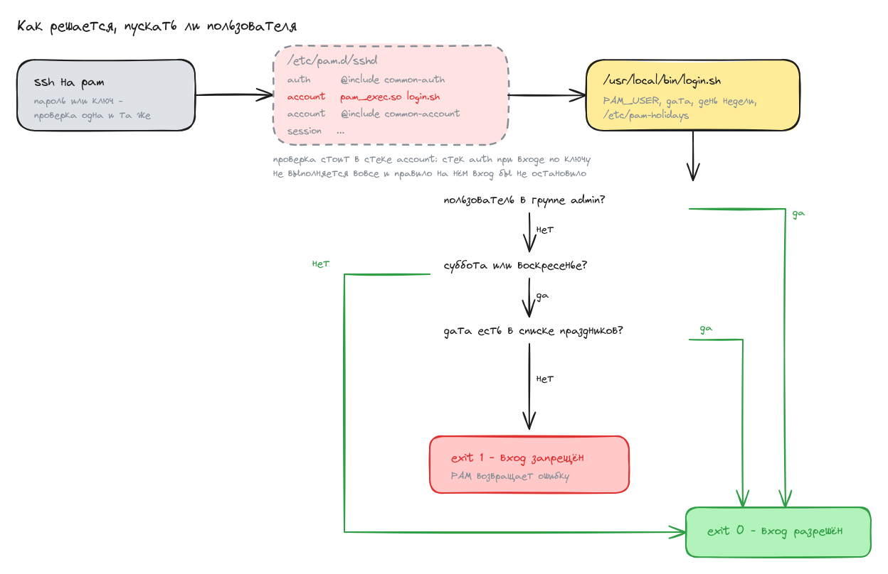

# Домашнее задание: PAM

## Задание

- Ограничить доступ к системе для всех пользователей, кроме группы администраторов,
  в выходные дни (суббота и воскресенье), за исключением праздничных дней.
- Задание со звёздочкой: предоставить определённому пользователю доступ к Docker
  и право перезапускать Docker-сервис.

## Как читается условие

«В выходные дни (суббота и воскресенье), за исключением праздничных дней» я понял буквально:
ограничение действует по субботам и воскресеньям, а праздники из-под него выведены. То есть
если выходной оказался праздничным днём, пускают всех. Праздники лежат отдельным
списком в `/etc/pam-holidays`, и если понадобится обратное поведение, достаточно
выкинуть из скрипта блок с их проверкой.

## Схема



Исходник схемы - [scheme.excalidraw](scheme.excalidraw), открывается на excalidraw.com
через Open, если понадобится что-то поправить.

## Стенд

Одна машина `pam` на `bento/ubuntu-22.04`, адрес 192.168.57.10 во внутренней сети.
Ходить на неё будем с хоста по ssh под разными пользователями.

Пользователи стенда:

| пользователь | группы            | что должен уметь                          |
|--------------|-------------------|-------------------------------------------|
| otus         | otus              | обычный пользователь, в выходные не пускают |
| otusadm      | admin, docker     | пускают всегда, работает с docker          |
| vagrant      | sudo, admin       | пускают всегда, через него работает ansible |

Файлы:

- [Vagrantfile](Vagrantfile) - одна ВМ и запуск плейбука
- [provision.yml](ansible/provision.yml) - весь плейбук
- [login.sh](ansible/files/login.sh) - скрипт, который решает, пускать ли пользователя
- [pam-holidays](ansible/files/pam-holidays) - список праздничных дней
- [sudoers-docker](ansible/files/sudoers-docker) - право перезапускать docker

## Запуск

```bash
vagrant up
```

```
PLAY RECAP *********************************************************************
pam                        : ok=14   changed=12   unreachable=0    failed=0    skipped=0
```

Повторный `vagrant provision` не трогает ничего:

```
PLAY RECAP *********************************************************************
pam                        : ok=13   changed=0    unreachable=0    failed=0    skipped=0
```

## Как устроено правило

Ограничение по времени напрашивается на модуль `pam_time`, но он умеет только списки
конкретных пользователей и не понимает групп: пришлось бы вручную перечислять всех
неадминистраторов и править список при каждом новом пользователе. Поэтому решение
на `pam_exec`: он запускает внешний скрипт и смотрит на его код возврата.

Скрипт [login.sh](ansible/files/login.sh) получает имя пользователя в переменной
`PAM_USER` и отвечает `exit 0` (пустить) или `exit 1` (не пускать). Порядок проверок:
член группы `admin` проходит всегда, будний день проходит всегда, выходной пропускается
только если дата есть в списке праздников.

Подключается он строкой в `/etc/pam.d/sshd` и `/etc/pam.d/login`:

```shell
vagrant@pam:~$ grep -n pam_exec /etc/pam.d/sshd /etc/pam.d/login
/etc/pam.d/sshd:14:account    required     pam_exec.so /usr/local/bin/login.sh
/etc/pam.d/login:98:account    required     pam_exec.so /usr/local/bin/login.sh
```

Важно, что проверка стоит в стеке `account`, а не `auth`, как в методичке. При входе
по ключу sshd стек `auth` не проходит вовсе, и правило, повешенное на `auth`, такой вход
не остановит. `account` отрабатывает при любом способе входа, ниже это проверено отдельно.

Пользователи и группы после провижена:

```shell
vagrant@pam:~$ getent group admin docker
admin:x:1001:root,vagrant,otusadm
docker:x:119:otusadm
vagrant@pam:~$ id otus
uid=1001(otus) gid=1002(otus) groups=1002(otus)
vagrant@pam:~$ id otusadm
uid=1002(otusadm) gid=1003(otusadm) groups=1003(otusadm),1001(admin),119(docker)
```

## Проверка

Чтобы подменять дату, сначала надо заглушить синхронизацию времени, иначе часы
уедут обратно посреди проверки:

```shell
vagrant@pam:~$ sudo systemctl mask --now systemd-timesyncd
Created symlink /etc/systemd/system/systemd-timesyncd.service → /dev/null.
vagrant@pam:~$ timedatectl | grep -E 'NTP service|synchronized'
System clock synchronized: no
              NTP service: n/a
```

### Будний день: пускают всех

```shell
vagrant@pam:~$ sudo date -s '2026-08-12 12:00:00' && date +'%F %a'
2026-08-12 Wed
```

```shell
$ ssh otus@192.168.57.10
вошёл: otus, на машине 2026-08-12 Wed
  -> код возврата ssh: 0
$ ssh otusadm@192.168.57.10
вошёл: otusadm, на машине 2026-08-12 Wed
  -> код возврата ssh: 0
```

### Суббота: обычного пользователя не пускают

```shell
vagrant@pam:~$ sudo date -s '2026-08-15 12:00:00' && date +'%F %a'
2026-08-15 Sat
```

```shell
$ ssh otus@192.168.57.10
/usr/local/bin/login.sh failed: exit code 1
Connection closed by 192.168.57.10 port 22
  -> код возврата ssh: 255
```

Администратора пускают, он в группе `admin`:

```shell
$ ssh otusadm@192.168.57.10
вошёл: otusadm, на машине 2026-08-15 Sat
  -> код возврата ssh: 0
```

### Суббота, которая при этом праздник: пускают всех

9 мая 2026 года выпадает на субботу и есть в `/etc/pam-holidays`:

```shell
vagrant@pam:~$ sudo date -s '2026-05-09 12:00:00' && date +'%F %a'
2026-05-09 Sat
```

```shell
$ ssh otus@192.168.57.10
вошёл: otus, на машине 2026-05-09 Sat
  -> код возврата ssh: 0
```

### Вход по ключу тоже под правилом

Отдельная проверка на то, что правило стоит в правильном месте стека. Заводим
пользователю `otus` ключ и забираем его на хост:

```shell
vagrant@pam:~$ sudo -u otus ssh-keygen -q -t ed25519 -N '' -f ~otus/.ssh/id_ed25519
vagrant@pam:~$ sudo -u otus cp ~otus/.ssh/id_ed25519.pub ~otus/.ssh/authorized_keys
```

В будний день ключ работает:

```shell
$ ssh -i otus_key otus@192.168.57.10
вошёл по ключу: otus, на машине 2026-08-12 Wed
  -> код возврата ssh: 0
```

В субботу тот же ключ не спасает:

```shell
$ ssh -i otus_key otus@192.168.57.10
/usr/local/bin/login.sh failed: exit code 1
Connection closed by 192.168.57.10 port 22
  -> код возврата ssh: 255
```

Если бы проверка стояла в стеке `auth`, как предлагает методичка, этот вход прошёл бы.

### Журнал решений

Скрипт пишет, кого и почему пустил, в `/var/log/pam-weekend.log`:

```shell
vagrant@pam:~$ sudo cat /var/log/pam-weekend.log
2026-08-12 13:35:54 user=otusadm day=2026-08-12 dow=3 allow: состоит в группе admin
2026-08-15 12:00:00 user=otus day=2026-08-15 dow=6 deny: выходной день, не состоит в группе admin
2026-08-15 12:00:00 user=otusadm day=2026-08-15 dow=6 allow: состоит в группе admin
2026-05-09 12:00:00 user=otus day=2026-05-09 dow=6 allow: праздничный день
2026-08-12 13:36:31 user=otus day=2026-08-12 dow=3 allow: будний день
2026-08-15 12:00:00 user=otus day=2026-08-15 dow=6 deny: выходной день, не состоит в группе admin
```

Сам sshd про отказ пишет так:

```shell
vagrant@pam:~$ sudo journalctl -u ssh --no-pager | grep login.sh | tail -2
Aug 15 12:00:00 pam sshd[4542]: pam_exec(sshd:account): /usr/local/bin/login.sh failed: exit code 1
Aug 15 12:00:00 pam sshd[4875]: pam_exec(sshd:account): /usr/local/bin/login.sh failed: exit code 1
```

Возвращаем время обратно:

```shell
vagrant@pam:~$ sudo systemctl unmask systemd-timesyncd && sudo timedatectl set-ntp true
Removed /etc/systemd/system/systemd-timesyncd.service.
vagrant@pam:~$ timedatectl | grep 'NTP service'
              NTP service: active
```

## Задание со звёздочкой

Доступ к docker даёт членство в группе `docker`: она владеет сокетом
`/var/run/docker.sock`, и её членам не нужен sudo для работы с контейнерами.
Право перезапускать сервис выдано отдельным файлом
[/etc/sudoers.d/docker-restart](ansible/files/sudoers-docker).

`otusadm` запускает контейнеры без sudo:

```shell
$ ssh otusadm@192.168.57.10
otusadm@pam:~$ id -nG
otusadm docker admin
otusadm@pam:~$ docker run --rm hello-world

Hello from Docker!
This message shows that your installation appears to be working correctly.
```

И перезапускает docker без пароля:

```shell
otusadm@pam:~$ sudo -n systemctl restart docker && echo "docker перезапущен"
docker перезапущен
otusadm@pam:~$ systemctl is-active docker
active
```

Больше ему не разрешено ничего:

```shell
otusadm@pam:~$ sudo -ln
Matching Defaults entries for otusadm on pam:
    env_reset, exempt_group=sudo, mail_badpass, secure_path=..., use_pty

User otusadm may run the following commands on pam:
    (root) NOPASSWD: /usr/bin/systemctl restart docker, /usr/bin/systemctl restart docker.service,
    /usr/bin/systemctl start docker, /usr/bin/systemctl stop docker, /usr/bin/systemctl status docker,
    /bin/systemctl restart docker, /bin/systemctl restart docker.service, /bin/systemctl start docker,
    /bin/systemctl stop docker, /bin/systemctl status docker
```

Разрешена не команда `systemctl` целиком, а конкретные строки: чужой сервис через неё
не перезапустить, и произвольную команду от root не выполнить.

```shell
otusadm@pam:~$ sudo systemctl restart ssh
Sorry, user otusadm is not allowed to execute '/usr/bin/systemctl restart ssh' as root on pam.
otusadm@pam:~$ sudo cat /etc/shadow
Sorry, user otusadm is not allowed to execute '/usr/bin/cat /etc/shadow' as root on pam.
```

У `otus` доступа к docker нет:

```shell
otus@pam:~$ id -nG
otus
otus@pam:~$ docker ps
permission denied while trying to connect to the docker API at unix:///var/run/docker.sock
```

## Отличия от методички

**Проверка перенесена из `auth` в `account`.** В методичке стоит
`auth required pam_exec.so debug /usr/local/bin/login.sh`. При входе по ssh-ключу
sshd стек `auth` не выполняет, поэтому такое правило блокирует только вход по паролю,
а вход по ключу проходит мимо него. Проверено выше отдельным пунктом.

**Файл `/etc/pam.d/sshd` из методички на Ubuntu не применим.** Там приведён файл
от RHEL: `password-auth`, `pam_selinux.so`, `pam_namespace.so` - ничего этого в Ubuntu
нет, а строка `account required dad` выглядит опечаткой и просто сломает вход.
Свою строку я дописываю в существующий файл через `lineinfile`, ничего не заменяя.

**Членство проверяется через `id`, а не через `/etc/group`.** В методичке
`getent group admin | grep -qw "$PAM_USER"`. В `/etc/group` перечислены только
дополнительные члены группы: если у пользователя группа `admin` записана основной,
его имени в этой строке не будет и проверка ошибётся. `id -nG` показывает все группы,
и основную тоже.

**Группа `admin` на Ubuntu раздаёт root.** В штатном `/etc/sudoers` Ubuntu есть строка
`%admin ALL=(ALL) ALL`. Методичка отдельно оговаривает, что добавление в группу `admin`
администратором пользователя не делает - на Ubuntu делает, и сразу с полным sudo.
Плейбук эту строку отключает, потому что группа у нас определяет только право входить
в выходные:

```shell
vagrant@pam:~$ sudo grep -n '^#\? *%admin' /etc/sudoers
48:# %admin ALL=(ALL) ALL   # отключено ansible, см. README
```

**Пароли задаются хешем, а не `passwd --stdin`.** Ключа `--stdin` у `passwd` в Ubuntu нет,
это особенность сборки RHEL. Пароль кладётся модулем `user` уже хешированным,
соль зафиксирована - иначе хеш пересчитывался бы на каждом прогоне и ansible каждый раз
считал бы, что пароль изменился.

**Разрешение входа по паролю перенесено в ansible.** В методичке это shell-провижинер
в Vagrantfile. Держать настройку в двух местах смысла нет, а модуль `lineinfile`
ещё и идемпотентен. Служба на Ubuntu называется `ssh`, а не `sshd`.

## На чём споткнулся

**Часы уезжали обратно посреди проверки.** Одного `timedatectl set-ntp false` мало:
в первые секунды после провижена `systemd-timesyncd` успевал вернуть настоящее время,
и часть попыток входа отрабатывала не по той дате, что я выставил. В логе скрипта это
видно сразу - строки с настоящим временем вперемешку с подменённым. Надёжно решается
`systemctl mask --now systemd-timesyncd` перед началом проверки и `unmask` после.

**Первое подключение на 192.168.57.10 отваливается по таймауту.** Сразу после
`vagrant up` первая попытка ssh на host-only адрес не доходит, следующая проходит
нормально. Лечится любым пакетом в ту сторону заранее, хватает `ping -c2 192.168.57.10`.

**`sudo -n` не показывает причину отказа.** Когда команда не подходит ни под одно
правило, `sudo -n` пишет `sudo: a password is required` и выглядит так, будто дело
в пароле. Настоящее сообщение видно, только если пароль дать: тогда sudo отвечает
`Sorry, user otusadm is not allowed to execute ...`.
