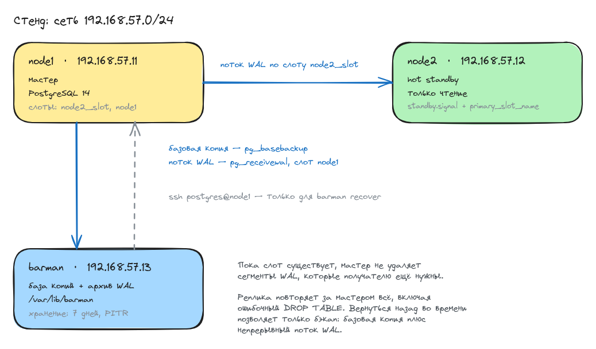

# Домашнее задание: репликация и резервное копирование PostgreSQL

## Задание

- Настроить hot_standby репликацию с использованием слотов.
- Настроить правильное резервное копирование.

## Схема



Исходник схемы - [scheme.excalidraw](scheme.excalidraw), открывается на excalidraw.com
через Open, если понадобится что-то поправить.

Репликация и бэкап здесь решают разные задачи и поэтому дублируют друг друга не полностью.
Реплика даёт горячую копию на сейчас: она отстаёт от мастера на доли секунды, но повторяет
за ним всё, в том числе ошибочный `DROP TABLE`. Бэкап даёт возможность вернуться назад
во времени: базовая копия плюс непрерывный поток WAL позволяют поднять кластер на любой
момент внутри окна хранения.

Оба канала идут через слоты репликации. Слот - это запись на мастере о том, до какого места
получатель дочитал журнал. Пока слот существует, мастер не удаляет сегменты, которые
получателю ещё нужны. Без слота отставшая реплика или недоступный barman просто обнаружат,
что нужного сегмента уже нет, и репликация с архивом сломаются.

## Стенд

Три машины на `bento/ubuntu-22.04`, PostgreSQL 14.23 из репозитория дистрибутива:

| хост   | адрес         | роль                        |
|--------|---------------|-----------------------------|
| node1  | 192.168.57.11 | мастер                      |
| node2  | 192.168.57.12 | реплика (hot standby)       |
| barman | 192.168.57.13 | сервер резервного копирования |

Настройка собрана в ansible, структура ролей взята из методички:

- [Vagrantfile](Vagrantfile) - три ВМ и запуск плейбука
- [hosts](ansible/hosts) - инвентарь: три хоста, ключи берутся из `.vagrant`
- [provision.yml](ansible/provision.yml) - три плея: базовые пакеты, репликация, бэкап

Роль install_postgres:

- [tasks/main.yml](ansible/roles/install_postgres/tasks/main.yml) - установка и запуск postgresql

Роль postgres_replication:

- [defaults/main.yml](ansible/roles/postgres_replication/defaults/main.yml) - адреса, пользователь, пароль, имя слота
- [tasks/main.yml](ansible/roles/postgres_replication/tasks/main.yml) - replicator, конфиги, pg_basebackup со слотом
- [postgresql.conf.j2](ansible/roles/postgres_replication/templates/postgresql.conf.j2) - параметры репликации и пути кластера
- [pg_hba.conf.j2](ansible/roles/postgres_replication/templates/pg_hba.conf.j2) - доступ для replicator и barman

Роль install_barman:

- [defaults/main.yml](ansible/roles/install_barman/defaults/main.yml) - адреса, пользователь barman, имя слота
- [tasks/main.yml](ansible/roles/install_barman/tasks/main.yml) - ssh-ключи, пользователь barman, конфиги
- [barman.conf.j2](ansible/roles/install_barman/templates/barman.conf.j2) - общие настройки barman
- [node1.conf.j2](ansible/roles/install_barman/templates/node1.conf.j2) - описание бекапируемого сервера
- [pgpass.j2](ansible/roles/install_barman/templates/pgpass.j2) - пароль barman к мастеру

Плейбук запускается один раз, провижинером последней машины `barman`, сразу на все хосты
(`ansible.limit = "all"`). Иначе не сработают шаги, которые ходят с одного узла на другой:
реплика тянет базу с мастера, barman раскладывает свой ssh-ключ на мастер.

## Запуск

```bash
vagrant up
```

```
PLAY RECAP *********************************************************************
barman                     : ok=15   changed=9    unreachable=0    failed=0    skipped=7
node1                      : ok=20   changed=14   unreachable=0    failed=0    skipped=18
node2                      : ok=17   changed=11   unreachable=0    failed=0    skipped=21
```

Повторный `vagrant provision` почти ничего не трогает:

```
PLAY RECAP *********************************************************************
barman                     : ok=15   changed=0    unreachable=0    failed=0    skipped=7
node1                      : ok=20   changed=1    unreachable=0    failed=0    skipped=18
node2                      : ok=14   changed=0    unreachable=0    failed=0    skipped=24
```

Единственный `changed` на node1 - это `restart postgresql-server on node1`. В методичке
перезапуск сделан обычной задачей, а не handler'ом, поэтому он отрабатывает всегда
и всегда отчитывается об изменении. Оставил как есть.

## Репликация

### Роли узлов

Мастер не в восстановлении, реплика - в нём:

```shell
vagrant@node1:/tmp$ sudo -u postgres psql -c 'select version();' -c 'select pg_is_in_recovery();'
                                                                 version
------------------------------------------------------------------------------------------------------------------------------------------
 PostgreSQL 14.23 (Ubuntu 14.23-0ubuntu0.22.04.1) on x86_64-pc-linux-gnu, compiled by gcc (Ubuntu 11.4.0-1ubuntu1~22.04.3) 11.4.0, 64-bit
(1 row)

 pg_is_in_recovery
-------------------
 f
(1 row)
```

### Слоты

На мастере два слота, оба активны. `node2_slot` держит сегменты для реплики,
`node1` - для barman:

```shell
vagrant@node1:/tmp$ sudo -u postgres psql -c 'select slot_name, slot_type, active, wal_status, restart_lsn from pg_replication_slots;'
 slot_name  | slot_type | active | wal_status | restart_lsn
------------+-----------+--------+------------+-------------
 node2_slot | physical  | t      | reserved   | 0/5000060
 node1      | physical  | t      | reserved   | 0/5000000
(2 rows)
```

`wal_status = reserved` означает, что все нужные слоту сегменты на месте.

### Кто подключён к мастеру

```shell
vagrant@node1:/tmp$ sudo -u postgres psql -x -c 'select application_name, client_addr, state, sync_state, sent_lsn, replay_lsn from pg_stat_replication;'
-[ RECORD 1 ]----+-------------------
application_name | 14/main
client_addr      | 192.168.57.12
state            | streaming
sync_state       | async
sent_lsn         | 0/5000060
replay_lsn       | 0/5000060
-[ RECORD 2 ]----+-------------------
application_name | barman_receive_wal
client_addr      | 192.168.57.13
state            | streaming
sync_state       | async
sent_lsn         | 0/5000060
replay_lsn       |
```

Две записи: реплика node2 и процесс `pg_receivewal` с сервера barman. У второго пустой
`replay_lsn` - он журнал не проигрывает, а просто складывает в архив.

### Что видит реплика

```shell
vagrant@node2:/tmp$ sudo -u postgres psql -c 'select pg_is_in_recovery();' -x -c 'select status, slot_name, sender_host, sender_port from pg_stat_wal_receiver;'
-[ RECORD 1 ]-----+--
pg_is_in_recovery | t

-[ RECORD 1 ]--------------
status      | streaming
slot_name   | node2_slot
sender_host | 192.168.57.11
sender_port | 5432
```

Реплика знает, что читает мастер именно через слот `node2_slot`.

### Как реплика узнала про мастер

`recovery.conf` не существует начиная с PostgreSQL 12. Вместо него параметры пишутся
в `postgresql.auto.conf`, а сам режим реплики включается наличием файла `standby.signal`.
Оба создал `pg_basebackup` с ключом `-R`:

```shell
vagrant@node2:/tmp$ sudo cat /var/lib/postgresql/14/main/postgresql.auto.conf
# Do not edit this file manually!
# It will be overwritten by the ALTER SYSTEM command.
primary_conninfo = 'user=replicator password=''Otus2022!'' channel_binding=prefer host=192.168.57.11 port=5432 sslmode=prefer sslcompression=0 sslsni=1 ssl_min_protocol_version=TLSv1.2 gssencmode=prefer krbsrvname=postgres target_session_attrs=any'
primary_slot_name = 'node2_slot'
vagrant@node2:/tmp$ sudo ls -l /var/lib/postgresql/14/main/standby.signal
-rw------- 1 postgres postgres 0 Aug 12 10:46 /var/lib/postgresql/14/main/standby.signal
```

`primary_slot_name` в файле есть - значит реплика подключается к мастеру через слот,
как и требует задание.

### Данные доезжают

Пишем на мастере:

```shell
vagrant@node1:/tmp$ sudo -u postgres psql -d otus -c "insert into test values (1,'alex'),(2,'boris'),(3,'clara');" -c 'select * from test;'
INSERT 0 3
 id | name
----+-------
  1 | alex
  2 | boris
  3 | clara
(3 rows)
```

Читаем на реплике:

```shell
vagrant@node2:/tmp$ sudo -u postgres psql -d otus -c 'select * from test;'
 id | name
----+-------
  1 | alex
  2 | boris
  3 | clara
(3 rows)
```

Записать в реплику нельзя, `hot_standby` даёт только чтение:

```shell
vagrant@node2:/tmp$ sudo -u postgres psql -d otus -c "insert into test values (4,'dmitry');"
ERROR:  cannot execute INSERT in a read-only transaction
```

## Резервное копирование

Бэкап делает barman с отдельного хоста. Схема такая:

- базовая копия снимается через `pg_basebackup` по репликационному подключению
  (`backup_method = postgres`), ssh на мастер для этого не нужен;
- WAL забирается непрерывно через `pg_receivewal` (`streaming_archiver = on`),
  а не через `archive_command`. Сегмент уезжает на barman по мере заполнения,
  а не после закрытия, поэтому окно потери данных - это последние записанные байты,
  а не последние 16 МБ;
- удерживает сегменты слот `node1`, `create_slot = auto` создаёт его сам;
- политика хранения `RECOVERY WINDOW OF 7 days` в режиме `auto`: barman сам удаляет копии
  и WAL, вышедшие за окно, но `minimum_redundancy = 1` не даёт остаться совсем без копий.

Именно связка «базовая копия + непрерывный WAL» и делает копирование правильным:
из одной только базовой копии можно вернуться лишь на момент её снятия, а с журналом -
на любую точку внутри окна.

### Проверка до первого бекапа

```shell
barman@barman:/tmp$ barman check node1
Server node1:
	PostgreSQL: OK
	superuser or standard user with backup privileges: OK
	PostgreSQL streaming: OK
	wal_level: OK
	replication slot: OK
	directories: OK
	retention policy settings: OK
	backup maximum age: FAILED (interval provided: 4 days, latest backup age: No available backups)
	backup minimum size: OK (0 B)
	wal maximum age: OK (no last_wal_maximum_age provided)
	wal size: OK (0 B)
	compression settings: OK
	failed backups: OK (there are 0 failed backups)
	minimum redundancy requirements: FAILED (have 0 backups, expected at least 1)
	pg_basebackup: OK
	pg_basebackup compatible: OK
	pg_basebackup supports tablespaces mapping: OK
	systemid coherence: OK (no system Id stored on disk)
	pg_receivexlog: OK
	pg_receivexlog compatible: OK
	receive-wal running: OK
	archiver errors: OK
```

Два FAILED ожидаемы: копий ещё нет, поэтому не выполняются требования по возрасту копии
и по минимальной избыточности. Всё остальное, включая слот и запущенный `receive-wal`, - OK.

### Первая копия

```shell
barman@barman:/tmp$ barman backup node1
Starting backup using postgres method for server node1 in /var/lib/barman/node1/base/20260812T104941
Backup start at LSN: 0/5000190 (000000010000000000000005, 00000190)
Starting backup copy via pg_basebackup for 20260812T104941
Copy done (time: less than one second)
Finalising the backup.
WARNING: pg_basebackup does not copy the PostgreSQL configuration files that reside outside PGDATA. Please manually backup the following files:
	/etc/postgresql/14/main/postgresql.conf
	/etc/postgresql/14/main/pg_hba.conf
	/etc/postgresql/14/main/pg_ident.conf

This is the first backup for server node1
WAL segments preceding the current backup have been found:
	000000010000000000000003 from server node1 has been removed
	000000010000000000000004 from server node1 has been removed
Backup size: 33.6 MiB
Backup end at LSN: 0/7000000 (000000010000000000000006, 00000000)
Backup completed (start time: 2026-08-12 10:49:41.333170, elapsed time: less than one second)
Processing xlog segments from streaming for node1
	000000010000000000000005
WARNING: IMPORTANT: this backup is classified as WAITING_FOR_WALS, meaning that Barman has not received yet all the required WAL files for the backup consistency.
```

Копия сразу после снятия в статусе `WAITING_FOR_WALS`: barman ещё не получил все сегменты,
нужные для её консистентности. Статус станет `DONE`, когда текущий сегмент закроется
и уедет в архив - это делает `barman cron` раз в минуту из `/etc/cron.d/barman`.

Предупреждение про конфиги важное и относится к самой схеме, а не к ошибке: `pg_basebackup`
копирует только каталог данных, а в Debian и Ubuntu конфиги лежат в `/etc`. Ниже при
восстановлении это вылезает наглядно.

### Проверка после бекапа

```shell
barman@barman:/tmp$ barman check node1
Server node1:
	PostgreSQL: OK
	superuser or standard user with backup privileges: OK
	PostgreSQL streaming: OK
	wal_level: OK
	replication slot: OK
	directories: OK
	retention policy settings: OK
	backup maximum age: OK (interval provided: 4 days, latest backup age: 47 seconds)
	backup minimum size: OK (33.6 MiB)
	wal maximum age: OK (no last_wal_maximum_age provided)
	wal size: OK (0 B)
	compression settings: OK
	failed backups: OK (there are 0 failed backups)
	minimum redundancy requirements: OK (have 1 backups, expected at least 1)
	pg_basebackup: OK
	pg_basebackup compatible: OK
	pg_basebackup supports tablespaces mapping: OK
	systemid coherence: OK
	pg_receivexlog: OK
	pg_receivexlog compatible: OK
	receive-wal running: OK
	archiver errors: OK
```

Все пункты OK.

```shell
barman@barman:/tmp$ barman status node1
Server node1:
	Description: backup node1
	Active: True
	Disabled: False
	PostgreSQL version: 14.23
	Cluster state: in production
	pgespresso extension: Not available
	Current data size: 33.9 MiB
	PostgreSQL Data directory: /var/lib/postgresql/14/main
	Current WAL segment: 000000010000000000000008
	Passive node: False
	Retention policies: enforced (mode: auto, retention: RECOVERY WINDOW OF 7 DAYS, WAL retention: MAIN)
	No. of available backups: 1
	First available backup: 20260812T104941
	Last available backup: 20260812T104941
	Minimum redundancy requirements: satisfied (1/1)
```

## Восстановление

Бэкап, из которого ни разу не восстанавливались, бэкапом считать нельзя, поэтому проверяю
его целиком. Сценарий такой: после снятия копии дописываю строки, ставлю именованную точку,
роняю таблицу и восстанавливаюсь на момент до падения.

Дописываем данные уже **после** базовой копии - в самой копии их нет, они существуют
только в WAL. И ставим точку, на которую потом будем восстанавливаться:

```shell
vagrant@node1:/tmp$ sudo -u postgres psql -d otus -c "insert into test values (4,'dmitry'),(5,'elena');" -c "select pg_create_restore_point('before_drop');"
INSERT 0 2
 pg_create_restore_point
-------------------------
 0/70002A0
(1 row)
```

Роняем таблицу:

```shell
vagrant@node1:/tmp$ sudo -u postgres psql -d otus -c 'drop table test;' -c '\dt'
DROP TABLE
Did not find any relations.
```

Закрываем текущий сегмент и забираем его в архив, иначе последние события останутся
в незакрытом сегменте на мастере:

```shell
barman@barman:/tmp$ barman switch-wal --force node1 && barman cron
The WAL file 000000010000000000000007 has been closed on server 'node1'
Starting WAL archiving for server node1
Starting check-backup for backup 20260812T104941 of server node1
```

Восстанавливаем на точку `before_drop`. Кладу копию в отдельный каталог, а не поверх боевого
каталога данных: так исходный кластер остаётся жив и репликация на node2 не ломается.

```shell
barman@barman:/tmp$ barman recover --target-name before_drop --target-action promote \
    --remote-ssh-command 'ssh postgres@192.168.57.11' \
    node1 20260812T104941 /var/lib/postgresql/14/restore
Starting remote restore for server node1 using backup 20260812T104941
Destination directory: /var/lib/postgresql/14/restore
Remote command: ssh postgres@192.168.57.11
Doing PITR. Recovery target name: 'before_drop'
Copying the base backup.
Copying required WAL segments.
Generating recovery configuration
Identify dangerous settings in destination directory.

WARNING
The following configuration files have not been saved during backup, hence they have not been restored.
You need to manually restore them in order to start the recovered PostgreSQL instance:

    postgresql.conf
    pg_hba.conf
    pg_ident.conf

Recovery completed (start time: 2026-08-12 10:51:04.223695, elapsed time: 3 seconds)

Your PostgreSQL server has been successfully prepared for recovery!
```

Конфигов в копии нет, о чём barman и предупреждал: они лежат в `/etc`, а `pg_basebackup`
забирает только каталог данных. Для восстановленного экземпляра хватает минимальных,
поднимаем его рядом с боевым, на порту 5433:

```shell
vagrant@node1:/tmp$ sudo -u postgres bash -c "
    printf \"port = 5433\nunix_socket_directories = '/tmp'\nhot_standby = on\n\" > /var/lib/postgresql/14/restore/postgresql.conf
    printf 'local   all   all   trust\n' > /var/lib/postgresql/14/restore/pg_hba.conf
    /usr/lib/postgresql/14/bin/pg_ctl -D /var/lib/postgresql/14/restore -l /var/lib/postgresql/14/restore/restore.log start"
waiting for server to start.... done
server started
```

Параметры восстановления barman сгенерировал сам:

```shell
vagrant@node1:/tmp$ sudo grep -E 'recovery_target|restore_command' /var/lib/postgresql/14/restore/postgresql.auto.conf
restore_command = 'cp barman_wal/%f %p'
recovery_target_name = 'before_drop'
recovery_target_action = 'promote'
```

Смотрим данные. В восстановленном экземпляре таблица на месте, причём со **всеми пятью**
строками - две последние в базовую копию не попадали и приехали из WAL:

```shell
vagrant@node1:/tmp$ sudo -u postgres /usr/lib/postgresql/14/bin/psql -h /tmp -p 5433 -d otus -c 'select * from test;'
 id |  name
----+--------
  1 | alex
  2 | boris
  3 | clara
  4 | dmitry
  5 | elena
(5 rows)
```

В боевом экземпляре её по-прежнему нет:

```shell
vagrant@node1:/tmp$ sudo -u postgres psql -d otus -c 'select * from test;'
ERROR:  relation "test" does not exist
LINE 1: select * from test;
                      ^
```

Восстановление на точку во времени отработало: вернулись ровно к состоянию перед `DROP TABLE`,
не потеряв данные, записанные после снятия копии.

Гасим временный экземпляр и убеждаемся, что стенд не пострадал - оба слота активны,
оба получателя стримят, реплика по-прежнему реплика:

```shell
vagrant@node1:/tmp$ sudo -u postgres psql -c 'select slot_name, active, wal_status from pg_replication_slots;' -c 'select application_name, state from pg_stat_replication;'
 slot_name  | active | wal_status
------------+--------+------------
 node2_slot | t      | reserved
 node1      | t      | reserved
(2 rows)

  application_name  |   state
--------------------+-----------
 14/main            | streaming
 barman_receive_wal | streaming
(2 rows)
```

```shell
vagrant@node2:/tmp$ sudo -u postgres psql -d otus -c '\dt' -c 'select pg_is_in_recovery();'
Did not find any relations.
 pg_is_in_recovery
-------------------
 t
(1 row)
```

Таблицы на реплике нет - `DROP TABLE` доехал до неё вместе с остальным журналом. Это ровно
та причина, по которой реплика не заменяет бэкап.

## Отличия от методички

Плейбук повторяет методичку по структуре: те же три роли, те же имена задач, те же конфиги.
Отступил в пяти местах.

**Слот для реплики.** Задание называется «репликация с использованием слотов», но в методичке
`pg_basebackup` вызывается как `pg_basebackup -h ... -U ... -R -P`, а `primary_slot_name`
нигде не выставляется. Слот при этом не создаётся, и репликация получается обычная,
без слотов. Добавил ключи `-C -S node2_slot`: `-C` создаёт слот на мастере,
а `-R` вместе с ним пишет `primary_slot_name` в `postgresql.auto.conf`.

**Расположение файлов кластера.** Методичка предлагает заменить `postgresql.conf` целиком
содержимым из своего листинга. В Debian и Ubuntu так нельзя: в штатном конфиге прописаны
`data_directory`, `hba_file`, `unix_socket_directories` и прочие пути, а `pg_ctlcluster`
берёт каталог данных именно оттуда. Без этих строк кластер просто не стартует.
Добавил их в начало шаблона.

**`path_prefix`.** В методичке `/usr/pgsql-14/bin/` - это путь из сборки для RHEL.
На Ubuntu утилиты лежат в `/usr/lib/postgresql/14/bin`, иначе barman не найдёт
`pg_basebackup` и `pg_receivewal`.

**Разрешения для barman в `pg_hba.conf`.** В методичке файл целиком раскладывается шаблоном
из роли `postgres_replication`, а роль `install_barman` потом дописывает в него две строки
через `lineinfile`. Две роли правят один файл, и на каждом прогоне плейбука они отменяют
работу друг друга: шаблон затирает строки barman, `lineinfile` возвращает их обратно,
и оба хоста бесконечно перезапускают postgres. Перенёс строки barman в сам шаблон,
`lineinfile` убрал.

**Имена пакетов.** `python3-pexpect.noarch` из методички - это имя в терминах rpm,
apt такой пакет не находит. Ставится как `python3-pexpect`. Точно так же служба
называется `postgresql`, а не `postgresql-14`.

Что оставил как в методичке, хотя сделал бы иначе: `timezone = 'UTC+3'` (в POSIX-нотации
знак инвертирован, эта запись означает UTC-3, то есть время уезжает на шесть часов -
правильно было бы `Europe/Moscow`) и пользователь `barman` с правами `SUPERUSER`
(ему хватило бы `REPLICATION` плюс `pg_read_all_settings`, `pg_read_all_stats` и `EXECUTE`
на четыре служебные функции - учётка ходит на мастер по сети с паролем в файле).

## На чём споткнулся

**Ansible и `become_user: postgres`.** Первый же прогон упал на создании пользователя
`replicator`:

```
fatal: [node1]: FAILED! => {"msg": "Failed to set permissions on the temporary files Ansible
needs to create when becoming an unprivileged user (rc: 1, err: chmod: invalid mode:
'A+user:postgres:rx:allow')"}
```

Сообщение уводит в сторону: похоже на проблему с ACL-синтаксисом, а на деле в боксе просто
нет пакета `acl`. Ansible при переходе `root` → `postgres` кладёт временный файл модуля
в `/tmp` и раздаёт на него права через `setfacl`; без `acl` он откатывается на `chmod`
с синтаксисом от Solaris и падает. Добавил `acl` в базовые пакеты первого плея.

**`barman recover` и ключ хоста.** Восстановление падало на ровном месте:

```
ERROR: Unable to connect to the target host using the command 'ssh postgres@192.168.57.11'
```

Ключ был разложен и `ssh` руками работал. Дело в том, что хост подключался впервые,
ssh спрашивал про отпечаток, а barman запускает команду без терминала и видит только
ненулевой код возврата. `ssh_command` с `StrictHostKeyChecking=accept-new` из `node1.conf`
тут не помогает: `barman recover` использует собственный `--remote-ssh-command`.
Добавил в роль задачу, которая забирает ключ хоста через `ssh-keyscan` и кладёт его
в `known_hosts` пользователя barman.

**Повторный запуск плейбука.** `pg_basebackup` в методичке выполняется безусловно, вместе
с удалением каталога данных. На втором прогоне это не только переливает базу заново,
но и падает: слот `node2_slot` на мастере уже существует, а `-C` пытается создать его
ещё раз. Обернул инициализацию реплики проверкой на наличие `standby.signal` - если
кластер уже реплика, шаги пропускаются.

**Статус копии `WAITING_FOR_WALS`.** Сразу после `barman backup` копия не считается готовой,
и `barman check` показывает `minimum redundancy requirements: FAILED`, хотя копия вроде бы
есть. Нужно дождаться, пока закроется и уедет в архив текущий сегмент WAL. В стенде это
ускоряется через `barman switch-wal --force node1 && barman cron`, в жизни за этим следит
`/etc/cron.d/barman`, который пакет ставит сам и который дёргает `barman cron` раз в минуту.
