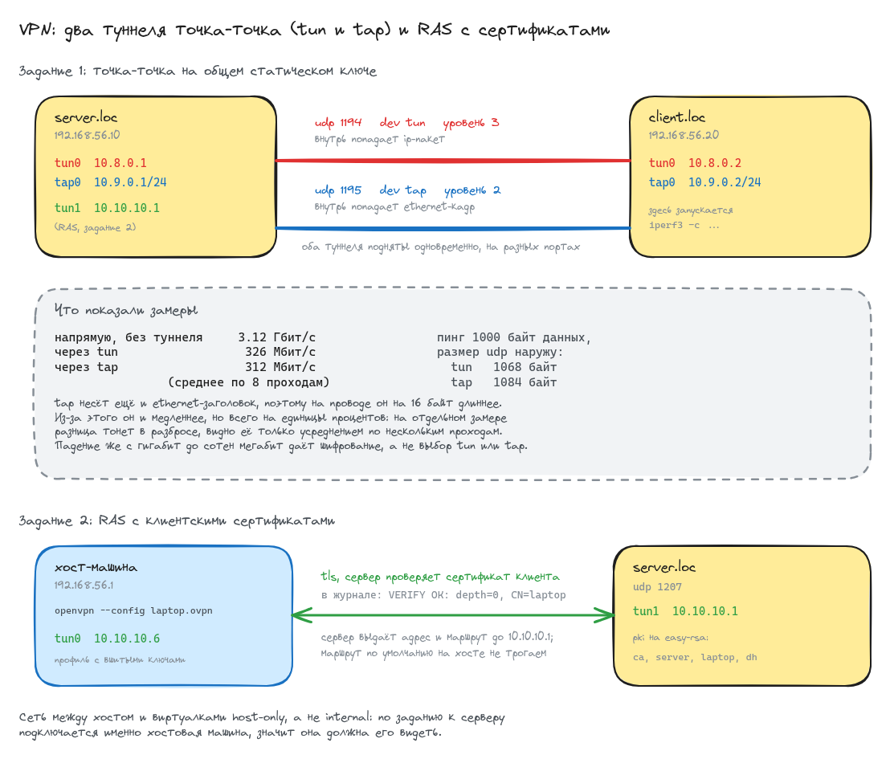

# Домашнее задание: VPN

## Задание

- Настроить VPN между двумя ВМ в режимах tun и tap, замерить скорость в туннелях
  и сделать вывод об отличающихся показателях.
- Поднять RAS на базе OpenVPN с клиентскими сертификатами, подключиться
  с локальной машины на ВМ.

## Схема



## Стенд

Две виртуалки на `bento/ubuntu-22.04`.

| машина | адрес | роль |
|--------|-------|------|
| server | 192.168.56.10 | оба конца туннелей «точка-точка» плюс RAS, здесь же сервер iperf3 |
| client | 192.168.56.20 | второй конец туннелей, отсюда идут замеры |

Сеть между ними host-only, а не internal. По второму пункту задания к VPN-серверу
подключается именно хостовая машина, значит она должна его видеть, поэтому
адаптер выведен на хост.

Файлы:

- [Vagrantfile](Vagrantfile) - две ВМ на общей host-only сети
- [provision.yml](ansible/provision.yml) - весь плейбук
- [group_vars/all.yml](ansible/group_vars/all.yml) - адресация, порты и описание обоих туннелей
- [p2p.conf.j2](ansible/templates/p2p.conf.j2) - шаблон туннеля «точка-точка», общий для tun и tap
- [ras.conf.j2](ansible/templates/ras.conf.j2) - шаблон RAS
- [client.ovpn.j2](ansible/templates/client.ovpn.j2) - профиль для хост-машины с вшитыми ключами
- [iperf3-server.service.j2](ansible/templates/iperf3-server.service.j2) - юнит сервера iperf3
- [.gitignore](.gitignore) - закрывает каталог с профилем, в нём приватный ключ

## Запуск

```bash
vagrant up
```

```
PLAY RECAP *********************************************************************
client                     : ok=7    changed=4    unreachable=0    failed=0    skipped=0
server                     : ok=20   changed=14   unreachable=0    failed=0    skipped=0
```

Повторный `vagrant provision` не трогает ничего:

```
PLAY RECAP *********************************************************************
client                     : ok=7    changed=0    unreachable=0    failed=0    skipped=0
server                     : ok=19   changed=0    unreachable=0    failed=0    skipped=1
```

Пропущенная задача - `daemon_reload`, она выполняется только когда поменялся юнит.

## Задание 1: туннели tun и tap

Оба туннеля описаны данными в [group_vars/all.yml](ansible/group_vars/all.yml)
и подняты одновременно на разных портах:

```yaml
p2p_tunnels:
  - name: p2p-tun
    dev: tun
    port: 1194
    server_addr: 10.8.0.1
    client_addr: 10.8.0.2
  - name: p2p-tap
    dev: tap
    port: 1195
    server_addr: 10.9.0.1
    client_addr: 10.9.0.2
    netmask: 255.255.255.0
```

В методичке предлагается настроить туннель, замерить, потом переделать конфигурацию
под другой режим и замерить снова. Так сравнивать неудобно: между замерами проходит
время, на хосте успевает поменяться нагрузка, и непонятно, чем вызвана разница.
Здесь туннели живут параллельно, и любой замер можно повторить в обоих режимах подряд.

Конфигурации собираются одним шаблоном - разница между режимами ровно в двух местах:
в `dev` и в форме `ifconfig`.

```shell
root@server:~# grep -vE '^\s*#|^\s*$' /etc/openvpn/p2p-tun.conf
dev tun
proto udp
port 1194
ifconfig 10.8.0.1 10.8.0.2
secret /etc/openvpn/static.key
persist-key
persist-tun
keepalive 10 60
log-append /var/log/openvpn/p2p-tun.log
verb 3

root@server:~# grep -vE '^\s*#|^\s*$' /etc/openvpn/p2p-tap.conf
dev tap
proto udp
port 1195
ifconfig 10.9.0.1 255.255.255.0
secret /etc/openvpn/static.key
persist-key
persist-tun
keepalive 10 60
log-append /var/log/openvpn/p2p-tap.log
verb 3
```

Форма `ifconfig` отличается не случайно. У `tun` это чистая точка-точка на третьем
уровне: указываем свой адрес и адрес соседа. У `tap` интерфейс ведёт себя как
обычный ethernet, соседей на нём может быть много, поэтому задаётся адрес с маской.

Ключ общий, PKI здесь не нужен: точка-точка на статическом ключе. Ключ генерируется
на сервере и переносится на клиента через `slurp` и `copy`, файлов в репозитории не остаётся.

Оба туннеля поднялись:

```shell
root@server:~# systemctl is-active openvpn@p2p-tun openvpn@p2p-tap
active
active

root@server:~# ip -br addr show tun0
tun0             UNKNOWN        10.8.0.1 peer 10.8.0.2/32 fe80::f374:d102:4b94:c0d6/64
root@server:~# ip -br addr show tap0
tap0             UNKNOWN        10.9.0.1/24 fe80::a437:a8ff:feee:4ce8/64
```

Разница между режимами видна прямо в свойствах интерфейсов:

```shell
root@server:~# ip -d link show tun0 | head -2
4: tun0: <POINTOPOINT,MULTICAST,NOARP,UP,LOWER_UP> mtu 1500 qdisc fq_codel state UNKNOWN mode DEFAULT group default qlen 500
    link/none  promiscuity 0 minmtu 68 maxmtu 65535

root@server:~# ip -d link show tap0 | head -2
5: tap0: <BROADCAST,MULTICAST,UP,LOWER_UP> mtu 1500 qdisc fq_codel state UNKNOWN mode DEFAULT group default qlen 1000
    link/ether 06:e5:7d:7a:eb:5b brd ff:ff:ff:ff:ff:ff promiscuity 0 minmtu 68 maxmtu 65521
```

У `tun` нет ни MAC-адреса (`link/none`), ни ARP (`NOARP`), ни широковещания -
в него попадают уже готовые IP-пакеты, канальный уровень ему не нужен.
У `tap` есть и MAC, и `BROADCAST`: это полноценный виртуальный ethernet.

Связность есть в обоих:

```shell
root@client:~# ping -c2 10.8.0.1 | tail -2
2 packets transmitted, 2 received, 0% packet loss, time 1029ms
rtt min/avg/max/mdev = 0.623/0.693/0.763/0.070 ms

root@client:~# ping -c2 10.9.0.1 | tail -2
2 packets transmitted, 2 received, 0% packet loss, time 1020ms
rtt min/avg/max/mdev = 0.653/0.706/0.759/0.053 ms
```

## Замеры скорости

На сервере постоянно работает `iperf3` в режиме сервера, замеры идут с клиента.
Сначала база - скорость по той же физической сети, но мимо туннеля:

```shell
root@client:~# iperf3 -c 192.168.56.10 -t 20 | grep -E "sender|receiver"
[  5]   0.00-20.00  sec  7.27 GBytes  3.12 Gbits/sec  61668             sender
[  5]   0.00-20.04  sec  7.27 GBytes  3.12 Gbits/sec                  receiver
```

Теперь через туннели:

```shell
root@client:~# iperf3 -c 10.8.0.1 -t 20 | grep -E "sender|receiver"
[  5]   0.00-20.00  sec   805 MBytes   338 Mbits/sec  911             sender
[  5]   0.00-20.04  sec   804 MBytes   336 Mbits/sec                  receiver

root@client:~# iperf3 -c 10.9.0.1 -t 20 | grep -E "sender|receiver"
[  5]   0.00-20.00  sec   802 MBytes   337 Mbits/sec  615             sender
[  5]   0.00-20.05  sec   802 MBytes   335 Mbits/sec                  receiver
```

По одному замеру вывод сделать нельзя: 336 против 335 - это разброс, а не разница.
Поэтому прогнал восемь чередующихся проходов по десять секунд, чтобы оба режима
попадали в одни и те же условия:

```
проход  tun      tap
     1  328      264
     2  310      284
     3  308      318
     4  325      319
     5  333      326
     6  333      327
     7  341      335
     8  330      325

среднее  tun 326.0  tap 312.2  Мбит/с, tap медленнее на 4.2%
```

| канал | скорость |
|-------|----------|
| напрямую, без туннеля | 3.12 Гбит/с |
| tun | 326 Мбит/с в среднем по восьми проходам |
| tap | 312 Мбит/с в среднем по восьми проходам |

Разброс между проходами заметный, местами он больше самой разницы между режимами
(проход 3 tap даже быстрее). Но направление устойчивое: tap оказался медленнее
в семи проходах из восьми.

Чтобы разница не осталась просто числами, посмотрел, что реально уходит на провод.
Пингуем через каждый туннель пакетом с 1000 байт полезной нагрузки и ловим
`tcpdump` наружную датаграмму:

```shell
root@client:~# tcpdump -ni eth1 -c 1 'udp port 1194 and greater 500'
16:02:33.473622 IP 192.168.56.20.44350 > 192.168.56.10.1194: UDP, length 1068

root@client:~# tcpdump -ni eth1 -c 1 'udp port 1195 and greater 500'
16:02:36.512225 IP 192.168.56.20.37841 > 192.168.56.10.1195: UDP, length 1084
```

**Вывод.** Внутри туннеля данные одни и те же, а наружу tap отправляет на 16 байт
больше: он заворачивает целый ethernet-кадр вместе с канальным заголовком, а tun -
только IP-пакет. Это и есть причина разницы в замерах. Отставание tap невелико,
единицы процентов, и на отдельном замере тонет в разбросе - увидеть его удаётся
только усреднением по нескольким чередующимся проходам.

Гораздо заметнее другое: любой туннель уронил скорость с 3.1 Гбит/с до примерно
320 Мбит/с, почти в десять раз. Это не про выбор режима, а про то, что весь трафик
уходит в userspace, шифруется и возвращается обратно в ядро. Упираемся в процессор,
а не в размер пакета - поэтому 16 лишних байт почти ничего и не меняют.

Отсюда практический смысл выбора: брать tap стоит не ради скорости, а когда нужен
именно второй уровень - широковещание, ARP, не-IP протоколы, объединение сегментов
в один broadcast-домен. Если хватает маршрутизации, tun дешевле: меньше заголовок
и в туннель не лезет служебный L2-трафик. На здешнем виртуальном линке между двумя
машинами одного хоста это единицы процентов, но на реальном канале с мелкими пакетами
лишние 16 байт на кадр весят куда больше: у пакета в 64 байта это уже четверть.

Сжатие намеренно выключено, хотя в методичке стоит `comp-lzo`. Со сжатием замер
теряет смысл: `iperf3` гонит однообразные данные, они ужимаются в разы, и вместо
пропускной способности туннеля получаются цифры работы компрессора. Плюс `comp-lzo`
объявлен устаревшим и выброшен в OpenVPN 2.6.

## Задание 2: RAS с клиентскими сертификатами

PKI делается на easy-rsa 3 прямо на сервере: корневой сертификат, сертификат
сервера, сертификат клиента и параметры Диффи-Хеллмана.

```yaml
- name: Выпустить сертификат сервера
  command: "{{ easyrsa }} build-server-full server nopass"
  args:
    chdir: "{{ ras_dir }}"
    creates: "{{ ras_dir }}/pki/issued/server.crt"
  environment: *easyrsa_env
```

Два отличия от методички. Первое: интерактивные вопросы гасятся переменной
`EASYRSA_BATCH`, а не `echo` в пайп - подстановка ответов пайпом ломается,
стоит поменяться числу или порядку вопросов. Второе: `build-server-full`
и `build-client-full` делают запрос и подпись одним шагом вместо пары
`gen-req` плюс `sign-req`. Каждая задача закрыта `creates:`, поэтому
повторный прогон ничего не перевыпускает.

Конфигурация RAS:

```shell
root@server:~# grep -vE '^\s*#|^\s*$' /etc/openvpn/ras.conf
port 1207
proto udp
dev tun
ca   /etc/openvpn/ras/pki/ca.crt
cert /etc/openvpn/ras/pki/issued/server.crt
key  /etc/openvpn/ras/pki/private/server.key
dh   /etc/openvpn/ras/pki/dh.pem
server 10.10.10.0 255.255.255.0
remote-cert-tls client
keepalive 10 120
persist-key
persist-tun
user nobody
group nogroup
log-append /var/log/openvpn/ras.log
verb 3
```

Сервер работает третьим туннелем, рядом с двумя из первого задания:

```shell
root@server:~# ip -br addr show type tun | awk '{print $1, $3}'
tun0 10.8.0.1
tap0 10.9.0.1/24
tun1 10.10.10.1
```

Для хоста плейбук собирает готовый профиль: сертификаты и ключ вшиты внутрь
блоками `<ca>`, `<cert>`, `<key>`, отдельные файлы носить не нужно.
Профиль забирается на хост-машину в каталог `client/`, который закрыт
от git - внутри приватный ключ клиента.

```
### Управляется ansible. Готовый профиль для подключения с хост-машины.
client
dev tun
proto udp
remote 192.168.56.10 1207
resolv-retry infinite
nobind
persist-key
persist-tun
remote-cert-tls server
verb 3
<ca> ... </ca>
<cert> ... </cert>
<key> ... </key>
```

`remote-cert-tls` стоит с обеих сторон и в разных значениях: клиент требует
от сервера сертификат с назначением «сервер», сервер от клиента - «клиент».
Без этого владелец любого клиентского сертификата того же центра сертификации
смог бы притвориться сервером для других клиентов.

### Подключение с хост-машины

```shell
$ sudo openvpn --config client/laptop.ovpn
```

```
VERIFY OK: depth=0, CN=server
[server] Peer Connection Initiated with [AF_INET]192.168.56.10:1207
PUSH: Received control message: 'PUSH_REPLY,route 10.10.10.1,topology net30,ping 10,ping-restart 120,ifconfig 10.10.10.6 10.10.10.5,peer-id 0,cipher AES-256-GCM'
net_addr_ptp_v4_add: 10.10.10.6 peer 10.10.10.5 dev tun0
net_route_v4_add: 10.10.10.1/32 via 10.10.10.5 dev [NULL] table 0 metric -1
Initialization Sequence Completed
```

Хост получил адрес в туннеле и маршрут до сервера:

```shell
$ ip -br addr show tun0
tun0             UNKNOWN        10.10.10.6 peer 10.10.10.5/32 fe80::571a:421c:b1e0:b2d0/64

$ ip route show | grep 10.10.10
10.10.10.1 via 10.10.10.5 dev tun0
10.10.10.5 dev tun0 proto kernel scope link src 10.10.10.6
```

Маршрут по умолчанию при этом остался прежним - сервер отдаёт только маршрут
до своей стороны туннеля, весь остальной трафик хоста через VPN не заворачивается:

```shell
$ ip route show default
default via 192.168.1.1 dev wlp195s0 proto dhcp src 192.168.1.29 metric 20600
```

Связь есть:

```shell
$ ping -c3 10.10.10.1 | tail -2
3 packets transmitted, 3 received, 0% packet loss, time 2083ms
rtt min/avg/max/mdev = 0.525/0.584/0.665/0.059 ms
```

Со стороны сервера видно, что клиент пущен именно по сертификату - в журнале
имя из сертификата, и оно же в списке подключённых:

```shell
root@server:~# grep "VERIFY OK: depth=0" /var/log/openvpn/ras.log | tail -1
192.168.56.1:34707 VERIFY OK: depth=0, CN=laptop

root@server:~# sed -n '/CLIENT LIST/,/ROUTING/p' /run/openvpn/ras.status
OpenVPN CLIENT LIST
Updated,2026-08-16 16:00:08
Common Name,Real Address,Bytes Received,Bytes Sent,Connected Since
laptop,192.168.56.1:34707,8700,3433,2026-08-16 15:59:44
ROUTING TABLE
```

## Что не сработало сразу

Первый прогон поднял на клиенте только `tun0`, а `p2p-tap` остался в
`activating`. В журнале:

```
TCP/UDP: Socket bind failed on local address [AF_INET][undef]:1194: Address already in use (errno=98)
```

Порты у туннелей разные - 1194 и 1195, но это порты сервера. Клиент по умолчанию
занимает ещё и локальный порт, равный порту подключения по умолчанию, и оба
клиентских процесса полезли на один и тот же 1194. Лечится `nobind` в клиентской
части шаблона: тогда исходящий порт берётся случайный.

Вторая мелочь: `status` в конфигурацию класть нельзя. Штатный юнит
`openvpn@.service` в Ubuntu уже передаёт `--status` аргументом, а повтор
директивы OpenVPN не принимает и падает при старте.


