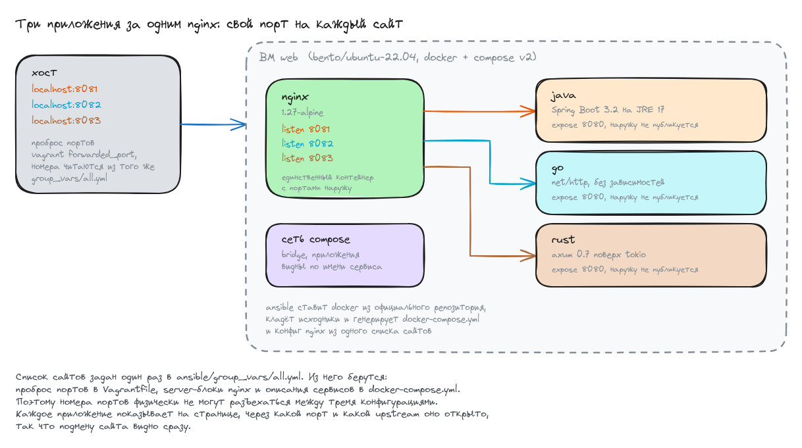
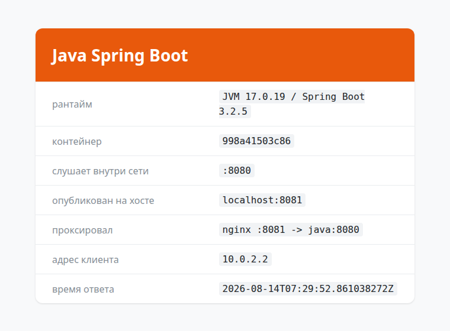
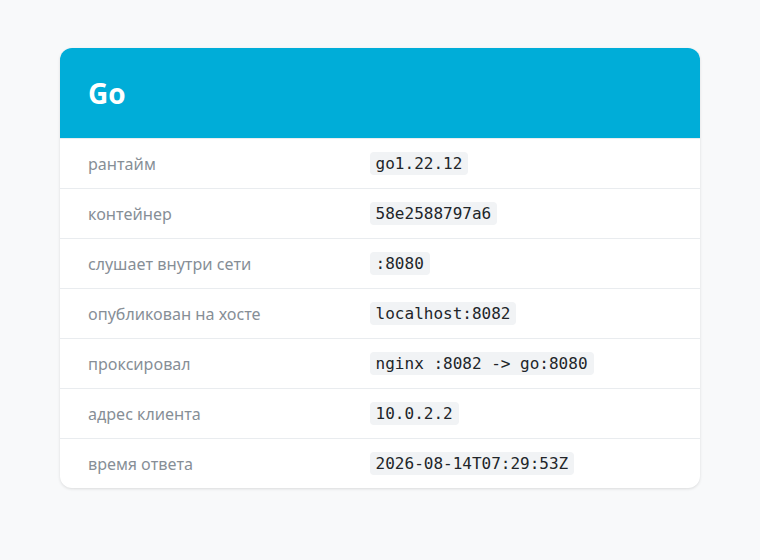
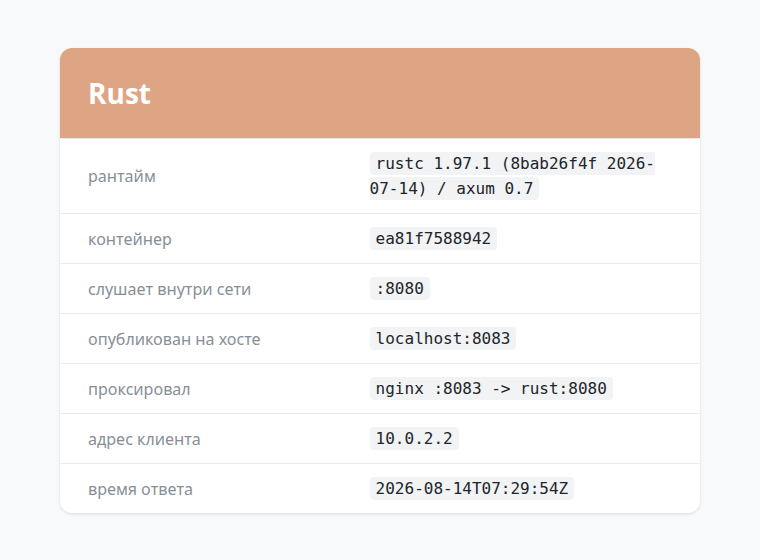

# Домашнее задание: развертывание веб приложения

## Задание

Поднять стенд из nginx и трёх приложений на разных языках, развернуть его через
docker-compose. К сдаче принимается vagrant-стенд с проброшенными на localhost
портами, каждый порт на свой сайт, всё через nginx. Формат сдачи - vagrant + ansible.

Из вариантов методички взял «свою комбинацию»: **Java Spring Boot + Go + Rust**.

| порт на хосте | сайт | стек |
|---------------|------|------|
| localhost:8081 | Java Spring Boot | Spring Boot 3.2 на JRE 17 |
| localhost:8082 | Go | `net/http`, без внешних зависимостей |
| localhost:8083 | Rust | axum 0.7 поверх tokio |

## Схема




## Как это устроено

Одна виртуальная машина, внутри четыре контейнера: nginx и три приложения.
Наружу опубликован **только nginx** - он слушает три порта и на каждом отдаёт
своё приложение. Сами приложения объявлены через `expose` и доступны лишь
внутри сети compose по имени сервиса.

Список сайтов задан один раз, в [ansible/group_vars/all.yml](ansible/group_vars/all.yml). Из него берутся:
- проброс портов в `Vagrantfile` (он читает тот же yaml через `YAML.load_file`);
- `server`-блоки в конфиге nginx;
- описания сервисов в `docker-compose.yml`.

Поэтому номера портов физически не могут разъехаться между тремя конфигурациями.
Чтобы добавить четвёртый сайт, достаточно дописать пункт в список и положить каталог с `Dockerfile`.

```yaml
sites:
  - name: java
    title: Java Spring Boot
    port: 8081
    upstream: "java:8080"
  ...
```

## Состав репозитория

- [Vagrantfile](Vagrantfile) - одна ВМ, проброс портов читается из group_vars
- [provision.yml](ansible/provision.yml) - весь плейбук: docker, исходники, запуск
- [group_vars/all.yml](ansible/group_vars/all.yml) - список сайтов и портов
- [docker-compose.yml.j2](ansible/templates/docker-compose.yml.j2) - шаблон compose
- [sites.conf.j2](ansible/templates/sites.conf.j2) - шаблон конфига nginx
- приложения: [java](ansible/files/app/java), [go](ansible/files/app/go), [rust](ansible/files/app/rust)
- [screens](screens) - скриншоты трёх страниц

Каждое приложение отдаёт три маршрута: `/` - страница, `/api` - те же данные в JSON,`/health` - проверка живости. 
На странице приложение показывает свой рантайм, имя контейнера, порт публикации и то, через какой upstream nginx его проксировал, 
так сразу видно, что открылся именно нужный сайт.

## Запуск

```bash
vagrant up
```

```
PLAY RECAP *********************************************************************
web                        : ok=15   changed=11   unreachable=0    failed=0    skipped=1
```

Дальше три сайта доступны сразу:

```
http://localhost:8081   Java Spring Boot
http://localhost:8082   Go
http://localhost:8083   Rust
```

## Проверка

### Контейнеры и публикация портов

```shell
vagrant@web:/opt/web$ sudo docker compose ps
SERVICE   IMAGE               STATUS          PORTS
go        web-go              Up 55 seconds   8080/tcp
java      web-java            Up 55 seconds   8080/tcp
nginx     nginx:1.27-alpine   Up 33 seconds   80/tcp, 0.0.0.0:8081-8083->8081-8083/tcp, [::]:8081-8083->8081-8083/tcp
rust      web-rust            Up 55 seconds   8080/tcp
```

Порты наружу есть только у nginx, у приложений - голый `8080/tcp` без публикации.

### Порты проброшены на локалхост

```shell
$ vagrant port web
  8081 (guest) => 8081 (host)
  8082 (guest) => 8082 (host)
  8083 (guest) => 8083 (host)
    22 (guest) => 2206 (host)
$ ss -lnt | grep 808
LISTEN 0  10  127.0.0.1:8081  0.0.0.0:*
LISTEN 0  10  127.0.0.1:8082  0.0.0.0:*
LISTEN 0  10  127.0.0.1:8083  0.0.0.0:*
```

Слушается именно `127.0.0.1`: в `Vagrantfile` у проброса указан
`host_ip: "127.0.0.1"`, иначе порты торчали бы наружу со всех интерфейсов хоста.

### Каждый порт отдаёт свой сайт

```shell
$ curl -sI http://127.0.0.1:8081/ | grep -iE 'HTTP/|server:|x-served-by:'
HTTP/1.1 200
Server: nginx/1.27.5
X-Served-By: nginx :8081 -> java:8080

$ curl -sI http://127.0.0.1:8082/ | grep -i x-served-by:
X-Served-By: nginx :8082 -> go:8080

$ curl -sI http://127.0.0.1:8083/ | grep -i x-served-by:
X-Served-By: nginx :8083 -> rust:8080
```

Заголовок `X-Served-By` проставляет сам nginx, и в нём видно и порт,
и upstream - то есть запрос точно прошёл через прокси, а не мимо.

```shell
$ curl -s http://127.0.0.1:8081/api
{"app":"Java Spring Boot","runtime":"JVM 17.0.19 / Spring Boot 3.2.5","host":"998a41503c86","port":"8080","published":"8081","via":"nginx :8081 -> java:8080","client":"10.0.2.2","now":"2026-08-14T07:27:39.906893873Z"}

$ curl -s http://127.0.0.1:8082/api
{"app":"Go","runtime":"go1.22.12","host":"58e2588797a6","port":"8080","published":"8082","via":"nginx :8082 -> go:8080","client":"10.0.2.2","now":"2026-08-14T07:27:39Z"}

$ curl -s http://127.0.0.1:8083/api
{"app":"Rust","client":"10.0.2.2","host":"ea81f7588942","now":"2026-08-14T07:27:39Z","port":"8080","published":"8083","runtime":"rustc 1.97.1 (8bab26f4f 2026-07-14) / axum 0.7","via":"nginx :8083 -> rust:8080"}
```

### Приложения наружу не торчат

```shell
$ curl --max-time 5 http://127.0.0.1:8080/
localhost:8080 -> код 000, exit 7
```

Внутри сети compose они при этом доступны по имени сервиса:

```shell
vagrant@web:/opt/web$ sudo docker compose exec nginx sh -c \
    'wget -qO- http://java:8080/health; wget -qO- http://go:8080/health; wget -qO- http://rust:8080/health'
okokok
```

### Логи nginx, по файлу на сайт

```shell
vagrant@web:/opt/web$ sudo docker compose exec nginx tail -1 /var/log/nginx/java.access.log
10.0.2.2 - - [14/Aug/2026:06:58:19 +0000] "GET / HTTP/1.1" 200 1277 "-" "curl/8.5.0"
```

### Скриншоты

| Java Spring Boot | Go | Rust |
|---|---|---|
|  |  |  |

## Особенности реализации

**Многоступенчатые сборки.** Каждый образ собирается в два этапа: тулчейн нужен
только на этапе компиляции, в финальный образ попадает результат. Разница
заметная - тулчейн Rust весит больше гигабайта:

```shell
vagrant@web:~$ sudo docker images --format 'table {{.Repository}}\t{{.Size}}' | grep web-
web-java     415MB
web-rust     115MB
web-go       21.9MB
```

**Слои с зависимостями отделены от кода.** В java сначала копируется только
`pom.xml` и выполняется `dependency:go-offline`, в rust - только `Cargo.toml`
с заглушкой `main.rs`. Пока манифест не менялся, правка кода не тянет за собой
повторную загрузку зависимостей.

**Приложения не знают номеров портов хоста.** Внутри все три слушают один и тот
же `8080` - имена контейнеров их и так разводят. Номер публикации приходит
переменной `PUBLISHED_PORT` и нужен только чтобы показать его на странице.

**Docker ставится из официального репозитория современным способом.** Методичка
добавляет ключ модулем `apt_key`, который объявлен устаревшим и кладёт ключ
в общую связку - он начинает действовать на все репозитории сразу. Здесь ключ
лежит отдельным файлом, а у репозитория указан `signed-by`. Кодовое имя релиза
берётся из фактов, а не задано как `xenial`, иначе на Ubuntu 22.04 подключился бы
репозиторий от другой версии.

**Compose v2 как плагин docker**, а не отдельный бинарник `docker-compose` версии
1.25 из методички: он давно не поддерживается, а `docker compose` идёт пакетом
`docker-compose-plugin`.

## На чём споткнулся

**Безусловная пересборка ломает стенд.** Сначала задача запуска стояла с `build: always`. 
Логика казалась безопасной: исходники не менялись, слои возьмутся из кеша, образ будет тот же. 
На деле пересборка выдаёт **новый id образа даже при неизменных исходниках**:

```shell
vagrant@web:/opt/web$ sudo docker compose build go >/dev/null; sudo docker images -q web-go
6a3c6c36cbc7
vagrant@web:/opt/web$ sudo docker compose build go >/dev/null; sudo docker images -q web-go
74f3d823acea
```

Тэг переезжает на новый образ, а работающие контейнеры остаются ссылаться на старый. 
На следующем прогоне `docker compose images` его уже не находит, и плейбук падает:

```
fatal: [web]: FAILED! => {"msg": "Error response from daemon:
No such image: sha256:860dc0fcc1ab06a5be523f65fe998908a4345230dfafad463a3ce40d75342a24"}
```

Поэтому сборка вынесена в отдельную задачу и выполняется только когда действительно поменялись исходники или compose-файл.

```
vagrant up          web : ok=15  changed=11
vagrant provision   web : ok=14  changed=1     <- задача "Поднять стенд"
vagrant provision   web : ok=14  changed=0
```


